# SiRAT frontend architecture

Generated from the code by `scripts/architecture/build.py`; rerun it after changing classes or station calls. Class boxes list public methods with their signatures. An arrow
`A --> B : name` means A's constructor takes a B called `name`; each diagram's full constructors are listed
under it.
ViewModel boxes list their Qt slots (what QML calls) and how many bindable properties they expose.
Types: `X?` is Optional, `Call[T]` is the async result of one station request. Dashed boxes are classes
detailed in another diagram. Arrows are drawn right-angled (one bend where possible) to keep crowded diagrams readable.

Contents

1. [Layers](#1-layers)
2. [Dependency rules](#2-dependency-rules)
3. [How the app is assembled](#3-how-the-app-is-assembled)
4. [Request flow: reading a register](#4-request-flow-reading-a-register)
5. [Request flow: running an action](#5-request-flow-running-an-action)
6. [Station interfaces (gateway)](#6-station-interfaces-gateway)
7. [The fake station](#7-the-fake-station)
8. [Shared state](#8-shared-state)
9. [Shell: pages, navigation, Ctrl+K](#9-shell-pages-navigation-ctrlk)
10. [Registers page](#10-registers-page)
11. [Watch and logger](#11-watch-and-logger)
12. [Actions and sequences](#12-actions-and-sequences)
13. [Dumps and Radio Calculator diff](#13-dumps-and-radio-calculator-diff)
14. [Radio and PHY](#14-radio-and-phy)
15. [Instruments](#15-instruments)
16. [Advanced](#16-advanced)
17. [Connection, settings, sessions, log](#17-connection-settings-sessions-log)
18. [ViewModels to backend endpoints](#18-viewmodels-to-backend-endpoints)

See [EXTENDING.md](EXTENDING.md) for how to add a page, an operation kind, a service or an endpoint.

## 1. Layers

QML only talks to ViewModels. ViewModels talk to services and state. Services are the only code that calls the
station, through the area interfaces in `gateway/port.py`. Everything below the ViewModels is pure Python (no
Qt). `models/`, `core/` and `stores/` are shared helpers any layer may use.

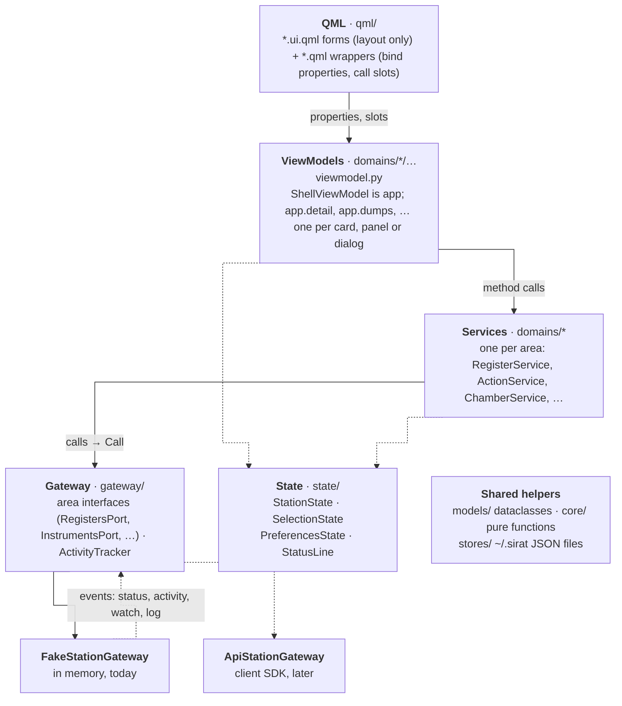

## 2. Dependency rules

Each layer may import the layers below it, never above. The rules on the right are checked by
`tests/unit/test_architecture.py`.

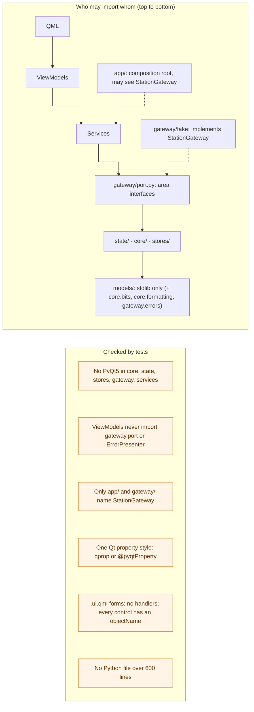

## 3. How the app is assembled

`ServiceContainer` (app/container.py) is the only place that constructs services and ViewModels.

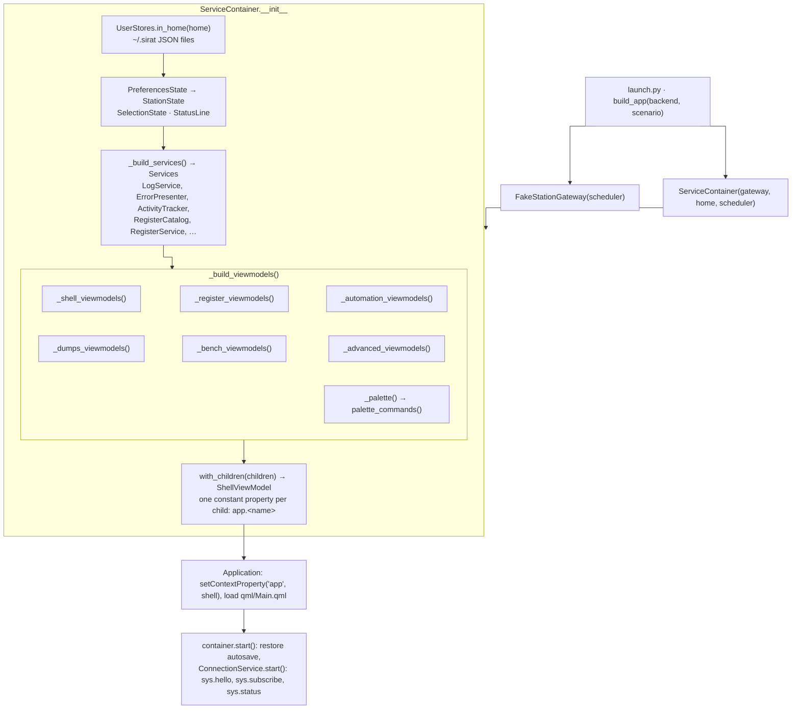

## 4. Request flow: reading a register

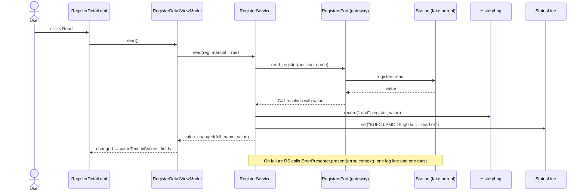

## 5. Request flow: running an action

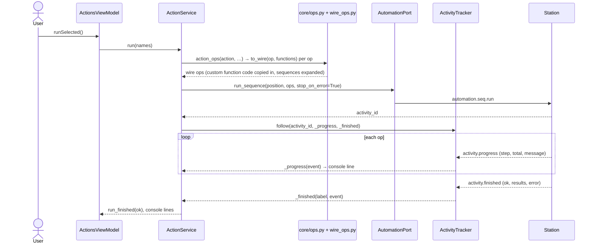

## 6. Station interfaces (gateway)

One interface per API area. A service declares the one it uses; `StationGateway` combines them for the
composition root and the backends. `ConnectionGateway` (connection/service.py) is `SystemPort + DutPort`.

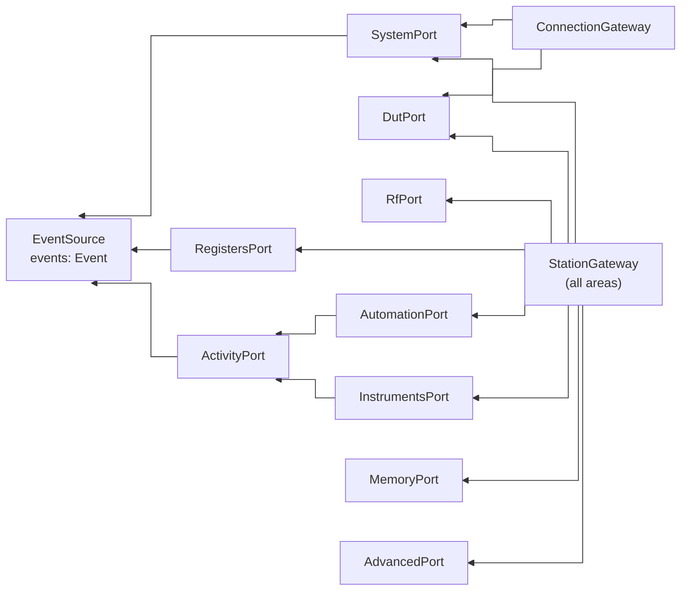

### DUT, registers, memory, Python

The calls about one DUT position.

```mermaid
%%{init: {"flowchart": {"curve": "stepBefore"}}}%%
flowchart LR
    classDef box text-align:left,fill:#f8f8ff,stroke:#6a6ab0,color:#1c1c1c
    classDef stub fill:#ffffff,stroke:#6a6ab0,stroke-dasharray:4 3,color:#1c1c1c
    SystemPort["<b>SystemPort</b><hr/>+hello() Call<br/>+status() Call<br/>+subscribe(topics: List[str]) Call<br/>+recover(position: int) Call"]:::box
    DutPort["<b>DutPort</b><hr/>+connect_dut(position: int, config_type: str, config_file: str, rpc: RpcAddress?=None) Call<br/>+reconnect_dut(position: int) Call[None]<br/>+disconnect_dut(position: int) Call<br/>+probe(position: int, rpc: RpcAddress?, timeout_s: float) Call[ProbeResult]<br/>+load_phy(position: int, phy: PhySpec) Call[LoadPhyResult]<br/>+dut_info(position: int) Call<br/>+set_rpc_timeout(seconds: float) Call"]:::box
    RfPort["<b>RfPort</b><hr/>+rf_paths() Call[List of str]<br/>+rf_connect(position: int, path: str) Call[None]<br/>+rf_disconnect(position: int) Call[None]<br/>+prs_route(position: int, route: PrsRoute) Call[None]<br/>+prs_signals(position: int) Call[PrsSignalCatalog]"]:::box
    RegistersPort["<b>RegistersPort</b><hr/>+register_tree(position: int) Call<br/>+read_register(position: int, name: str) Call<br/>+read_many(position: int, names: List[str], include_read_sensitive: bool=False) Call<br/>+write_register(position: int, name: str, value: int, confirm: bool=False, verify: bool=True) Call<br/>+write_field(position: int, name: str, field: str, value: int, confirm: bool=False, verify: bool=True) Call<br/>+watch(position: int, names: List[str], interval_s: float, include_read_sensitive: bool=False) Call<br/>+unwatch(sub_id: str) Call"]:::box
    MemoryPort["<b>MemoryPort</b><hr/>+memory_read(position: int, address: int, size: int) Call[MemoryBlock]<br/>+memory_write(position: int, address: int, value: int, size: int) Call[MemoryWriteRes]"]:::box
    AdvancedPort["<b>AdvancedPort</b><hr/>+console_open(position: int) Call[str]<br/>+console_exec(session_id: str, code: str, mode: str='auto') Call[ExecResult]<br/>+console_names(session_id: str) Call[List of NameInfo]<br/>+console_close(session_id: str) Call[None]<br/>+custom_function(position: int, name: str, code: str, session_id: str?=None) Call[ExecResult]<br/>+dut_control_describe(position: int) Call[ApiTree]<br/>+dut_control_invoke(position: int, path: str, args: List[Any], kwargs: Dict[str,Any]) Call[InvokeRes]"]:::box
```

### Long-running work, instruments, and the plumbing

Sequence runs, chamber waits and ECA captures are activities: the start call returns an activity id and `activity.progress` / `activity.finished` events follow, routed by `ActivityTracker`. `Call` is the async result every port method returns.

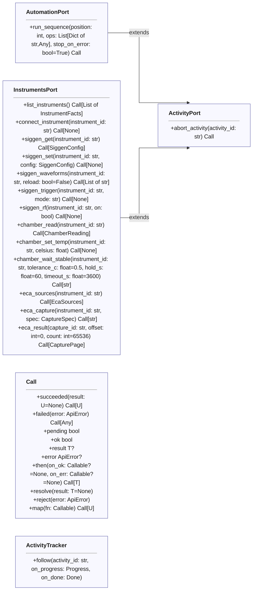

<details><summary>Constructors</summary>

```text
ActivityTracker(source: EventSource)
```

</details>

## 7. The fake station

`FakeStationGateway` implements `StationGateway` in memory, enforces the same requires rules as the real
service (`core/requires.py`) and returns the same error codes. It composes one part per area.

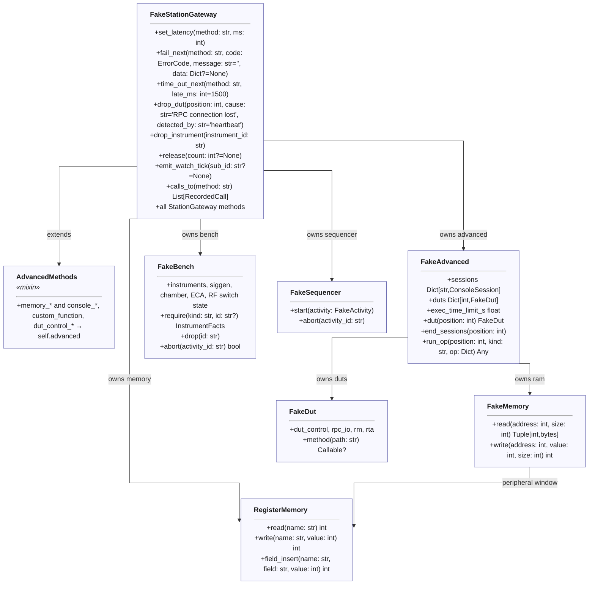

<details><summary>Constructors</summary>

```text
FakeStationGateway(scheduler: Scheduler?=None, peripherals: List[PeripheralDef]?=None, seed: int=7, clock: Callable=time.time)
FakeAdvanced(respond: Respond, log: Log, host: AdvancedHost, peripherals: List[PeripheralDef], seed: int)
FakeBench(scheduler: Scheduler, emit: Callable, log: Callable, emit_status: Callable, clock: Callable, chip: Callable)
```

</details>

## 8. Shared state

Four small stores, each with its own change event, so a status message doesn't refresh pages that only care about the DUT. `Event` is the plain-Python signal the services and stores use (Qt-free).

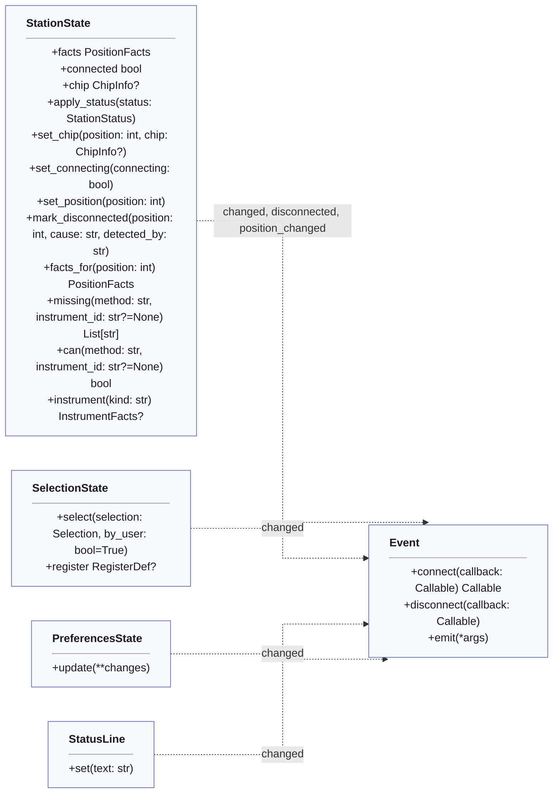

<details><summary>Constructors</summary>

```text
StationState(position: int=1, backend_label: str='')
PreferencesState(preferences: Preferences?=None)
StatusLine(text: str='Ready')
```

</details>

## 9. Shell: pages, navigation, Ctrl+K

`domains/shell/pages.py` holds the page table (key, title, icon, QML file). `with_children()` turns every registered ViewModel into a constant `app.<name>` property. `app/commands.py` builds the Ctrl+K list.

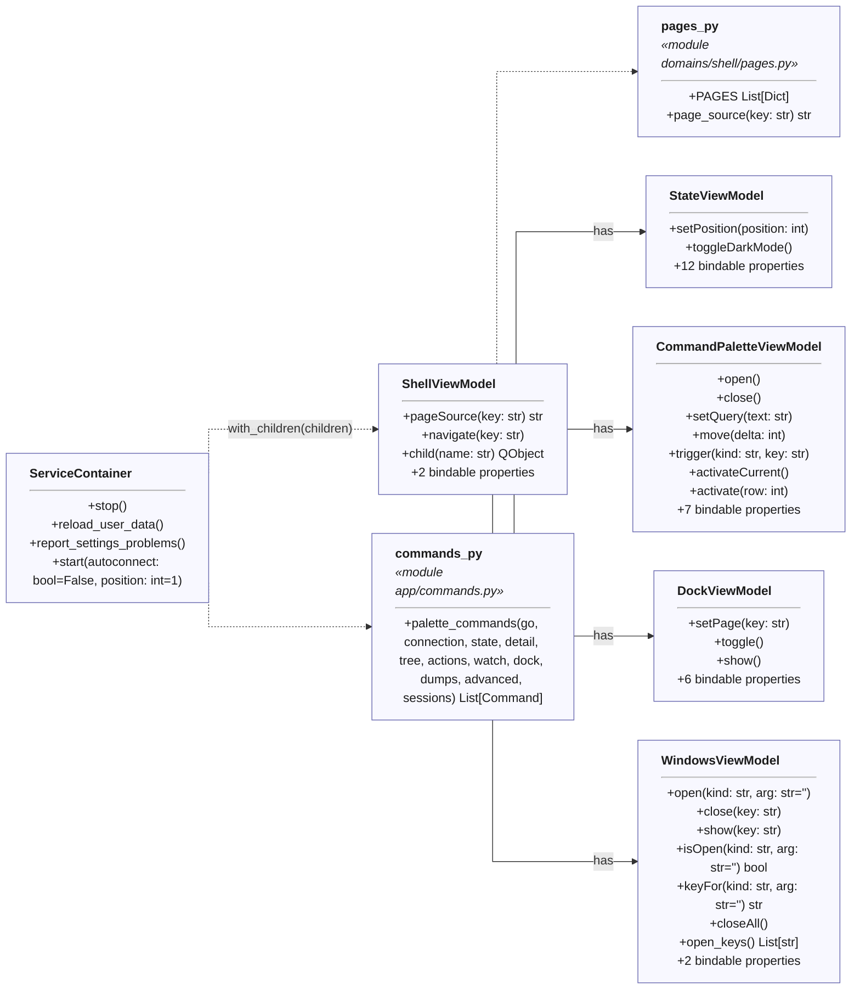

<details><summary>Constructors</summary>

```text
ServiceContainer(gateway: StationGateway, home: Path, scheduler: Scheduler, backend_label: str='', interactions: InteractionService?=None, dumps_dir: Path?=None)
ShellViewModel(children: Dict~str,QObject~)
StateViewModel(state: StationState, prefs: PreferencesState, status: StatusLine)
CommandPaletteViewModel(selection: SelectionState, catalog: RegisterCatalog, actions: ActionService, sequences: SequenceService, navigate: Callable, select_action: Callable, select_sequence: Callable, commands: List~Command~)
DockViewModel(history: HistoryLog, log: LogService, actions: ActionService)
```

</details>

## 10. Registers page

Tree and favorites select a register (`SelectionState`); the detail panel shows and edits it; the shortcuts ViewModel sends it elsewhere (favorites, watch, logger, formulas, Actions).

### Registers page: services

Constructor arrows between services.

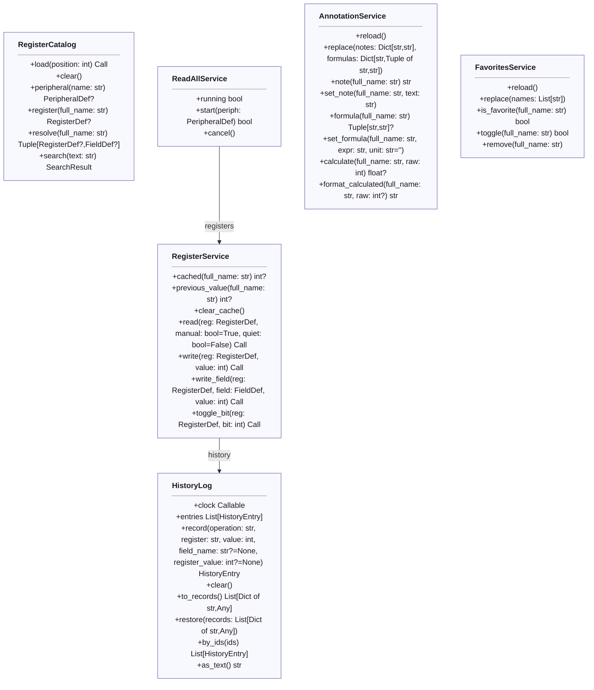

<details><summary>Constructors</summary>

```text
RegisterCatalog(gateway: RegistersPort, prefs: PreferencesState)
RegisterService(gateway: RegistersPort, state: StationState, prefs: PreferencesState, status: StatusLine, history: HistoryLog, interactions: InteractionService, errors: ErrorPresenter, log: LogService)
ReadAllService(registers: RegisterService, log: LogService)
AnnotationService(notes_store: JsonStore, formulas_store: JsonStore)
FavoritesService(store: JsonStore)
```

</details>

### Registers page: ViewModels

Slots QML calls; the services they use are shown by name (members above).

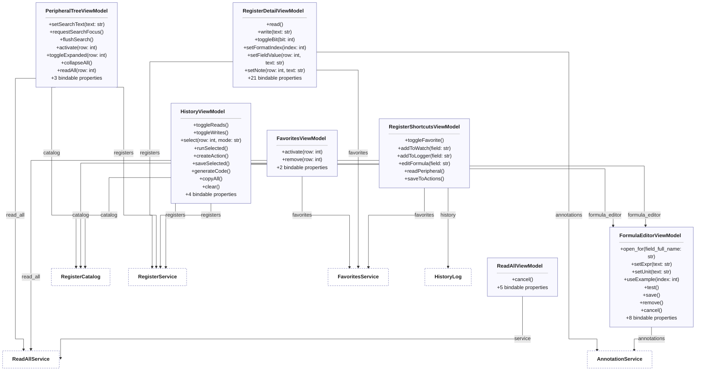

<details><summary>Constructors</summary>

```text
PeripheralTreeViewModel(state: StationState, selection: SelectionState, prefs: PreferencesState, catalog: RegisterCatalog, registers: RegisterService, read_all: ReadAllService)
FavoritesViewModel(state: StationState, selection: SelectionState, catalog: RegisterCatalog, favorites: FavoritesService)
RegisterDetailViewModel(state: StationState, selection: SelectionState, prefs: PreferencesState, registers: RegisterService, favorites: FavoritesService, annotations: AnnotationService, interactions: InteractionService, runs_finished: Event)
RegisterShortcutsViewModel(selection: SelectionState, registers: RegisterService, favorites: FavoritesService, watch: WatchService, logger: DataLoggerService, actions: ActionRecorder, formula_editor: FormulaEditorViewModel, read_all: ReadAllService, interactions: InteractionService)
ReadAllViewModel(service: ReadAllService, interactions: InteractionService)
HistoryViewModel(history: HistoryLog, catalog: RegisterCatalog, registers: RegisterService, actions: ActionRecorder, interactions: InteractionService)
FormulaEditorViewModel(annotations: AnnotationService, interactions: InteractionService)
```

</details>

## 11. Watch and logger

Both use a `WatchSubscription` (registers.watch / registers.unwatch); values arrive as `WatchValues` events.

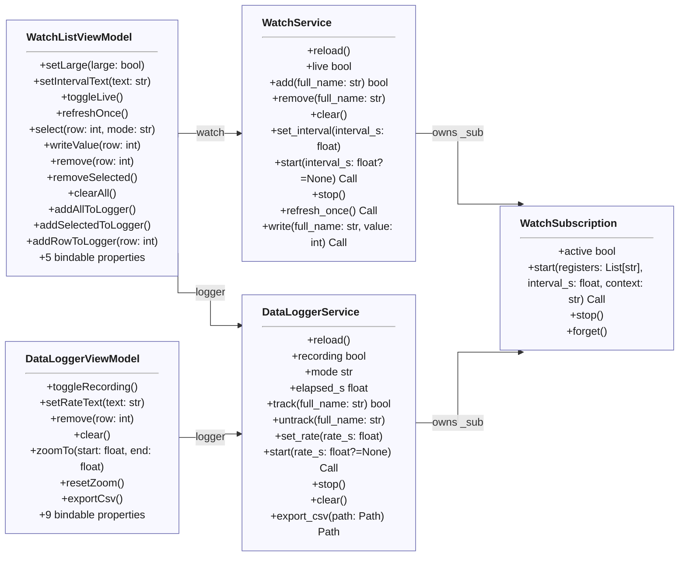

<details><summary>Constructors</summary>

```text
WatchService(gateway: RegistersPort, state: StationState, catalog: RegisterCatalog, registers: RegisterService, store: JsonStore, errors: ErrorPresenter, clock: Callable=time.time)
DataLoggerService(gateway: RegistersPort, state: StationState, catalog: RegisterCatalog, annotations: AnnotationService, store: JsonStore, errors: ErrorPresenter, scheduler: Scheduler, clock: Callable=time.time)
WatchSubscription(gateway: RegistersPort, state: StationState, errors: ErrorPresenter)
WatchListViewModel(watch: WatchService, logger: DataLoggerService, annotations: AnnotationService, interactions: InteractionService, prefs: PreferencesState)
DataLoggerViewModel(logger: DataLoggerService, interactions: InteractionService, export_dir: Path)
```

</details>

## 12. Actions and sequences

Every operation kind is one `OpKind` in `core/ops.py` (`KINDS`), used by `describe_op(op)`, `code_lines(op, functions)` (code generation) and `to_wire(op, functions)` (automation.seq.run). Pages that offer Add to Actions depend on `ActionRecorder`.

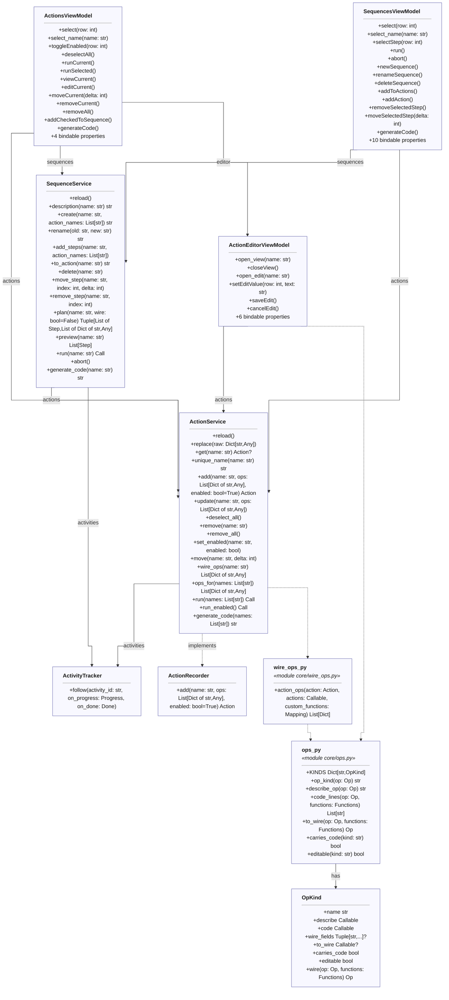

<details><summary>Constructors</summary>

```text
ActionService(store: JsonStore, gateway: AutomationPort, state: StationState, activities: ActivityTracker, errors: ErrorPresenter, log: LogService, custom_functions: JsonStore?=None)
SequenceService(store: JsonStore, actions: ActionService, gateway: AutomationPort, state: StationState, activities: ActivityTracker, errors: ErrorPresenter, log: LogService, clock: Callable=time.time)
ActivityTracker(source: EventSource)
ActionsViewModel(actions: ActionService, sequences: SequenceService, editor: ActionEditorViewModel, state: StationState, interactions: InteractionService)
SequencesViewModel(sequences: SequenceService, actions: ActionService, state: StationState, interactions: InteractionService)
ActionEditorViewModel(actions: ActionService, catalog: RegisterCatalog, prefs: PreferencesState, interactions: InteractionService)
```

</details>

## 13. Dumps and Radio Calculator diff

`DumpsViewModel` starts the work; the picker, the progress dialog and the comparison card are separate ViewModels it drives.

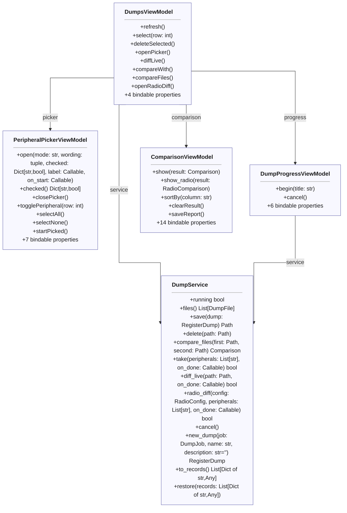

<details><summary>Constructors</summary>

```text
DumpService(directory: Path, catalog: RegisterCatalog, registers: RegisterService, log: LogService, clock: Callable=…)
DumpsViewModel(service: DumpService, catalog: RegisterCatalog, state: StationState, prefs: PreferencesState, interactions: InteractionService, picker: PeripheralPickerViewModel, progress: DumpProgressViewModel, comparison: ComparisonViewModel)
DumpProgressViewModel(service: DumpService)
ComparisonViewModel(reports_dir: Path, interactions: InteractionService)
```

</details>

## 14. Radio and PHY

PHY loading goes through `ConnectionService.load_phy` (dut.load_phy); PRS routing through `RfPort`.

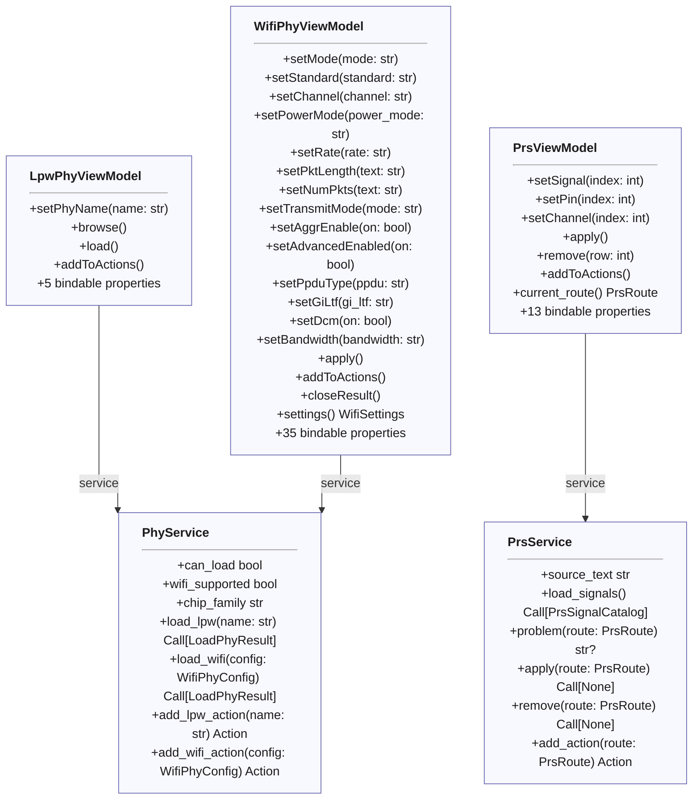

<details><summary>Constructors</summary>

```text
PhyService(connection: ConnectionService, state: StationState, actions: ActionRecorder)
PrsService(gateway: RfPort, state: StationState, history: HistoryLog, actions: ActionRecorder, errors: ErrorPresenter, log: LogService)
LpwPhyViewModel(service: PhyService, state: StationState, interactions: InteractionService)
WifiPhyViewModel(service: PhyService, state: StationState, interactions: InteractionService)
PrsViewModel(service: PrsService, state: StationState, interactions: InteractionService)
```

</details>

## 15. Instruments

`InstrumentBench` finds the instrument of each kind in `StationState.instruments` and follows instrument activities (chamber waits, ECA captures) through the shared `ActivityTracker`.

### Instruments: services

Constructor arrows between services.

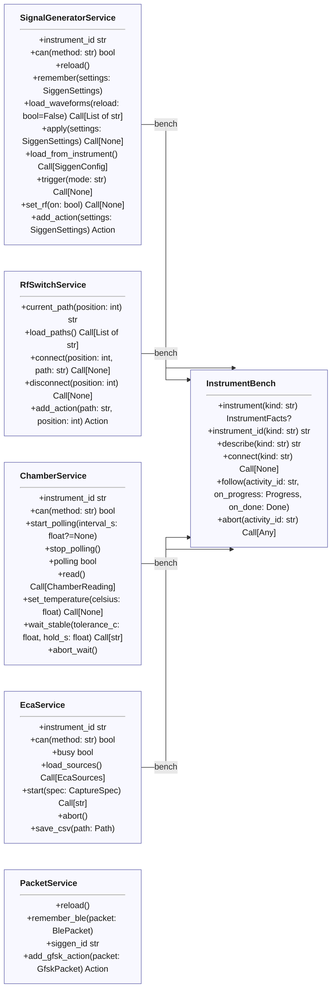

<details><summary>Constructors</summary>

```text
InstrumentBench(gateway: InstrumentsPort, state: StationState, activities: ActivityTracker, errors: ErrorPresenter, log: LogService)
SignalGeneratorService(gateway: InstrumentsPort, state: StationState, bench: InstrumentBench, store: JsonStore, actions: ActionRecorder, errors: ErrorPresenter, log: LogService)
RfSwitchService(gateway: RfPort, state: StationState, bench: InstrumentBench, actions: ActionRecorder, errors: ErrorPresenter, log: LogService)
ChamberService(gateway: InstrumentsPort, state: StationState, bench: InstrumentBench, errors: ErrorPresenter, log: LogService, scheduler: Scheduler)
EcaService(gateway: InstrumentsPort, state: StationState, bench: InstrumentBench, errors: ErrorPresenter, log: LogService)
PacketService(store: JsonStore, actions: ActionRecorder, siggen_id: Callable)
```

</details>

### Instruments: ViewModels

Slots QML calls; the services they use are shown by name (members above).

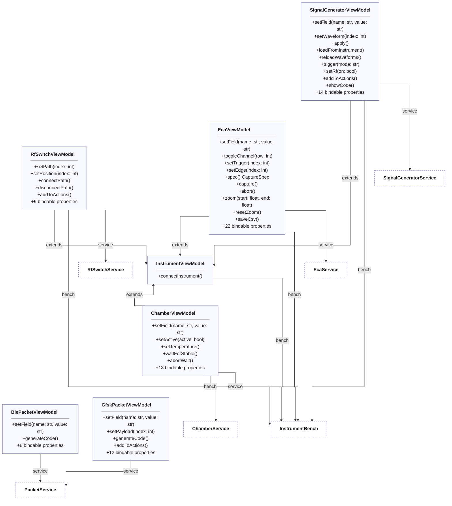

<details><summary>Constructors</summary>

```text
InstrumentViewModel(bench: InstrumentBench, state: StationState)
SignalGeneratorViewModel(service: SignalGeneratorService, bench: InstrumentBench, state: StationState, interactions: InteractionService)
RfSwitchViewModel(service: RfSwitchService, bench: InstrumentBench, state: StationState, interactions: InteractionService)
ChamberViewModel(service: ChamberService, bench: InstrumentBench, state: StationState, interactions: InteractionService)
EcaViewModel(service: EcaService, bench: InstrumentBench, state: StationState, interactions: InteractionService)
BlePacketViewModel(service: PacketService, interactions: InteractionService)
GfskPacketViewModel(service: PacketService, interactions: InteractionService)
```

</details>

## 16. Advanced

The console and custom functions share one station-side Python session per DUT (`PythonSession`).

### Advanced: services

Constructor arrows between services.

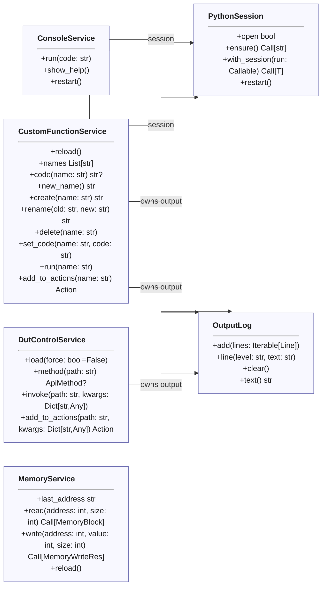

<details><summary>Constructors</summary>

```text
PythonSession(gateway: AdvancedPort, state: StationState)
ConsoleService(gateway: AdvancedPort, state: StationState, session: PythonSession, errors: ErrorPresenter)
CustomFunctionService(store: JsonStore, gateway: AdvancedPort, state: StationState, session: PythonSession, actions: ActionRecorder, errors: ErrorPresenter)
DutControlService(gateway: AdvancedPort, state: StationState, actions: ActionRecorder, errors: ErrorPresenter)
MemoryService(gateway: MemoryPort, state: StationState, store: JsonStore, errors: ErrorPresenter, log: LogService)
```

</details>

### Advanced: ViewModels

Slots QML calls; the services they use are shown by name (members above).

```mermaid
%%{init: {"flowchart": {"curve": "stepAfter"}}}%%
flowchart TB
    classDef box text-align:left,fill:#f8f8ff,stroke:#6a6ab0,color:#1c1c1c
    classDef stub fill:#ffffff,stroke:#6a6ab0,stroke-dasharray:4 3,color:#1c1c1c
    AdvancedViewModel["<b>AdvancedViewModel</b><hr/>+setTab(index: int)<br/>+show(name: str)<br/>+2 bindable properties"]:::box
    ConsoleViewModel["<b>ConsoleViewModel</b><hr/>+setDraft(text: str)<br/>+execute()<br/>+historyPrevious()<br/>+historyNext()<br/>+help()<br/>+restart()<br/>+5 bindable properties"]:::box
    CustomFunctionsViewModel["<b>CustomFunctionsViewModel</b><hr/>+select(index: int)<br/>+setCode(text: str)<br/>+attachHighlighter(document: QObject, dark: bool)<br/>+newFunction()<br/>+renameFunction()<br/>+deleteFunction()<br/>+run()<br/>+addToActions()<br/>+10 bindable properties"]:::box
    DutControlViewModel["<b>DutControlViewModel</b><hr/>+load()<br/>+reload()<br/>+setFilter(text: str)<br/>+activate(row: int)<br/>+collapseAll()<br/>+setParam(name: str, value: str)<br/>+execute()<br/>+addToActions()<br/>+13 bindable properties"]:::box
    MemoryViewModel["<b>MemoryViewModel</b><hr/>+setField(name: str, value: str)<br/>+setFormat(index: int)<br/>+setWriteSize(index: int)<br/>+read()<br/>+useRowAddress(row: int)<br/>+write()<br/>+copyDump()<br/>+18 bindable properties"]:::box
    ConsoleService["<b>ConsoleService</b>"]:::stub
    PythonSession["<b>PythonSession</b>"]:::stub
    CustomFunctionService["<b>CustomFunctionService</b>"]:::stub
    DutControlService["<b>DutControlService</b>"]:::stub
    MemoryService["<b>MemoryService</b>"]:::stub
    ConsoleViewModel -->|"service"| ConsoleService
    ConsoleViewModel -->|"session"| PythonSession
    CustomFunctionsViewModel -->|"service"| CustomFunctionService
    DutControlViewModel -->|"service"| DutControlService
    MemoryViewModel -->|"service"| MemoryService
    AdvancedViewModel ~~~ DutControlViewModel
    ConsoleViewModel ~~~ MemoryViewModel
```

<details><summary>Constructors</summary>

```text
ConsoleViewModel(service: ConsoleService, session: PythonSession, state: StationState)
CustomFunctionsViewModel(service: CustomFunctionService, state: StationState, interactions: InteractionService, highlighters: HighlighterHost)
DutControlViewModel(service: DutControlService, state: StationState, interactions: InteractionService)
MemoryViewModel(service: MemoryService, state: StationState, interactions: InteractionService)
```

</details>

## 17. Connection, settings, sessions, log

`ErrorPresenter` is how services report station failures: one log line and one toast.

### Connection, settings, sessions, log: services

Constructor arrows between services.

```mermaid
%%{init: {"flowchart": {"curve": "stepAfter"}}}%%
flowchart TB
    classDef box text-align:left,fill:#f8f8ff,stroke:#6a6ab0,color:#1c1c1c
    classDef stub fill:#ffffff,stroke:#6a6ab0,stroke-dasharray:4 3,color:#1c1c1c
    ConnectionService["<b>ConnectionService</b><hr/>+start() Call<br/>+refresh_status() Call<br/>+connect(position: int, config_type: str='EFR32', config_file: str='', rpc: RpcAddress?=None) Call<br/>+reconnect(position: int) Call<br/>+dut_info() Call<br/>+recover(position: int) Call<br/>+disconnect(position: int) Call<br/>+load_phy(position: int, phy: PhySpec) Call[LoadPhyResult]"]:::box
    HardwareConfigService["<b>HardwareConfigService</b><hr/>+reload()<br/>+save(config: HardwareConfig) Call<br/>+test_connection(config: HardwareConfig) Call"]:::box
    SessionService["<b>SessionService</b><hr/>+snapshot(name: str, created: str?=None) Dict[str,Any]<br/>+apply(data: Dict[str,Any])<br/>+path_for(name: str) Path<br/>+exists(name: str) bool<br/>+list() List[SessionInfo]<br/>+save(name: str) SessionInfo<br/>+load(name: str) SessionInfo<br/>+delete(name: str)<br/>+preview(name: str) Dict[str,Any]<br/>+start_autosave(interval_ms: int=AUTOSAVE_MS)<br/>+stop_autosave()<br/>+autosave()<br/>+restore_autosave() int"]:::box
    SettingsTransfer["<b>SettingsTransfer</b><hr/>+export(path: Path) List[str]<br/>+import_(path: Path) Tuple[List of str,List of Problem]<br/>+clear_all()"]:::box
    ErrorPresenter["<b>ErrorPresenter</b><hr/>+message_for(error: ApiError) str<br/>+present(error: ApiError, context: str='')<br/>+verify_mismatch(target: str, written: int, readback: int)"]:::box
    LogService["<b>LogService</b><hr/>+add(level: str, text: str, source: str='ui')<br/>+debug(text: str)<br/>+info(text: str)<br/>+success(text: str)<br/>+warning(text: str)<br/>+error(text: str)<br/>+clear()<br/>+on_gateway_event(event: object)"]:::box
    ConnectionService -->|"errors"| ErrorPresenter
    ConnectionService -->|"log"| LogService
    HardwareConfigService -->|"log"| LogService
    SessionService -->|"log"| LogService
    ErrorPresenter -->|"log"| LogService
```

<details><summary>Constructors</summary>

```text
ConnectionService(gateway: ConnectionGateway, state: StationState, catalog: RegisterCatalog, errors: ErrorPresenter, log: LogService)
HardwareConfigService(store: JsonStore, gateway: DutPort, state: StationState, log: LogService)
SessionService(directory: Path, autosave_path: Path, annotations: AnnotationService, favorites: FavoritesService, actions: ActionService, history: HistoryLog, dumps: DumpService, log: LogService, scheduler: Scheduler, clock: Callable=…)
SettingsTransfer(stores: UserStores, reload_all: Callable)
ErrorPresenter(interactions: InteractionService, log: LogService)
LogService(clock: Callable=time.time)
```

</details>

### Connection, settings, sessions, log: ViewModels

Slots QML calls; the services they use are shown by name (members above).

```mermaid
%%{init: {"flowchart": {"curve": "stepAfter"}}}%%
flowchart TB
    classDef box text-align:left,fill:#f8f8ff,stroke:#6a6ab0,color:#1c1c1c
    classDef stub fill:#ffffff,stroke:#6a6ab0,stroke-dasharray:4 3,color:#1c1c1c
    ConnectionViewModel["<b>ConnectionViewModel</b><hr/>+openSheet()<br/>+setOverride(on: bool)<br/>+setRpcHost(host: str)<br/>+setRpcPort(port: str)<br/>+closeSheet()<br/>+setPosition(position: int)<br/>+setConfigTypeIndex(index: int)<br/>+setConfigFile(path: str)<br/>+connect()<br/>+disconnectDut()<br/>+10 bindable properties"]:::box
    DisconnectRecoveryViewModel["<b>DisconnectRecoveryViewModel</b><hr/>+reconnect()<br/>+loadLpwPhy()<br/>+loadWifiPhy()<br/>+addReconnectToActions()<br/>+dismiss()<br/>+9 bindable properties"]:::box
    SystemInfoViewModel["<b>SystemInfoViewModel</b><hr/>+refresh()<br/>+setTabIndex(index: int)<br/>+copyAll()<br/>+text() str<br/>+6 bindable properties"]:::box
    SettingsViewModel["<b>SettingsViewModel</b><hr/>+setDarkMode(on: bool)<br/>+setAutoRead(on: bool)<br/>+setConfirmCritical(on: bool)<br/>+setShowSecure(on: bool)<br/>+clearRegisterCache()<br/>+exportSettings()<br/>+importSettings()<br/>+clearAllSettings()<br/>+5 bindable properties"]:::box
    HardwareConfigViewModel["<b>HardwareConfigViewModel</b><hr/>+setField(name: str, value: str)<br/>+setOverride(on: bool)<br/>+save()<br/>+testConnection()<br/>+10 bindable properties"]:::box
    SessionsViewModel["<b>SessionsViewModel</b><hr/>+saveSession()<br/>+openBrowser()<br/>+closeBrowser()<br/>+select(row: int)<br/>+loadSelected()<br/>+deleteSelected()<br/>+5 bindable properties"]:::box
    LogViewModel["<b>LogViewModel</b><hr/>+toggleLevel(index: int)<br/>+setSearchText(text: str)<br/>+nextMatch()<br/>+previousMatch()<br/>+saveLog()<br/>+clear()<br/>+setPoppedOut(on: bool)<br/>+6 bindable properties"]:::box
    ConnectionService["<b>ConnectionService</b>"]:::stub
    LogService["<b>LogService</b>"]:::stub
    HardwareConfigService["<b>HardwareConfigService</b>"]:::stub
    SettingsTransfer["<b>SettingsTransfer</b>"]:::stub
    SessionService["<b>SessionService</b>"]:::stub
    ConnectionViewModel -->|"service"| ConnectionService
    ConnectionViewModel -->|"log"| LogService
    ConnectionViewModel -->|"hardware"| HardwareConfigService
    DisconnectRecoveryViewModel -->|"service"| ConnectionService
    SystemInfoViewModel -->|"connection"| ConnectionService
    SettingsViewModel -->|"transfer"| SettingsTransfer
    HardwareConfigViewModel -->|"service"| HardwareConfigService
    SessionsViewModel -->|"service"| SessionService
    LogViewModel -->|"log"| LogService
    ConnectionViewModel ~~~ SettingsViewModel
    DisconnectRecoveryViewModel ~~~ HardwareConfigViewModel
    SystemInfoViewModel ~~~ SessionsViewModel
    SettingsViewModel ~~~ LogViewModel
```

<details><summary>Constructors</summary>

```text
ConnectionViewModel(service: ConnectionService, state: StationState, log: LogService, hardware: HardwareConfigService?=None, interactions: InteractionService?=None)
DisconnectRecoveryViewModel(service: ConnectionService, state: StationState, actions: ActionRecorder, interactions: InteractionService, open_radio_page: Callable=…)
SystemInfoViewModel(connection: ConnectionService, state: StationState, interactions: InteractionService)
SettingsViewModel(state: StationState, prefs: PreferencesState, on_clear_cache: Callable, transfer: SettingsTransfer, interactions: InteractionService)
HardwareConfigViewModel(service: HardwareConfigService)
SessionsViewModel(service: SessionService, interactions: InteractionService)
LogViewModel(log: LogService, interactions: InteractionService)
```

</details>

## 18. ViewModels to backend endpoints

What the real station service must answer for each screen to work. Solid arrows are calls a user action
triggers, traced from each ViewModel slot through the services to the gateway (`callgraph`, not hand-drawn).
47 endpoints in total; the ones marked
⚠ unused are in the API design but no screen calls them yet (instruments.list).

### Overview: pages to API areas

Arrow labels are how many endpoints of that area the page calls.

```mermaid
%%{init: {"flowchart": {"curve": "stepBefore"}}}%%
flowchart LR
    Registers["Registers"]
    Watch["Watch"]
    Actions_and_sequences["Actions and sequences"]
    Dumps["Dumps"]
    Radio["Radio"]
    Instruments["Instruments"]
    Advanced["Advanced"]
    Connection_and_settings["Connection and settings"]
    ns_sys[["sys.* (4)"]]
    ns_dut[["dut.* (7)"]]
    ns_registers[["registers.* (7)"]]
    ns_rf[["rf.* (5)"]]
    ns_automation[["automation.* (1)"]]
    ns_activity[["activity.* (1)"]]
    ns_instruments[["instruments.* (13)"]]
    ns_memory[["memory.* (2)"]]
    ns_advanced[["advanced.* (7)"]]
    Registers -->|4| ns_registers
    Watch -->|3| ns_registers
    Actions_and_sequences -->|1| ns_automation
    Actions_and_sequences -->|1| ns_activity
    Dumps -->|1| ns_registers
    Radio -->|1| ns_dut
    Radio -->|1| ns_rf
    Instruments -->|11| ns_instruments
    Instruments -->|2| ns_rf
    Instruments -->|1| ns_activity
    Advanced -->|7| ns_advanced
    Advanced -->|2| ns_memory
    Connection_and_settings -->|6| ns_dut
    Connection_and_settings -->|1| ns_registers
    Connection_and_settings -->|2| ns_sys
    bgsvc["services on their own<br/>startup, live watch, connects"]
    bgsvc -.-> ns_sys
    bgsvc -.-> ns_registers
    bgsvc -.-> ns_rf
    bgsvc -.-> ns_instruments
    bgsvc -.-> ns_dut
```

### Registers

```mermaid
%%{init: {"flowchart": {"curve": "stepBefore"}}}%%
flowchart LR
    PeripheralTreeViewModel["PeripheralTreeViewModel"]
    RegisterDetailViewModel["RegisterDetailViewModel"]
    RegisterShortcutsViewModel["RegisterShortcutsViewModel"]
    HistoryViewModel["HistoryViewModel"]
    registers_read(["registers.read"])
    registers_read_many(["registers.read_many"])
    registers_write(["registers.write"])
    registers_write_field(["registers.write_field"])
    PeripheralTreeViewModel --> registers_read
    RegisterDetailViewModel --> registers_read
    RegisterDetailViewModel --> registers_write
    RegisterDetailViewModel --> registers_write_field
    RegisterShortcutsViewModel --> registers_read
    RegisterShortcutsViewModel --> registers_read_many
    HistoryViewModel --> registers_read
    HistoryViewModel --> registers_write
    HistoryViewModel --> registers_write_field
```

### Watch

```mermaid
%%{init: {"flowchart": {"curve": "stepBefore"}}}%%
flowchart LR
    WatchListViewModel["WatchListViewModel"]
    DataLoggerViewModel["DataLoggerViewModel"]
    registers_read_many(["registers.read_many"])
    registers_write(["registers.write"])
    registers_write_field(["registers.write_field"])
    WatchListViewModel --> registers_read_many
    WatchListViewModel --> registers_write
    WatchListViewModel --> registers_write_field
    DataLoggerViewModel --> registers_read_many
```

### Actions and sequences

```mermaid
%%{init: {"flowchart": {"curve": "stepBefore"}}}%%
flowchart LR
    ActionsViewModel["ActionsViewModel"]
    SequencesViewModel["SequencesViewModel"]
    activity_abort(["activity.abort"])
    automation_seq_run(["automation.seq.run"])
    ActionsViewModel --> automation_seq_run
    SequencesViewModel --> activity_abort
    SequencesViewModel --> automation_seq_run
```

### Dumps

```mermaid
%%{init: {"flowchart": {"curve": "stepBefore"}}}%%
flowchart LR
    DumpsViewModel["DumpsViewModel"]
    registers_read(["registers.read"])
    DumpsViewModel --> registers_read
```

### Radio

```mermaid
%%{init: {"flowchart": {"curve": "stepBefore"}}}%%
flowchart LR
    LpwPhyViewModel["LpwPhyViewModel"]
    WifiPhyViewModel["WifiPhyViewModel"]
    PrsViewModel["PrsViewModel"]
    dut_load_phy(["dut.load_phy"])
    rf_prs_route(["rf.prs_route"])
    LpwPhyViewModel --> dut_load_phy
    WifiPhyViewModel --> dut_load_phy
    PrsViewModel --> rf_prs_route
```

### Instruments

```mermaid
%%{init: {"flowchart": {"curve": "stepBefore"}}}%%
flowchart LR
    InstrumentViewModel["InstrumentViewModel"]
    SignalGeneratorViewModel["SignalGeneratorViewModel"]
    RfSwitchViewModel["RfSwitchViewModel"]
    ChamberViewModel["ChamberViewModel"]
    EcaViewModel["EcaViewModel"]
    activity_abort(["activity.abort"])
    instruments_chamber_read(["instruments.chamber.read"])
    instruments_chamber_set_temp(["instruments.chamber.set_temp"])
    instruments_chamber_wait_stable(["instruments.chamber.wait_stable"])
    instruments_connect(["instruments.connect"])
    instruments_eca_capture(["instruments.eca.capture"])
    instruments_eca_result(["instruments.eca.result"])
    instruments_siggen_get(["instruments.siggen.get"])
    instruments_siggen_rf(["instruments.siggen.rf"])
    instruments_siggen_set(["instruments.siggen.set"])
    instruments_siggen_trigger(["instruments.siggen.trigger"])
    instruments_siggen_waveforms(["instruments.siggen.waveforms"])
    rf_connect(["rf.connect"])
    rf_disconnect(["rf.disconnect"])
    InstrumentViewModel --> instruments_connect
    SignalGeneratorViewModel --> instruments_siggen_get
    SignalGeneratorViewModel --> instruments_siggen_rf
    SignalGeneratorViewModel --> instruments_siggen_set
    SignalGeneratorViewModel --> instruments_siggen_trigger
    SignalGeneratorViewModel --> instruments_siggen_waveforms
    RfSwitchViewModel --> rf_connect
    RfSwitchViewModel --> rf_disconnect
    ChamberViewModel --> activity_abort
    ChamberViewModel --> instruments_chamber_read
    ChamberViewModel --> instruments_chamber_set_temp
    ChamberViewModel --> instruments_chamber_wait_stable
    EcaViewModel --> activity_abort
    EcaViewModel --> instruments_eca_capture
    EcaViewModel --> instruments_eca_result
```

### Advanced

```mermaid
%%{init: {"flowchart": {"curve": "stepBefore"}}}%%
flowchart LR
    ConsoleViewModel["ConsoleViewModel"]
    CustomFunctionsViewModel["CustomFunctionsViewModel"]
    DutControlViewModel["DutControlViewModel"]
    MemoryViewModel["MemoryViewModel"]
    advanced_console_close(["advanced.console.close"])
    advanced_console_exec(["advanced.console.exec"])
    advanced_console_names(["advanced.console.names"])
    advanced_console_open(["advanced.console.open"])
    advanced_custom_function(["advanced.custom_function"])
    advanced_dut_control_describe(["advanced.dut_control.describe"])
    advanced_dut_control_invoke(["advanced.dut_control.invoke"])
    memory_read(["memory.read"])
    memory_write(["memory.write"])
    ConsoleViewModel --> advanced_console_close
    ConsoleViewModel --> advanced_console_exec
    ConsoleViewModel --> advanced_console_names
    ConsoleViewModel --> advanced_console_open
    CustomFunctionsViewModel --> advanced_console_open
    CustomFunctionsViewModel --> advanced_custom_function
    DutControlViewModel --> advanced_dut_control_describe
    DutControlViewModel --> advanced_dut_control_invoke
    MemoryViewModel --> memory_read
    MemoryViewModel --> memory_write
```

### Connection and settings

```mermaid
%%{init: {"flowchart": {"curve": "stepBefore"}}}%%
flowchart LR
    ConnectionViewModel["ConnectionViewModel"]
    DisconnectRecoveryViewModel["DisconnectRecoveryViewModel"]
    FaultRecoveryViewModel["FaultRecoveryViewModel"]
    SystemInfoViewModel["SystemInfoViewModel"]
    HardwareConfigViewModel["HardwareConfigViewModel"]
    dut_connect(["dut.connect"])
    dut_disconnect(["dut.disconnect"])
    dut_info(["dut.info"])
    dut_probe(["dut.probe"])
    dut_reconnect(["dut.reconnect"])
    dut_set_rpc_timeout(["dut.set_rpc_timeout"])
    registers_tree(["registers.tree"])
    sys_recover(["sys.recover"])
    sys_status(["sys.status"])
    ConnectionViewModel --> dut_connect
    ConnectionViewModel --> dut_disconnect
    ConnectionViewModel --> registers_tree
    ConnectionViewModel --> sys_status
    DisconnectRecoveryViewModel --> dut_connect
    DisconnectRecoveryViewModel --> dut_reconnect
    DisconnectRecoveryViewModel --> registers_tree
    DisconnectRecoveryViewModel --> sys_status
    FaultRecoveryViewModel --> sys_recover
    SystemInfoViewModel --> dut_info
    HardwareConfigViewModel --> dut_probe
    HardwareConfigViewModel --> dut_set_rpc_timeout
```

### Calls services make on their own

```mermaid
%%{init: {"flowchart": {"curve": "stepBefore"}}}%%
flowchart LR
    sys_hello(["sys.hello"])
    sys_subscribe(["sys.subscribe"])
    sys_status(["sys.status"])
    registers_watch(["registers.watch"])
    registers_unwatch(["registers.unwatch"])
    rf_paths(["rf.paths"])
    instruments_eca_sources(["instruments.eca.sources"])
    rf_prs_signals(["rf.prs_signals"])
    dut_info(["dut.info"])
    ConnectionService["ConnectionService"]
    EcaService["EcaService"]
    PrsService["PrsService"]
    RfSwitchService["RfSwitchService"]
    SystemInfoViewModel_via_ConnectionService["SystemInfoViewModel via ConnectionService"]
    WatchService__DataLoggerService["WatchService, DataLoggerService"]
    ConnectionService -->|startup| sys_hello
    ConnectionService -->|startup| sys_subscribe
    ConnectionService -->|startup, after connect| sys_status
    WatchService__DataLoggerService -->|Live / Record| registers_watch
    WatchService__DataLoggerService -->|Pause / Stop| registers_unwatch
    RfSwitchService -->|RF switch connects| rf_paths
    EcaService -->|ECA connects| instruments_eca_sources
    PrsService -->|DUT connects| rf_prs_signals
    SystemInfoViewModel_via_ConnectionService -->|DUT connects| dut_info
```

### Events

| Event (pushed after `sys.subscribe`) | Who listens | What it does |
|---|---|---|
| `status.changed` (`StatusChanged`) | ConnectionService | `StationState.apply_status`: facts per position, instruments |
| `dut.disconnected` (`DutDisconnected`) | ConnectionService | `StationState.mark_disconnected`; recovery dialog, sessions end |
| `watch.values` (`WatchValues`) | WatchService, DataLoggerService | new values for the watch list and the logger plot |
| `activity.progress`, `activity.finished` | ActivityTracker → ActionService, SequenceService, InstrumentBench | run and instrument progress |
| `log` (`LogLine`) | LogService | the Log panel |
| `call.late` (`CallLate`) | LogService | how a call that timed out finally ended |

### All endpoints

| Endpoint | Gateway method | Requires | Called by |
|---|---|---|---|
| `activity.abort` | `abort_activity` | — | ChamberViewModel, EcaViewModel, SequencesViewModel |
| `advanced.console.close` | `console_close` | — | ConsoleViewModel |
| `advanced.console.exec` | `console_exec` | dut | ConsoleViewModel |
| `advanced.console.names` | `console_names` | — | ConsoleViewModel |
| `advanced.console.open` | `console_open` | dut | ConsoleViewModel, CustomFunctionsViewModel |
| `advanced.custom_function` | `custom_function` | dut, idle | CustomFunctionsViewModel |
| `advanced.dut_control.describe` | `dut_control_describe` | dut | DutControlViewModel |
| `advanced.dut_control.invoke` | `dut_control_invoke` | dut, idle | DutControlViewModel |
| `automation.seq.run` | `run_sequence` | dut, idle, no_fault | ActionsViewModel, SequencesViewModel |
| `dut.connect` | `connect_dut` | no_fault | ConnectionViewModel, DisconnectRecoveryViewModel |
| `dut.disconnect` | `disconnect_dut` | — | ConnectionViewModel |
| `dut.info` | `dut_info` | dut | SystemInfoViewModel, SystemInfoViewModel via ConnectionService (DUT connects) |
| `dut.load_phy` | `load_phy` | dut, idle | LpwPhyViewModel, WifiPhyViewModel |
| `dut.probe` | `probe` | — | HardwareConfigViewModel |
| `dut.reconnect` | `reconnect_dut` | no_fault | DisconnectRecoveryViewModel |
| `dut.set_rpc_timeout` | `set_rpc_timeout` | — | HardwareConfigViewModel |
| `instruments.chamber.read` | `chamber_read` | instrument:chamber | ChamberViewModel |
| `instruments.chamber.set_temp` | `chamber_set_temp` | instrument:chamber, idle | ChamberViewModel |
| `instruments.chamber.wait_stable` | `chamber_wait_stable` | instrument:chamber, idle | ChamberViewModel |
| `instruments.connect` | `connect_instrument` | — | InstrumentViewModel |
| `instruments.eca.capture` | `eca_capture` | instrument:eca, idle | EcaViewModel |
| `instruments.eca.result` | `eca_result` | — | EcaViewModel |
| `instruments.eca.sources` | `eca_sources` | instrument:eca | EcaService (ECA connects) |
| `instruments.list` | `list_instruments` | — | not used by the frontend yet |
| `instruments.siggen.get` | `siggen_get` | instrument:signal_generator | SignalGeneratorViewModel |
| `instruments.siggen.rf` | `siggen_rf` | instrument:signal_generator | SignalGeneratorViewModel |
| `instruments.siggen.set` | `siggen_set` | instrument:signal_generator, idle | SignalGeneratorViewModel |
| `instruments.siggen.trigger` | `siggen_trigger` | instrument:signal_generator | SignalGeneratorViewModel |
| `instruments.siggen.waveforms` | `siggen_waveforms` | instrument:signal_generator | SignalGeneratorViewModel |
| `memory.read` | `memory_read` | dut | MemoryViewModel |
| `memory.write` | `memory_write` | dut, idle | MemoryViewModel |
| `registers.read` | `read_register` | dut | DumpsViewModel, HistoryViewModel, PeripheralTreeViewModel, RegisterDetailViewModel, RegisterShortcutsViewModel |
| `registers.read_many` | `read_many` | dut | DataLoggerViewModel, RegisterShortcutsViewModel, WatchListViewModel |
| `registers.tree` | `register_tree` | dut | ConnectionViewModel, DisconnectRecoveryViewModel |
| `registers.unwatch` | `unwatch` | — | WatchService, DataLoggerService (Pause / Stop) |
| `registers.watch` | `watch` | dut | WatchService, DataLoggerService (Live / Record) |
| `registers.write` | `write_register` | dut, idle | HistoryViewModel, RegisterDetailViewModel, WatchListViewModel |
| `registers.write_field` | `write_field` | dut, idle | HistoryViewModel, RegisterDetailViewModel, WatchListViewModel |
| `rf.connect` | `rf_connect` | instrument:rf_switch | RfSwitchViewModel |
| `rf.disconnect` | `rf_disconnect` | instrument:rf_switch | RfSwitchViewModel |
| `rf.paths` | `rf_paths` | instrument:rf_switch | RfSwitchService (RF switch connects) |
| `rf.prs_route` | `prs_route` | dut | PrsViewModel |
| `rf.prs_signals` | `prs_signals` | dut | PrsService (DUT connects) |
| `sys.hello` | `hello` | — | ConnectionService (startup) |
| `sys.recover` | `recover` | — | FaultRecoveryViewModel |
| `sys.status` | `status` | — | ConnectionViewModel, DisconnectRecoveryViewModel, ConnectionService (startup, after connect) |
| `sys.subscribe` | `subscribe` | — | ConnectionService (startup) |

"Requires" is the client's copy of the service's rule table (`core/requires.py`); the GUI disables a button
while a requirement is missing and the service refuses the call with `wrong_state`.
