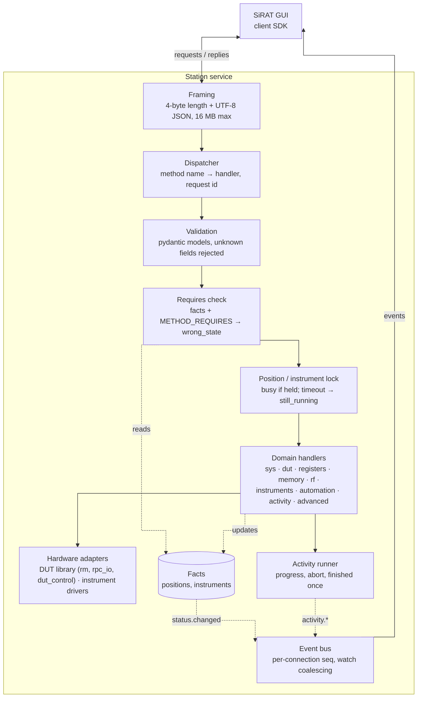
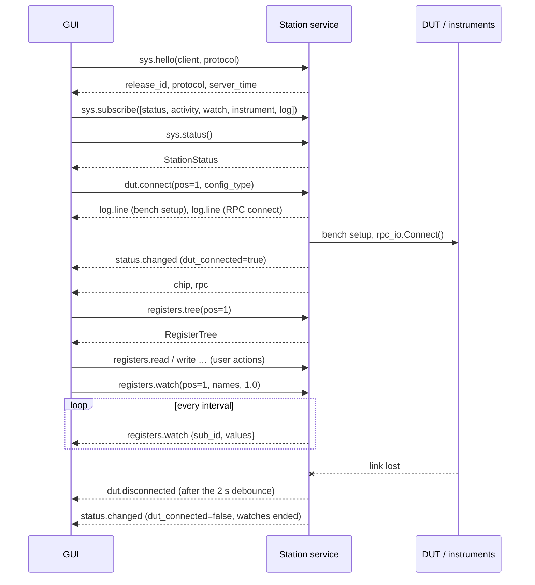
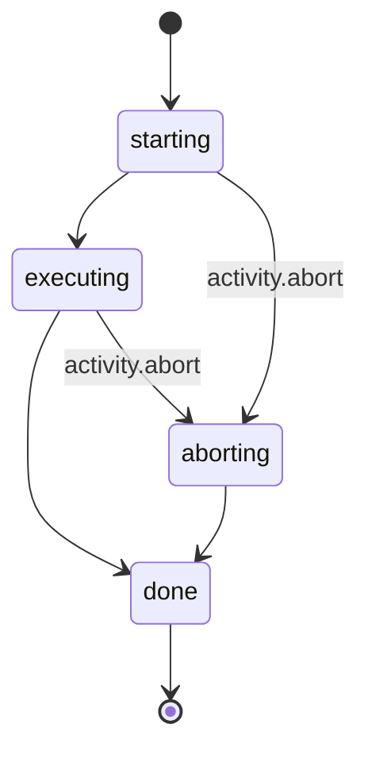
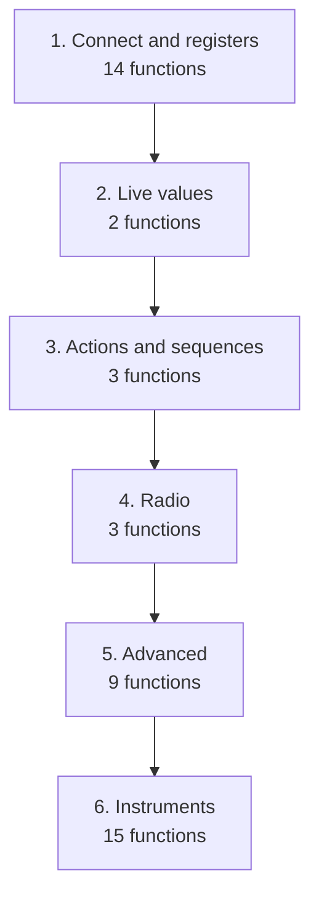

# SiRAT station service: backend design

What the station service has to implement so the SiRAT GUI works against real hardware: the functions, the exact
payloads that go in and come out, the events it pushes, the state it keeps, and the order to build it in.

- **The contract** is [API_DESIGN.md](API_DESIGN.md) (revision 2). This document doesn't change it; it makes it
  concrete for whoever builds the service. Where the two disagree, API_DESIGN.md wins and the difference is listed
  in [contract gaps](#10-contract-gaps-to-settle).
- **The reference implementation** is the frontend's fake station (`src/sirat_ui/gateway/fake/`). It enforces the
  same requires, returns the same error codes and is what the GUI is tested against. Every example payload below
  was captured by calling it, then put in the API's wire format.
- **Who calls what** is in [ARCHITECTURE.md, section 18](ARCHITECTURE.md#18-viewmodels-to-backend-endpoints).

Generated by `scripts/architecture/backend_doc.py`; rerun it after changing the API or the fake.

Contents

1. [The service at a glance](#1-the-service-at-a-glance)
2. [Suggested structure](#2-suggested-structure)
3. [Messages on the wire](#3-messages-on-the-wire)
4. [A client session](#4-a-client-session)
5. [State the service keeps](#5-state-the-service-keeps)
6. [Functions to implement](#6-functions-to-implement)
7. [Events to push](#7-events-to-push)
8. [Activities](#8-activities)
9. [Errors](#9-errors)
10. [Contract gaps to settle](#10-contract-gaps-to-settle)
11. [Build order](#11-build-order)
12. [Appendix: operations in automation.seq.run](#12-appendix-operations-in-automationseqrun)

## 1. The service at a glance

One process per station, reached over TCP on loopback. 47 functions in 9 areas, 7 kinds of event,
facts for 4 DUT positions and the instruments. Every call goes through the same pipeline.



## 2. Suggested structure

A layout that keeps the contract, the rules and the hardware apart. Names are suggestions.

| Part | What it holds | Notes |
|---|---|---|
| `contracts/` | The pydantic models: every request, result and event in this document | Shared with the client SDK; no hardware imports (CI check) |
| `server/` | Framing, connections, dispatcher, subscriptions, `seq` | One task per connection; replies may go out of order |
| `facts.py` | `PositionFacts`, `InstrumentFacts`, reset rules | Every change emits `status.changed` |
| `requires.py` | `METHOD_REQUIRES` and `check_requires` | Copy `src/sirat_ui/core/requires.py`: the GUI uses the same table to enable buttons |
| `locks.py` | One lock per position and per instrument | A timed-out call keeps its lock until it really ends |
| `activities.py` | Activity runner: `starting → executing → done`, abort flag, `finished` exactly once | Hardware errors during an activity set the position's `fault` |
| `domains/<area>.py` | One handler module per area in section 6 | Map library exceptions to error codes here |
| `adapters/` | The DUT library and instrument drivers behind small interfaces | Lets the service run against simulators in CI |

## 3. Messages on the wire

Each frame is a 4-byte big-endian length, then a UTF-8 JSON body (16 MB at most). Requests, replies and events
share the connection.

Request

```json
{
  "id": 17,
  "method": "registers.read",
  "params": {
    "pos": 1,
    "name": "BUFC.LPMODE"
  },
  "timeout_ms": 5000
}
```

Reply, success. The result is always an object (see [contract gaps](#10-contract-gaps-to-settle), item 1)

```json
{
  "id": 17,
  "ok": true,
  "result": {
    "value": 1
  }
}
```

Reply, failure

```json
{
  "id": 17,
  "ok": false,
  "error": {
    "code": "wrong_state",
    "message": "DUT 1 isn't ready for registers.read",
    "data": {
      "missing": [
        "dut"
      ]
    }
  }
}
```

Event

```json
{
  "event": "status.changed",
  "seq": 912,
  "data": {
    "release_id": "fake-2026.10",
    "positions": [
      {
        "position": 1,
        "dut_connected": true,
        "phy": null,
        "watching": false,
        "rf_path": null,
        "activity": "idle",
        "fault": null
      },
      {
        "position": 2,
        "dut_connected": false,
        "phy": null,
        "watching": false,
        "rf_path": null,
        "activity": "idle",
        "fault": null
      },
      "… 2 more"
    ],
    "instruments": [
      {
        "id": "siggen1",
        "kind": "signal_generator",
        "connected": true,
        "model": "SMBV100B",
        "activity": "idle"
      },
      {
        "id": "switch1",
        "kind": "rf_switch",
        "connected": true,
        "model": "RF switch matrix",
        "activity": "idle"
      },
      "… 2 more"
    ],
    "claim": null
  }
}
```

**Rules**

- `id` matches replies to requests; replies may come in any order.
- `seq` goes up by one for every event *sent* on the connection. A gap means events were lost, so the GUI
  refetches `sys.status`. Watch events the service drops (keeping only the newest per subscription) don't use a
  `seq`.
- `timeout_ms` defaults to the RPC timeout (`dut.set_rpc_timeout`, 5 s, range 1–300 s).
- A call that runs past `timeout_ms` is answered with `timeout` and `data.still_running: true`. The hardware call
  keeps going and keeps its lock (other calls get `busy` with `data.request_id`). When it ends, the service sends
  `call.late`, so the GUI learns whether a timed-out write happened:

```json
{
  "id": 31,
  "ok": false,
  "error": {
    "code": "timeout",
    "message": "registers.write didn't answer in time",
    "data": {
      "still_running": true,
      "request_id": 51
    }
  }
}
{
  "event": "call.late",
  "data": {
    "request_id": 51,
    "ok": true,
    "result": {
      "value_written": 1,
      "value_readback": 1,
      "verified": true
    }
  },
  "seq": 913
}
```

## 4. A client session



## 5. State the service keeps

**Facts** are the only state the requires check reads. Any change sends `status.changed` with the whole
`StationStatus`:

```json
{
  "release_id": "fake-2026.10",
  "positions": [
    {
      "position": 1,
      "dut_connected": true,
      "phy": null,
      "watching": false,
      "rf_path": null,
      "activity": "idle",
      "fault": null
    },
    {
      "position": 2,
      "dut_connected": false,
      "phy": null,
      "watching": false,
      "rf_path": null,
      "activity": "idle",
      "fault": null
    },
    "… 2 more"
  ],
  "instruments": [
    {
      "id": "siggen1",
      "kind": "signal_generator",
      "connected": true,
      "model": "SMBV100B",
      "activity": "idle"
    },
    {
      "id": "switch1",
      "kind": "rf_switch",
      "connected": true,
      "model": "RF switch matrix",
      "activity": "idle"
    },
    "… 2 more"
  ],
  "claim": null
}
```

**Tags** a method can require (`wrong_state.data.missing` lists tags, never fact names):

| Tag | Met when (the GUI's wording) |
|---|---|
| `dut` | a connected DUT |
| `phy` | a loaded PHY |
| `idle` | the DUT or instrument to be idle |
| `no_fault` | the fault to be cleared (Recover, next to the status in the top bar) |
| `instrument:signal_generator` | a connected signal generator |
| `instrument:rf_switch` | a connected RF switch |
| `instrument:chamber` | a connected temperature chamber |
| `instrument:eca` | a connected ECA |

`idle` means the position's `activity` is idle, or, for `instruments.*` calls with an `id`, that instrument's.

**Reset rules**

- A DUT disconnect clears `phy`, `watching` and `rf_path`, ends that position's watches and closes its console
  sessions.
- Loading a PHY changes nothing else.
- An instrument drop ends that instrument's activity with `instrument_error`.
- `hardware_error` and `dut_disconnected` update the facts *before* the reply, so the next `sys.status` is right.

**Requires per method** (the same table the GUI uses, `src/sirat_ui/core/requires.py`):

| Method | Requires |
|---|---|
| `advanced.console.exec` | `dut` |
| `advanced.console.open` | `dut` |
| `advanced.custom_function` | `dut`, `idle` |
| `advanced.dut_control.describe` | `dut` |
| `advanced.dut_control.invoke` | `dut`, `idle` |
| `automation.seq.run` | `dut`, `idle`, `no_fault` |
| `dut.connect` | `no_fault` |
| `dut.info` | `dut` |
| `dut.load_phy` | `dut`, `idle` |
| `dut.reconnect` | `no_fault` |
| `instruments.chamber.read` | `instrument:chamber` |
| `instruments.chamber.set_temp` | `instrument:chamber`, `idle` |
| `instruments.chamber.wait_stable` | `instrument:chamber`, `idle` |
| `instruments.eca.capture` | `instrument:eca`, `idle` |
| `instruments.eca.sources` | `instrument:eca` |
| `instruments.siggen.get` | `instrument:signal_generator` |
| `instruments.siggen.rf` | `instrument:signal_generator` |
| `instruments.siggen.set` | `instrument:signal_generator`, `idle` |
| `instruments.siggen.trigger` | `instrument:signal_generator` |
| `instruments.siggen.waveforms` | `instrument:signal_generator` |
| `memory.read` | `dut` |
| `memory.write` | `dut`, `idle` |
| `registers.read` | `dut` |
| `registers.read_many` | `dut` |
| `registers.tree` | `dut` |
| `registers.watch` | `dut` |
| `registers.write` | `dut`, `idle` |
| `registers.write_field` | `dut`, `idle` |
| `rf.connect` | `instrument:rf_switch` |
| `rf.disconnect` | `instrument:rf_switch` |
| `rf.paths` | `instrument:rf_switch` |
| `rf.prs_route` | `dut` |
| `rf.prs_signals` | `dut` |

## 6. Functions to implement

Each area starts with a summary; each function then has its signature, what it must do, its errors besides `wrong_state` and `invalid_params`, what it changes, who calls it, and a captured request and reply.

### sys: Handshake and station status

| Function | Requires | Called by |
|---|---|---|
| `sys.hello` | — | ConnectionService (startup) |
| `sys.subscribe` | — | ConnectionService (startup) |
| `sys.status` | — | ConnectionViewModel, DisconnectRecoveryViewModel, ConnectionService (startup, after connect) |
| `sys.recover` | — | FaultRecoveryViewModel |

#### `sys.hello`

```python
sys.hello(client: str, protocol: int) -> {release_id: str, protocol: int, server_time: str}
```

First call on a connection. Returns the service build and the protocol version it speaks; the GUI shows the release in the status bar.

- **Errors:** —
- **Changes:** —
- **Called by:** ConnectionService (startup)

<details><summary>Example payloads</summary>

Request

```json
{
  "id": 7,
  "method": "sys.hello",
  "params": {}
}
```

Reply

```json
{
  "id": 7,
  "ok": true,
  "result": {
    "release_id": "fake-2026.10",
    "protocol": 1
  }
}
```

</details>

#### `sys.subscribe`

```python
sys.subscribe(topics: list[str]) -> Empty
```

Starts pushing events for these topics on this connection: `status`, `activity`, `watch`, `instrument`, `log`. The GUI subscribes to all five right after `sys.hello`.

- **Errors:** —
- **Changes:** —
- **Called by:** ConnectionService (startup)

<details><summary>Example payloads</summary>

Request

```json
{
  "id": 7,
  "method": "sys.subscribe",
  "params": {
    "topics": [
      "status",
      "activity",
      "… 3 more"
    ]
  }
}
```

Reply

```json
{
  "id": 7,
  "ok": true,
  "result": {}
}
```

</details>

#### `sys.status`

```python
sys.status() -> StationStatus
```

The facts for all four positions and every instrument. The GUI calls it at startup and whenever an event `seq` gap means it may have missed a `status.changed`.

- **Errors:** —
- **Changes:** —
- **Called by:** ConnectionViewModel, DisconnectRecoveryViewModel, ConnectionService (startup, after connect)

<details><summary>Example payloads</summary>

Request

```json
{
  "id": 7,
  "method": "sys.status",
  "params": {}
}
```

Reply

```json
{
  "id": 7,
  "ok": true,
  "result": {
    "release_id": "fake-2026.10",
    "positions": [
      {
        "position": 1,
        "dut_connected": true,
        "phy": null,
        "watching": false,
        "rf_path": null,
        "activity": "idle",
        "fault": null
      },
      {
        "position": 2,
        "dut_connected": false,
        "phy": null,
        "watching": false,
        "rf_path": null,
        "activity": "idle",
        "fault": null
      },
      "… 2 more"
    ],
    "instruments": [
      {
        "id": "siggen1",
        "kind": "signal_generator",
        "connected": true,
        "model": "SMBV100B",
        "activity": "idle"
      },
      {
        "id": "switch1",
        "kind": "rf_switch",
        "connected": true,
        "model": "RF switch matrix",
        "activity": "idle"
      },
      "… 2 more"
    ],
    "claim": null
  }
}
```

</details>

#### `sys.recover`

```python
sys.recover(pos: Position) -> Empty
```

Applies the safe state to a position and clears its `fault`. A hardware error during an activity sets the fault, and until it's cleared the position refuses `automation.seq.run` (and `dut.connect` / `dut.reconnect`). The GUI shows a Recover button next to the status while the selected position has a fault.

- **Errors:** —
- **Changes:** `fault` cleared, `activity` idle; `status.changed`
- **Called by:** FaultRecoveryViewModel

<details><summary>Example payloads</summary>

Request

```json
{
  "id": 7,
  "method": "sys.recover",
  "params": {
    "pos": 1
  }
}
```

Reply

```json
{
  "id": 7,
  "ok": true,
  "result": {}
}
```

Events it causes

```json
{
  "event": "log.line",
  "data": {
    "ts": 1793200000.0,
    "level": "info",
    "source": "station",
    "text": "DUT 1 recovered: safe state applied, fault cleared",
    "pos": 1
  }
}
{
  "event": "status.changed",
  "data": {
    "release_id": "fake-2026.10",
    "positions": [
      {
        "position": 1,
        "dut_connected": true,
        "phy": "PHY_WIFI_5G_HP",
        "watching": false,
        "rf_path": null,
        "activity": "idle",
        "fault": null
      },
      {
        "position": 2,
        "dut_connected": false,
        "phy": null,
        "watching": false,
        "rf_path": null,
        "activity": "idle",
        "fault": null
      },
      "… 2 more"
    ],
    "instruments": [
      {
        "id": "siggen1",
        "kind": "signal_generator",
        "connected": true,
        "model": "SMBV100B",
        "activity": "idle"
      },
      {
        "id": "switch1",
        "kind": "rf_switch",
        "connected": true,
        "model": "RF switch matrix",
        "activity": "idle"
      },
      "… 2 more"
    ],
    "claim": null
  }
}
```

</details>

### dut: DUT connection

| Function | Requires | Called by |
|---|---|---|
| `dut.connect` | `no_fault` | ConnectionViewModel, DisconnectRecoveryViewModel |
| `dut.reconnect` | `no_fault` | DisconnectRecoveryViewModel |
| `dut.disconnect` | — | ConnectionViewModel |
| `dut.probe` | — | HardwareConfigViewModel |
| `dut.info` | `dut` | SystemInfoViewModel, SystemInfoViewModel via ConnectionService (DUT connects) |
| `dut.load_phy` | `dut`, `idle` | LpwPhyViewModel, WifiPhyViewModel |
| `dut.set_rpc_timeout` | — | HardwareConfigViewModel |

#### `dut.connect`

```python
dut.connect(pos: Position, config_type: 'EFR32' | 'EFX', config_file: str = '', rpc: RpcAddress | None = None) -> {chip: ChipInfo, rpc: RpcAddress}
```

Bench setup for the position, then the RPC connection to the DUT. `rpc` omitted means the address in the workspace config. Sends `log.line` progress (`source: dut.connect`, `pos`) while it runs, so the connect sheet can show the steps.

- **Errors:** `timeout` (address unreachable), `hardware_error`
- **Changes:** `dut_connected` true; `status.changed`
- **Called by:** ConnectionViewModel, DisconnectRecoveryViewModel

<details><summary>Example payloads</summary>

Request

```json
{
  "id": 7,
  "method": "dut.connect",
  "params": {
    "pos": 1,
    "config_type": "EFR32",
    "config_file": "",
    "rpc": null
  }
}
```

Reply

```json
{
  "id": 7,
  "ok": true,
  "result": {
    "chip": {
      "part": "EFR32XG29XFULL",
      "revision": "A0",
      "family": "LION"
    },
    "rpc": {
      "host": "localhost",
      "port": 10001
    }
  }
}
```

Events it causes

```json
{
  "event": "log.line",
  "data": {
    "ts": 1793200000.0,
    "level": "info",
    "source": "dut.connect",
    "text": "DUT 1: bench setup (EFR32)",
    "pos": 1
  }
}
{
  "event": "log.line",
  "data": {
    "ts": 1793200000.0,
    "level": "info",
    "source": "dut.connect",
    "text": "DUT 1: RPC connect to localhost:10001",
    "pos": 1
  }
}
{
  "event": "log.line",
  "data": {
    "ts": 1793200000.0,
    "level": "success",
    "source": "station",
    "text": "Connected to DUT 1 (EFR32)"
  }
}
{
  "event": "status.changed",
  "data": {
    "release_id": "fake-2026.10",
    "positions": [
      {
        "position": 1,
        "dut_connected": true,
        "phy": null,
        "watching": false,
        "rf_path": null,
        "activity": "idle",
        "fault": null
      },
      {
        "position": 2,
        "dut_connected": false,
        "phy": null,
        "watching": false,
        "rf_path": null,
        "activity": "idle",
        "fault": null
      },
      "… 2 more"
    ],
    "instruments": [
      {
        "id": "siggen1",
        "kind": "signal_generator",
        "connected": true,
        "model": "SMBV100B",
        "activity": "idle"
      },
      {
        "id": "switch1",
        "kind": "rf_switch",
        "connected": true,
        "model": "RF switch matrix",
        "activity": "idle"
      },
      "… 2 more"
    ],
    "claim": null
  }
}
```

</details>

#### `dut.reconnect`

```python
dut.reconnect(pos: Position) -> Empty
```

RPC only (`rpc_io.Connect()`), keeping the bench setup. Used by the disconnect-recovery dialog after a firmware assert.

- **Errors:** `not_found` (position never connected), `timeout`
- **Changes:** `dut_connected` true; `status.changed`
- **Called by:** DisconnectRecoveryViewModel

<details><summary>Example payloads</summary>

Request

```json
{
  "id": 7,
  "method": "dut.reconnect",
  "params": {
    "pos": 1
  }
}
```

Reply

```json
{
  "id": 7,
  "ok": true,
  "result": {}
}
```

Events it causes

```json
{
  "event": "log.line",
  "data": {
    "ts": 1793200000.0,
    "level": "success",
    "source": "station",
    "text": "Reconnected RPC to DUT 1"
  }
}
{
  "event": "status.changed",
  "data": {
    "release_id": "fake-2026.10",
    "positions": [
      {
        "position": 1,
        "dut_connected": true,
        "phy": null,
        "watching": false,
        "rf_path": null,
        "activity": "idle",
        "fault": null
      },
      {
        "position": 2,
        "dut_connected": false,
        "phy": null,
        "watching": false,
        "rf_path": null,
        "activity": "idle",
        "fault": null
      },
      "… 2 more"
    ],
    "instruments": [
      {
        "id": "siggen1",
        "kind": "signal_generator",
        "connected": true,
        "model": "SMBV100B",
        "activity": "idle"
      },
      {
        "id": "switch1",
        "kind": "rf_switch",
        "connected": true,
        "model": "RF switch matrix",
        "activity": "idle"
      },
      "… 2 more"
    ],
    "claim": null
  }
}
```

</details>

#### `dut.disconnect`

```python
dut.disconnect(pos: Position) -> Empty
```

Closes the DUT connection.

- **Errors:** —
- **Changes:** Reset rules (below): `phy`, `watching`, `rf_path` cleared, watches and console sessions of the position end; `status.changed`
- **Called by:** ConnectionViewModel

<details><summary>Example payloads</summary>

Request

```json
{
  "id": 7,
  "method": "dut.disconnect",
  "params": {
    "pos": 1
  }
}
```

Reply

```json
{
  "id": 7,
  "ok": true,
  "result": {}
}
```

Events it causes

```json
{
  "event": "log.line",
  "data": {
    "ts": 1793200000.0,
    "level": "info",
    "source": "station",
    "text": "Disconnected DUT 1"
  }
}
{
  "event": "status.changed",
  "data": {
    "release_id": "fake-2026.10",
    "positions": [
      {
        "position": 1,
        "dut_connected": false,
        "phy": null,
        "watching": false,
        "rf_path": null,
        "activity": "idle",
        "fault": null
      },
      {
        "position": 2,
        "dut_connected": false,
        "phy": null,
        "watching": false,
        "rf_path": null,
        "activity": "idle",
        "fault": null
      },
      "… 2 more"
    ],
    "instruments": [
      {
        "id": "siggen1",
        "kind": "signal_generator",
        "connected": true,
        "model": "SMBV100B",
        "activity": "idle"
      },
      {
        "id": "switch1",
        "kind": "rf_switch",
        "connected": true,
        "model": "RF switch matrix",
        "activity": "idle"
      },
      "… 2 more"
    ],
    "claim": null
  }
}
```

</details>

#### `dut.probe`

```python
dut.probe(pos: Position, rpc: RpcAddress | None, timeout_s: float) -> {ok: bool, latency_ms: float, detail: str}
```

Can that address be reached? Never connects or disconnects anything, so testing a setting can't drop a live connection. An unreachable address is `ok: false`, not an error.

- **Errors:** —
- **Changes:** —
- **Called by:** HardwareConfigViewModel

<details><summary>Example payloads</summary>

Request

```json
{
  "id": 7,
  "method": "dut.probe",
  "params": {
    "pos": 1,
    "rpc": {
      "host": "10.0.0.12",
      "port": 10001
    },
    "timeout_s": 2.0
  }
}
```

Reply

```json
{
  "id": 7,
  "ok": true,
  "result": {
    "ok": true,
    "latency_ms": 3.2,
    "detail": "Reached the DUT 1 RPC server at 10.0.0.12:10001"
  }
}
```

</details>

#### `dut.info`

```python
dut.info(pos: Position) -> DutInfo
```

System information (req 31): chip, revision, hardware identifiers, the RPC address and timeout, and the firmware application if it reports one.

- **Errors:** —
- **Changes:** —
- **Called by:** SystemInfoViewModel, SystemInfoViewModel via ConnectionService (DUT connects)

<details><summary>Example payloads</summary>

Request

```json
{
  "id": 7,
  "method": "dut.info",
  "params": {
    "pos": 1
  }
}
```

Reply

```json
{
  "id": 7,
  "ok": true,
  "result": {
    "chip": "EFR32XG29XFULL",
    "revision": "A0",
    "hw": {
      "PART_NUMBER": "EFR32XG29XFULLF1024IM40",
      "CHIPREVHW_CHIP_REV": "A0",
      "CHIPREVHW_FAMILY_NAME": "lion",
      "CHIPREVHW_PRODUCT_REV": 1,
      "DEVINFO_NAME": "EFR32XG29",
      "MEMINFO_FLASHSIZE": 1024,
      "MEMINFO_RAMSIZE": 256,
      "UNIQUE_ID": 81985529216486896
    },
    "rta": {
      "host": "localhost",
      "port": 10001,
      "timeout_s": 5.0
    },
    "app": {
      "name": "rail_test",
      "version": "2026.10.1",
      "build_time": "2026-10-20 09:14:03"
    }
  }
}
```

</details>

#### `dut.load_phy`

```python
dut.load_phy(pos: Position, phy: {kind: 'lpw', name} | {kind: 'wifi', config: WifiPhyConfig}) -> {name: str, function: str, overrides: [[key, value]]}
```

LPW: `reset_and_download_lpw_phy(name)`. WiFi: builds the config and calls `load_wifi_phy`; `overrides` are the TestInputs values it set, shown in the success dialog.

- **Errors:** `invalid_params` (WiFi on a non-Everest DUT, channel outside the standard's band), `hardware_error`
- **Changes:** `phy` set; `status.changed`, `log.line`
- **Called by:** LpwPhyViewModel, WifiPhyViewModel

<details><summary>Example payloads</summary>

Request

```json
{
  "id": 7,
  "method": "dut.load_phy",
  "params": {
    "pos": 1,
    "phy": {
      "kind": "lpw",
      "name": "BLE_1M"
    }
  }
}
```

Reply

```json
{
  "id": 7,
  "ok": true,
  "result": {
    "name": "BLE_1M",
    "function": "reset_and_download_lpw_phy",
    "overrides": []
  }
}
```

Events it causes

```json
{
  "event": "log.line",
  "data": {
    "ts": 1793200000.0,
    "level": "success",
    "source": "station",
    "text": "Loaded PHY BLE_1M on DUT 1"
  }
}
{
  "event": "status.changed",
  "data": {
    "release_id": "fake-2026.10",
    "positions": [
      {
        "position": 1,
        "dut_connected": true,
        "phy": "BLE_1M",
        "watching": false,
        "rf_path": null,
        "activity": "idle",
        "fault": null
      },
      {
        "position": 2,
        "dut_connected": false,
        "phy": null,
        "watching": false,
        "rf_path": null,
        "activity": "idle",
        "fault": null
      },
      "… 2 more"
    ],
    "instruments": [
      {
        "id": "siggen1",
        "kind": "signal_generator",
        "connected": true,
        "model": "SMBV100B",
        "activity": "idle"
      },
      {
        "id": "switch1",
        "kind": "rf_switch",
        "connected": true,
        "model": "RF switch matrix",
        "activity": "idle"
      },
      "… 2 more"
    ],
    "claim": null
  }
}
```

*wifi:*

Request

```json
{
  "id": 7,
  "method": "dut.load_phy",
  "params": {
    "pos": 1,
    "phy": {
      "kind": "wifi",
      "config": {
        "mode": "RX",
        "standard": "802.11ax",
        "channel": 36,
        "power_mode": "HP",
        "rate": "7",
        "phy_name": "PHY_WIFI_5G_HP"
      }
    }
  }
}
```

Reply

```json
{
  "id": 7,
  "ok": true,
  "result": {
    "name": "PHY_WIFI_5G_HP",
    "function": "load_wifi_phy",
    "overrides": [
      [
        "WIFI_MODE",
        "RX"
      ],
      [
        "WIFI_STANDARD",
        "802.11ax"
      ],
      "… 3 more"
    ]
  }
}
```

Events it causes

```json
{
  "event": "log.line",
  "data": {
    "ts": 1793200000.0,
    "level": "success",
    "source": "station",
    "text": "Loaded PHY PHY_WIFI_5G_HP on DUT 1"
  }
}
{
  "event": "status.changed",
  "data": {
    "release_id": "fake-2026.10",
    "positions": [
      {
        "position": 1,
        "dut_connected": true,
        "phy": "PHY_WIFI_5G_HP",
        "watching": false,
        "rf_path": null,
        "activity": "idle",
        "fault": null
      },
      {
        "position": 2,
        "dut_connected": false,
        "phy": null,
        "watching": false,
        "rf_path": null,
        "activity": "idle",
        "fault": null
      },
      "… 2 more"
    ],
    "instruments": [
      {
        "id": "siggen1",
        "kind": "signal_generator",
        "connected": true,
        "model": "SMBV100B",
        "activity": "idle"
      },
      {
        "id": "switch1",
        "kind": "rf_switch",
        "connected": true,
        "model": "RF switch matrix",
        "activity": "idle"
      },
      "… 2 more"
    ],
    "claim": null
  }
}
```

</details>

#### `dut.set_rpc_timeout`

```python
dut.set_rpc_timeout(seconds: float 1..300) -> Empty
```

Station-wide: every DUT's RPC timeout, and the default `timeout_ms` of calls.

- **Errors:** —
- **Changes:** —
- **Called by:** HardwareConfigViewModel

<details><summary>Example payloads</summary>

Request

```json
{
  "id": 7,
  "method": "dut.set_rpc_timeout",
  "params": {
    "seconds": 10
  }
}
```

Reply

```json
{
  "id": 7,
  "ok": true,
  "result": {}
}
```

</details>

### registers: Registers

| Function | Requires | Called by |
|---|---|---|
| `registers.tree` | `dut` | ConnectionViewModel, DisconnectRecoveryViewModel |
| `registers.read` | `dut` | DumpsViewModel, HistoryViewModel, PeripheralTreeViewModel, RegisterDetailViewModel, RegisterShortcutsViewModel |
| `registers.read_many` | `dut` | DataLoggerViewModel, RegisterShortcutsViewModel, WatchListViewModel |
| `registers.write` | `dut`, `idle` | HistoryViewModel, RegisterDetailViewModel, WatchListViewModel |
| `registers.write_field` | `dut`, `idle` | HistoryViewModel, RegisterDetailViewModel, WatchListViewModel |
| `registers.watch` | `dut` | WatchService, DataLoggerService (Live / Record) |
| `registers.unwatch` | — | WatchService, DataLoggerService (Pause / Stop) |

#### `registers.tree`

```python
registers.tree(pos: Position) -> RegisterTree
```

Every peripheral, register and field of the connected chip, with descriptions, enum values, reset values and the six access types. The GUI caches it by (chip, revision, `tree_id`).

- **Errors:** —
- **Changes:** —
- **Called by:** ConnectionViewModel, DisconnectRecoveryViewModel

<details><summary>Example payloads</summary>

The fake returns the client's own models (see [contract gaps](#10-contract-gaps-to-settle), item 2), so
this example follows the API's `RegisterTree`:

Request

```json
{"id": 7, "method": "registers.tree", "params": {"pos": 1}}
```

Reply

```json
{
  "id": 7,
  "ok": true,
  "result": {
    "tree_id": "sha256:9f2c…",
    "peripherals": [
      {
        "name": "BUFC",
        "base_address": 3120562176,
        "description": "Buffer controller",
        "critical": false,
        "read_sensitive": false,
        "registers": [
          {
            "name": "LPMODE",
            "address": 3120562184,
            "width": 32,
            "access": "rw",
            "reset_value": 1,
            "description": "Low power mode",
            "fields": [
              {"name": "LPENBYM33", "lsb": 1, "width": 1, "access": "rw",
               "description": "Low power mode enable from M33",
               "enums": [{"name": "DISABLED", "value": 0, "description": ""},
                         {"name": "ENABLED", "value": 1, "description": ""}]}
            ]
          }
        ]
      }
    ]
  }
}
```

</details>

#### `registers.read`

```python
registers.read(pos: Position, name: str) -> {value: int}
```

One register by `PERIPHERAL.REGISTER`. A single read of a read-sensitive register is allowed (the user asked for exactly that register).

- **Errors:** `not_found`, `access_denied` (write-only), `dut_disconnected`
- **Changes:** —
- **Called by:** DumpsViewModel, HistoryViewModel, PeripheralTreeViewModel, RegisterDetailViewModel, RegisterShortcutsViewModel

<details><summary>Example payloads</summary>

Request

```json
{
  "id": 7,
  "method": "registers.read",
  "params": {
    "pos": 1,
    "name": "BUFC.LPMODE"
  }
}
```

Reply

```json
{
  "id": 7,
  "ok": true,
  "result": {
    "value": 1
  }
}
```

*no DUT:*

Request

```json
{
  "id": 7,
  "method": "registers.read",
  "params": {
    "pos": 1,
    "name": "BUFC.LPMODE"
  }
}
```

Reply (error)

```json
{
  "id": 7,
  "ok": false,
  "error": {
    "code": "wrong_state",
    "message": "DUT 1 isn't ready for registers.read",
    "data": {
      "missing": [
        "dut"
      ]
    }
  }
}
```

</details>

#### `registers.read_many`

```python
registers.read_many(pos: Position, names: list[str], include_read_sensitive: bool = false) -> {items: [{name, value | error}]}
```

Bulk read for dumps, Read All, the logger and Radio Calculator diff. One bad register doesn't fail the call: its item carries the error instead.

- **Errors:** Per item: `read_sensitive`, `not_found`, `access_denied`
- **Changes:** —
- **Called by:** DataLoggerViewModel, RegisterShortcutsViewModel, WatchListViewModel

<details><summary>Example payloads</summary>

Request

```json
{
  "id": 7,
  "method": "registers.read_many",
  "params": {
    "pos": 1,
    "names": [
      "BUFC.LPMODE",
      "USART0.RXDATA",
      "NOPE.REG"
    ],
    "include_read_sensitive": false
  }
}
```

Reply

```json
{
  "id": 7,
  "ok": true,
  "result": {
    "items": [
      {
        "name": "BUFC.LPMODE",
        "value": 1,
        "error": null
      },
      {
        "name": "USART0.RXDATA",
        "value": null,
        "error": {
          "code": "read_sensitive",
          "message": "USART0.RXDATA is read-sensitive",
          "data": {}
        }
      },
      {
        "name": "NOPE.REG",
        "value": null,
        "error": {
          "code": "not_found",
          "message": "Register NOPE.REG doesn't exist",
          "data": {}
        }
      }
    ]
  }
}
```

</details>

#### `registers.write`

```python
registers.write(pos: Position, name: str, value: int, confirm: bool = false, verify: bool = true) -> WriteRes
```

Writes and (with `verify`) reads back. A read-back that differs is `verified: false`, not an error: the write happened and the GUI warns.

- **Errors:** `confirmation_required` (critical peripheral without `confirm`), `access_denied`, `out_of_range`, `not_found`
- **Changes:** —
- **Called by:** HistoryViewModel, RegisterDetailViewModel, WatchListViewModel

<details><summary>Example payloads</summary>

Request

```json
{
  "id": 7,
  "method": "registers.write",
  "params": {
    "pos": 1,
    "name": "BUFC.LPMODE",
    "value": 3,
    "confirm": false
  }
}
```

Reply

```json
{
  "id": 7,
  "ok": true,
  "result": {
    "value_written": 3,
    "value_readback": 3,
    "verified": true
  }
}
```

*timeout:*

Request

```json
{
  "id": 7,
  "method": "registers.write",
  "params": {
    "pos": 1,
    "name": "BUFC.LPMODE",
    "value": 1,
    "confirm": false
  }
}
```

Reply (error)

```json
{
  "id": 7,
  "ok": false,
  "error": {
    "code": "timeout",
    "message": "registers.write didn't answer in time",
    "data": {
      "still_running": true,
      "request_id": 51
    }
  }
}
```

Events it causes

```json
{
  "event": "call.late",
  "data": {
    "request_id": 51,
    "ok": true,
    "result": {
      "value_written": 1,
      "value_readback": 1,
      "verified": true
    }
  }
}
```

*critical, no confirm:*

Request

```json
{
  "id": 7,
  "method": "registers.write",
  "params": {
    "pos": 1,
    "name": "CMU.CLKEN0",
    "value": 1,
    "confirm": false
  }
}
```

Reply (error)

```json
{
  "id": 7,
  "ok": false,
  "error": {
    "code": "confirmation_required",
    "message": "CMU.CLKEN0 is in a critical peripheral",
    "data": {
      "register": "CMU.CLKEN0"
    }
  }
}
```

</details>

#### `registers.write_field`

```python
registers.write_field(pos: Position, name: str, field: str, value: int, confirm: bool = false, verify: bool = true) -> WriteRes
```

Read-modify-write of one field under the position lock.

- **Errors:** As `registers.write`
- **Changes:** —
- **Called by:** HistoryViewModel, RegisterDetailViewModel, WatchListViewModel

<details><summary>Example payloads</summary>

Request

```json
{
  "id": 7,
  "method": "registers.write_field",
  "params": {
    "pos": 1,
    "name": "BUFC.LPMODE",
    "field": "LPENBYM33",
    "value": 1,
    "confirm": false
  }
}
```

Reply

```json
{
  "id": 7,
  "ok": true,
  "result": {
    "value_written": 3,
    "value_readback": 3,
    "verified": true
  }
}
```

</details>

#### `registers.watch`

```python
registers.watch(pos: Position, names: list[str], interval_s: float 0.1..60, include_read_sensitive: bool = false) -> {sub_id: str}
```

Starts a subscription that pushes `registers.watch` events every interval. If the client is slow, keep only the newest values per subscription (dropped ones don't use a `seq`).

- **Errors:** `read_sensitive`, `not_found`
- **Changes:** `watching` true; `registers.watch` events
- **Called by:** WatchService, DataLoggerService (Live / Record)

<details><summary>Example payloads</summary>

Request

```json
{
  "id": 7,
  "method": "registers.watch",
  "params": {
    "pos": 1,
    "names": [
      "BUFC.LPMODE",
      "SYNTH.FREQ"
    ],
    "interval_s": 1.0
  }
}
```

Reply

```json
{
  "id": 7,
  "ok": true,
  "result": {
    "sub_id": "w1"
  }
}
```

Events it causes

```json
{
  "event": "registers.watch",
  "data": {
    "sub_id": "w1",
    "pos": 1,
    "ts": 1793200000.0,
    "values": [
      {
        "name": "BUFC.LPMODE",
        "value": 3
      },
      {
        "name": "SYNTH.FREQ",
        "value": 2439999
      }
    ]
  }
}
```

</details>

#### `registers.unwatch`

```python
registers.unwatch(sub_id: str) -> Empty
```

Ends a subscription. Unknown ids are not an error (the DUT may have dropped it already).

- **Errors:** —
- **Changes:** `watching` false when the position has no other watch
- **Called by:** WatchService, DataLoggerService (Pause / Stop)

<details><summary>Example payloads</summary>

Request

```json
{
  "id": 7,
  "method": "registers.unwatch",
  "params": {
    "sub_id": "w1"
  }
}
```

Reply

```json
{
  "id": 7,
  "ok": true,
  "result": {}
}
```

</details>

### memory: Memory

| Function | Requires | Called by |
|---|---|---|
| `memory.read` | `dut` | MemoryViewModel |
| `memory.write` | `dut`, `idle` | MemoryViewModel |

#### `memory.read`

```python
memory.read(pos: Position, address: int, size: int 1..4096) -> {address: int, data: base64}
```

Aligns the start down and the end up to 4 bytes and returns the aligned `address` it actually read. The GUI formats bytes, words or dwords, little-endian.

- **Errors:** `out_of_range` (unmapped address)
- **Changes:** —
- **Called by:** MemoryViewModel

<details><summary>Example payloads</summary>

Request

```json
{
  "id": 7,
  "method": "memory.read",
  "params": {
    "pos": 1,
    "address": 536870912,
    "size": 32
  }
}
```

Reply

```json
{
  "id": 7,
  "ok": true,
  "result": {
    "address": 536870912,
    "data": "U2lSQVQgZmFrZSBSQU0AAAABAgMEBQYHCAkKCwwNDg8="
  }
}
```

</details>

#### `memory.write`

```python
memory.write(pos: Position, address: int, value: int, size: 1 | 2 | 4) -> {address, value_written, value_readback}
```

Read-modify-write of the aligned 4-byte word under the position lock. The GUI confirms every memory write before calling.

- **Errors:** `access_denied` (flash), `out_of_range`, `invalid_params` (crosses a 4-byte word)
- **Changes:** `log.line`
- **Called by:** MemoryViewModel

<details><summary>Example payloads</summary>

Request

```json
{
  "id": 7,
  "method": "memory.write",
  "params": {
    "pos": 1,
    "address": 536870928,
    "value": 3405705229,
    "size": 4
  }
}
```

Reply

```json
{
  "id": 7,
  "ok": true,
  "result": {
    "address": 536870928,
    "value_written": 3405705229,
    "value_readback": 3405705229
  }
}
```

Events it causes

```json
{
  "event": "log.line",
  "data": {
    "ts": 1793200000.0,
    "level": "info",
    "source": "station",
    "text": "Memory write 0xCAFEF00D to 0x20000010",
    "pos": 1
  }
}
```

</details>

### rf: RF switch and PRS

| Function | Requires | Called by |
|---|---|---|
| `rf.paths` | `instrument:rf_switch` | RfSwitchService (RF switch connects) |
| `rf.connect` | `instrument:rf_switch` | RfSwitchViewModel |
| `rf.disconnect` | `instrument:rf_switch` | RfSwitchViewModel |
| `rf.prs_signals` | `dut` | PrsService (DUT connects) |
| `rf.prs_route` | `dut` | PrsViewModel |

#### `rf.paths`

```python
rf.paths() -> {names: list[str]}
```

The RF switch's path names, from the switch configuration.

- **Errors:** —
- **Changes:** —
- **Called by:** RfSwitchService (RF switch connects)

<details><summary>Example payloads</summary>

Request

```json
{
  "id": 7,
  "method": "rf.paths",
  "params": {
    "id": null
  }
}
```

Reply

```json
{
  "id": 7,
  "ok": true,
  "result": {
    "names": [
      "TX_PATH",
      "RX_PATH",
      "… 3 more"
    ]
  }
}
```

</details>

#### `rf.connect`

```python
rf.connect(pos: Position, path: str) -> Empty
```

Connects a switch path to a DUT position.

- **Errors:** `not_found` (unknown path), `instrument_error`
- **Changes:** `rf_path` set; `status.changed`, `log.line`
- **Called by:** RfSwitchViewModel

<details><summary>Example payloads</summary>

Request

```json
{
  "id": 7,
  "method": "rf.connect",
  "params": {
    "pos": 1,
    "path": "TX_PATH"
  }
}
```

Reply

```json
{
  "id": 7,
  "ok": true,
  "result": {}
}
```

Events it causes

```json
{
  "event": "log.line",
  "data": {
    "ts": 1793200000.0,
    "level": "info",
    "source": "station",
    "text": "RF switch connected TX_PATH to DUT 1"
  }
}
{
  "event": "status.changed",
  "data": {
    "release_id": "fake-2026.10",
    "positions": [
      {
        "position": 1,
        "dut_connected": true,
        "phy": "PHY_WIFI_5G_HP",
        "watching": false,
        "rf_path": "TX_PATH",
        "activity": "idle",
        "fault": null
      },
      {
        "position": 2,
        "dut_connected": false,
        "phy": null,
        "watching": false,
        "rf_path": null,
        "activity": "idle",
        "fault": null
      },
      "… 2 more"
    ],
    "instruments": [
      {
        "id": "siggen1",
        "kind": "signal_generator",
        "connected": true,
        "model": "SMBV100B",
        "activity": "idle"
      },
      {
        "id": "switch1",
        "kind": "rf_switch",
        "connected": true,
        "model": "RF switch matrix",
        "activity": "idle"
      },
      "… 2 more"
    ],
    "claim": null
  }
}
```

</details>

#### `rf.disconnect`

```python
rf.disconnect(pos: Position) -> Empty
```

Disconnects the position's path.

- **Errors:** `instrument_error`
- **Changes:** `rf_path` cleared; `status.changed`, `log.line`
- **Called by:** RfSwitchViewModel

<details><summary>Example payloads</summary>

Request

```json
{
  "id": 7,
  "method": "rf.disconnect",
  "params": {
    "pos": 1
  }
}
```

Reply

```json
{
  "id": 7,
  "ok": true,
  "result": {}
}
```

Events it causes

```json
{
  "event": "log.line",
  "data": {
    "ts": 1793200000.0,
    "level": "info",
    "source": "station",
    "text": "RF switch disconnected DUT 1"
  }
}
{
  "event": "status.changed",
  "data": {
    "release_id": "fake-2026.10",
    "positions": [
      {
        "position": 1,
        "dut_connected": true,
        "phy": "PHY_WIFI_5G_HP",
        "watching": false,
        "rf_path": null,
        "activity": "idle",
        "fault": null
      },
      {
        "position": 2,
        "dut_connected": false,
        "phy": null,
        "watching": false,
        "rf_path": null,
        "activity": "idle",
        "fault": null
      },
      "… 2 more"
    ],
    "instruments": [
      {
        "id": "siggen1",
        "kind": "signal_generator",
        "connected": true,
        "model": "SMBV100B",
        "activity": "idle"
      },
      {
        "id": "switch1",
        "kind": "rf_switch",
        "connected": true,
        "model": "RF switch matrix",
        "activity": "idle"
      },
      "… 2 more"
    ],
    "claim": null
  }
}
```

</details>

#### `rf.prs_signals`

```python
rf.prs_signals(pos: Position) -> {family: str, module: str, signals: list[str]}
```

The PRS signals the chip family's `pti_prs_module` offers. The GUI falls back to a built-in list if this fails.

- **Errors:** —
- **Changes:** —
- **Called by:** PrsService (DUT connects)

<details><summary>Example payloads</summary>

Request

```json
{
  "id": 7,
  "method": "rf.prs_signals",
  "params": {
    "pos": 1
  }
}
```

Reply

```json
{
  "id": 7,
  "ok": true,
  "result": {
    "family": "lion",
    "module": "dut_control_rta.series_six_lpw.lion.controls.pti_prs_module",
    "signals": [
      "ACTIVE",
      "ANT0",
      "… 14 more"
    ]
  }
}
```

</details>

#### `rf.prs_route`

```python
rf.prs_route(pos: Position, route: {signal, pin: PA0..PD7, channel: 0..11}) -> Empty
```

Routes an internal signal to a GPIO pin; `signal: DISABLE` removes a route.

- **Errors:** `invalid_params` (port A/B with channels 6–11, port C/D with 0–5)
- **Changes:** `log.line`
- **Called by:** PrsViewModel

<details><summary>Example payloads</summary>

Request

```json
{
  "id": 7,
  "method": "rf.prs_route",
  "params": {
    "pos": 1,
    "route": {
      "signal": "RAC_RX",
      "pin": "PC0",
      "channel": 6
    }
  }
}
```

Reply

```json
{
  "id": 7,
  "ok": true,
  "result": {}
}
```

Events it causes

```json
{
  "event": "log.line",
  "data": {
    "ts": 1793200000.0,
    "level": "info",
    "source": "station",
    "text": "PRS RAC_RX routed to PC0 on channel 6"
  }
}
```

</details>

### instruments: Instruments

| Function | Requires | Called by |
|---|---|---|
| `instruments.list` | — | nothing yet (see contract gaps) |
| `instruments.connect` | — | InstrumentViewModel |
| `instruments.siggen.get` | `instrument:signal_generator` | SignalGeneratorViewModel |
| `instruments.siggen.set` | `instrument:signal_generator`, `idle` | SignalGeneratorViewModel |
| `instruments.siggen.waveforms` | `instrument:signal_generator` | SignalGeneratorViewModel |
| `instruments.siggen.trigger` | `instrument:signal_generator` | SignalGeneratorViewModel |
| `instruments.siggen.rf` | `instrument:signal_generator` | SignalGeneratorViewModel |
| `instruments.chamber.read` | `instrument:chamber` | ChamberViewModel |
| `instruments.chamber.set_temp` | `instrument:chamber`, `idle` | ChamberViewModel |
| `instruments.chamber.wait_stable` | `instrument:chamber`, `idle` | ChamberViewModel |
| `instruments.eca.sources` | `instrument:eca` | EcaService (ECA connects) |
| `instruments.eca.capture` | `instrument:eca`, `idle` | EcaViewModel |
| `instruments.eca.result` | — | EcaViewModel |

#### `instruments.list`

```python
instruments.list() -> {instruments: list[InstrumentFacts]}
```

The station's instruments. The GUI currently reads them from `sys.status` instead.

- **Errors:** —
- **Changes:** —
- **Called by:** nothing yet (see contract gaps)

<details><summary>Example payloads</summary>

Request

```json
{
  "id": 7,
  "method": "instruments.list",
  "params": {}
}
```

Reply

```json
{
  "id": 7,
  "ok": true,
  "result": {
    "instruments": [
      {
        "id": "siggen1",
        "kind": "signal_generator",
        "connected": true,
        "model": "SMBV100B",
        "activity": "idle"
      },
      {
        "id": "switch1",
        "kind": "rf_switch",
        "connected": true,
        "model": "RF switch matrix",
        "activity": "idle"
      },
      "… 2 more"
    ]
  }
}
```

</details>

#### `instruments.connect`

```python
instruments.connect(id: str, address: str | None = None) -> Empty
```

Connects an instrument that dropped (the Connect button on each instrument card).

- **Errors:** `not_found`, `instrument_error`
- **Changes:** `connected` true; `status.changed`
- **Called by:** InstrumentViewModel

<details><summary>Example payloads</summary>

Request

```json
{
  "id": 7,
  "method": "instruments.connect",
  "params": {
    "id": "siggen1"
  }
}
```

Reply

```json
{
  "id": 7,
  "ok": true,
  "result": {}
}
```

Events it causes

```json
{
  "event": "log.line",
  "data": {
    "ts": 1793200000.0,
    "level": "success",
    "source": "instrument",
    "text": "Instrument siggen1 connected"
  }
}
{
  "event": "status.changed",
  "data": {
    "release_id": "fake-2026.10",
    "positions": [
      {
        "position": 1,
        "dut_connected": true,
        "phy": "PHY_WIFI_5G_HP",
        "watching": false,
        "rf_path": null,
        "activity": "idle",
        "fault": null
      },
      {
        "position": 2,
        "dut_connected": false,
        "phy": null,
        "watching": false,
        "rf_path": null,
        "activity": "idle",
        "fault": null
      },
      "… 2 more"
    ],
    "instruments": [
      {
        "id": "siggen1",
        "kind": "signal_generator",
        "connected": true,
        "model": "SMBV100B",
        "activity": "idle"
      },
      {
        "id": "switch1",
        "kind": "rf_switch",
        "connected": true,
        "model": "RF switch matrix",
        "activity": "idle"
      },
      "… 2 more"
    ],
    "claim": null
  }
}
```

</details>

#### `instruments.siggen.get`

```python
instruments.siggen.get(id: str) -> SiggenConfig
```

What the signal generator is loaded with now (Load from instrument).

- **Errors:** `instrument_error`
- **Changes:** —
- **Called by:** SignalGeneratorViewModel

<details><summary>Example payloads</summary>

Request

```json
{
  "id": 7,
  "method": "instruments.siggen.get",
  "params": {
    "id": "siggen1"
  }
}
```

Reply

```json
{
  "id": 7,
  "ok": true,
  "result": {
    "sg_type": "PacketSrw",
    "input_config_name": "BLE_1M",
    "frequency_hz": 2440000000.0,
    "power_dbm": 0.0,
    "overrides": {}
  }
}
```

</details>

#### `instruments.siggen.set`

```python
instruments.siggen.set(id: str, config: SiggenConfig) -> Empty
```

Applies type, waveform, frequency (Hz on the wire), power and overrides.

- **Errors:** `invalid_params` (power outside −150..30 dBm, unknown waveform), `instrument_error`
- **Changes:** `log.line`
- **Called by:** SignalGeneratorViewModel

<details><summary>Example payloads</summary>

Request

```json
{
  "id": 7,
  "method": "instruments.siggen.set",
  "params": {
    "id": "siggen1",
    "config": {
      "sg_type": "PacketSrw",
      "input_config_name": "BLE_1M",
      "frequency_hz": 2402000000.0,
      "power_dbm": -10.0,
      "overrides": {
        "GAIN": 3
      }
    }
  }
}
```

Reply

```json
{
  "id": 7,
  "ok": true,
  "result": {}
}
```

Events it causes

```json
{
  "event": "log.line",
  "data": {
    "ts": 1793200000.0,
    "level": "info",
    "source": "instrument",
    "text": "Signal generator loaded BLE_1M at 2402 MHz, -10 dBm"
  }
}
```

</details>

#### `instruments.siggen.waveforms`

```python
instruments.siggen.waveforms(id: str, reload: bool = false) -> {names: list[str]}
```

The waveform files the instrument has; `reload` rescans them.

- **Errors:** `instrument_error`
- **Changes:** —
- **Called by:** SignalGeneratorViewModel

<details><summary>Example payloads</summary>

Request

```json
{
  "id": 7,
  "method": "instruments.siggen.waveforms",
  "params": {
    "id": "siggen1",
    "reload": false
  }
}
```

Reply

```json
{
  "id": 7,
  "ok": true,
  "result": {
    "names": [
      "BLE_1M",
      "BLE_2M",
      "… 4 more"
    ]
  }
}
```

</details>

#### `instruments.siggen.trigger`

```python
instruments.siggen.trigger(id: str, mode: 'infinite' | 'single') -> Empty
```

Starts the waveform.

- **Errors:** `instrument_error`
- **Changes:** `log.line`
- **Called by:** SignalGeneratorViewModel

<details><summary>Example payloads</summary>

Request

```json
{
  "id": 7,
  "method": "instruments.siggen.trigger",
  "params": {
    "id": "siggen1",
    "mode": "single"
  }
}
```

Reply

```json
{
  "id": 7,
  "ok": true,
  "result": {}
}
```

Events it causes

```json
{
  "event": "log.line",
  "data": {
    "ts": 1793200000.0,
    "level": "info",
    "source": "instrument",
    "text": "Signal generator single trigger"
  }
}
```

</details>

#### `instruments.siggen.rf`

```python
instruments.siggen.rf(id: str, on: bool) -> Empty
```

Switches the RF output.

- **Errors:** `instrument_error`
- **Changes:** `log.line`
- **Called by:** SignalGeneratorViewModel

<details><summary>Example payloads</summary>

Request

```json
{
  "id": 7,
  "method": "instruments.siggen.rf",
  "params": {
    "id": "siggen1",
    "on": true
  }
}
```

Reply

```json
{
  "id": 7,
  "ok": true,
  "result": {}
}
```

Events it causes

```json
{
  "event": "log.line",
  "data": {
    "ts": 1793200000.0,
    "level": "info",
    "source": "instrument",
    "text": "Signal generator RF on"
  }
}
```

</details>

#### `instruments.chamber.read`

```python
instruments.chamber.read(id: str) -> {actual_c, target_c, stable}
```

The live reading; the GUI polls it at the interval the user picks while the page is visible.

- **Errors:** `instrument_error`
- **Changes:** —
- **Called by:** ChamberViewModel

<details><summary>Example payloads</summary>

Request

```json
{
  "id": 7,
  "method": "instruments.chamber.read",
  "params": {
    "id": "chamber1"
  }
}
```

Reply

```json
{
  "id": 7,
  "ok": true,
  "result": {
    "actual_c": 23.0,
    "target_c": 23.0,
    "stable": true
  }
}
```

</details>

#### `instruments.chamber.set_temp`

```python
instruments.chamber.set_temp(id: str, celsius: float) -> Empty
```

Returns when the setpoint is accepted, not when it's reached.

- **Errors:** `instrument_error`
- **Changes:** `log.line`
- **Called by:** ChamberViewModel

<details><summary>Example payloads</summary>

Request

```json
{
  "id": 7,
  "method": "instruments.chamber.set_temp",
  "params": {
    "id": "chamber1",
    "celsius": 40.0
  }
}
```

Reply

```json
{
  "id": 7,
  "ok": true,
  "result": {}
}
```

Events it causes

```json
{
  "event": "log.line",
  "data": {
    "ts": 1793200000.0,
    "level": "info",
    "source": "instrument",
    "text": "Chamber setpoint 40 °C"
  }
}
```

</details>

#### `instruments.chamber.wait_stable`

```python
instruments.chamber.wait_stable(id: str, tolerance_c: float = 0.5, hold_s: float = 60, timeout_s: float = 3600) -> ActivityRef
```

An activity: done after the reading has stayed within tolerance for `hold_s`. Progress about once a second; abortable.

- **Errors:** In `activity.finished.error`: `timeout`, `aborted`, `instrument_error`
- **Changes:** Instrument `activity`; `activity.progress`, `activity.finished`
- **Called by:** ChamberViewModel

<details><summary>Example payloads</summary>

Request

```json
{
  "id": 7,
  "method": "instruments.chamber.wait_stable",
  "params": {
    "id": "chamber1",
    "tolerance_c": 0.5,
    "hold_s": 2,
    "timeout_s": 3600
  }
}
```

Reply

```json
{
  "id": 7,
  "ok": true,
  "result": {
    "activity_id": "i1"
  }
}
```

Events it causes

```json
{
  "event": "status.changed",
  "data": {
    "release_id": "fake-2026.10",
    "positions": [
      {
        "position": 1,
        "dut_connected": true,
        "phy": "PHY_WIFI_5G_HP",
        "watching": false,
        "rf_path": null,
        "activity": "idle",
        "fault": null
      },
      {
        "position": 2,
        "dut_connected": false,
        "phy": null,
        "watching": false,
        "rf_path": null,
        "activity": "idle",
        "fault": null
      },
      "… 2 more"
    ],
    "instruments": [
      {
        "id": "siggen1",
        "kind": "signal_generator",
        "connected": true,
        "model": "SMBV100B",
        "activity": "idle"
      },
      {
        "id": "switch1",
        "kind": "rf_switch",
        "connected": true,
        "model": "RF switch matrix",
        "activity": "idle"
      },
      "… 2 more"
    ],
    "claim": null
  }
}
{
  "event": "activity.progress",
  "data": {
    "activity_id": "i1",
    "step": 0,
    "total": 2,
    "message": "25.0 °C, target 40 °C, stable for 0 of 2 s",
    "instrument_id": "chamber1"
  }
}
{
  "event": "activity.progress",
  "data": {
    "activity_id": "i1",
    "step": 0,
    "total": 2,
    "message": "27.0 °C, target 40 °C, stable for 0 of 2 s",
    "instrument_id": "chamber1"
  }
}
{
  "event": "activity.progress",
  "data": {
    "activity_id": "i1",
    "step": 0,
    "total": 2,
    "message": "29.0 °C, target 40 °C, stable for 0 of 2 s",
    "instrument_id": "chamber1"
  }
}
```
… and 10 more events of the same kinds

</details>

#### `instruments.eca.sources`

```python
instruments.eca.sources(id: str) -> {channels: list[str], triggers: list[str]}
```

What can be captured and what can trigger. `immediate` is always allowed as a trigger.

- **Errors:** `instrument_error`
- **Changes:** —
- **Called by:** EcaService (ECA connects)

<details><summary>Example payloads</summary>

Request

```json
{
  "id": 7,
  "method": "instruments.eca.sources",
  "params": {
    "id": "eca1"
  }
}
```

Reply

```json
{
  "id": 7,
  "ok": true,
  "result": {
    "channels": [
      "PA_EN",
      "RX_EN",
      "… 2 more"
    ],
    "triggers": [
      "PA_EN",
      "RX_EN",
      "… 2 more"
    ]
  }
}
```

</details>

#### `instruments.eca.capture`

```python
instruments.eca.capture(id: str, spec: CaptureSpec) -> ActivityRef
```

An activity (arm, wait for trigger, capture, upload). `activity.finished.result` is `{capture_id}`. Keep the capture until its last page is read, or for 1 hour.

- **Errors:** `invalid_params` (unknown channel, more than 1,000,000 samples per channel)
- **Changes:** Instrument `activity`; `activity.progress`, `activity.finished`
- **Called by:** EcaViewModel

<details><summary>Example payloads</summary>

Request

```json
{
  "id": 7,
  "method": "instruments.eca.capture",
  "params": {
    "id": "eca1",
    "spec": {
      "channels": [
        "PA_EN",
        "RX_EN"
      ],
      "trigger": "PA_EN",
      "edge": "rising",
      "sample_rate_hz": 1000000.0,
      "duration_s": 0.004,
      "pretrigger_pct": 10
    }
  }
}
```

Reply

```json
{
  "id": 7,
  "ok": true,
  "result": {
    "activity_id": "i2"
  }
}
```

Events it causes

```json
{
  "event": "status.changed",
  "data": {
    "release_id": "fake-2026.10",
    "positions": [
      {
        "position": 1,
        "dut_connected": true,
        "phy": "PHY_WIFI_5G_HP",
        "watching": false,
        "rf_path": null,
        "activity": "idle",
        "fault": null
      },
      {
        "position": 2,
        "dut_connected": false,
        "phy": null,
        "watching": false,
        "rf_path": null,
        "activity": "idle",
        "fault": null
      },
      "… 2 more"
    ],
    "instruments": [
      {
        "id": "siggen1",
        "kind": "signal_generator",
        "connected": true,
        "model": "SMBV100B",
        "activity": "idle"
      },
      {
        "id": "switch1",
        "kind": "rf_switch",
        "connected": true,
        "model": "RF switch matrix",
        "activity": "idle"
      },
      "… 2 more"
    ],
    "claim": null
  }
}
{
  "event": "activity.progress",
  "data": {
    "activity_id": "i2",
    "step": 1,
    "total": 4,
    "message": "Arming",
    "instrument_id": "eca1"
  }
}
{
  "event": "activity.progress",
  "data": {
    "activity_id": "i2",
    "step": 2,
    "total": 4,
    "message": "Waiting for trigger",
    "instrument_id": "eca1"
  }
}
{
  "event": "activity.progress",
  "data": {
    "activity_id": "i2",
    "step": 3,
    "total": 4,
    "message": "Capturing",
    "instrument_id": "eca1"
  }
}
```
… and 4 more events of the same kinds

</details>

#### `instruments.eca.result`

```python
instruments.eca.result(capture_id: str, offset: int = 0, count: int = 65536) -> CapturePage
```

One page of samples per channel: base64, little-endian int16, in mV. `more: false` on the last page.

- **Errors:** `not_found` (unknown or expired capture)
- **Changes:** —
- **Called by:** EcaViewModel

<details><summary>Example payloads</summary>

Request

```json
{
  "id": 7,
  "method": "instruments.eca.result",
  "params": {
    "capture_id": "c3",
    "offset": 0,
    "count": 4
  }
}
```

Reply

```json
{
  "id": 7,
  "ok": true,
  "result": {
    "meta": {
      "spec": {
        "channels": [
          "PA_EN",
          "RX_EN"
        ],
        "trigger": "PA_EN",
        "edge": "rising",
        "sample_rate_hz": 1000000.0,
        "duration_s": 0.004,
        "pretrigger_pct": 10
      },
      "started_at": 1793200000.0,
      "sample_count": 4000,
      "chip": "EFR32XG29XFULL",
      "pos": 0
    },
    "offset": 0,
    "count": 4,
    "channels": {
      "PA_EN": "AAAAAAAAAAA=",
      "RX_EN": "AAAAAAAAAAA="
    },
    "more": true
  }
}
```

</details>

### automation: Running actions

| Function | Requires | Called by |
|---|---|---|
| `automation.seq.run` | `dut`, `idle`, `no_fault` | ActionsViewModel, SequencesViewModel |

#### `automation.seq.run`

```python
automation.seq.run(pos: Position, ops: list[Op], stop_on_error: bool = true) -> ActivityRef
```

Runs the ops in order as one activity; ops in one run share one Python namespace. Each progress event echoes the op's `group` (the action it came from). The ops are listed in the appendix.

- **Errors:** In `activity.finished.error`: the failing op's error; `aborted`
- **Changes:** Position `activity`; `activity.progress` per op, `activity.finished` once
- **Called by:** ActionsViewModel, SequencesViewModel

<details><summary>Example payloads</summary>

Request

```json
{
  "id": 7,
  "method": "automation.seq.run",
  "params": {
    "pos": 1,
    "ops": [
      {
        "type": "register_write",
        "register": "BUFC.LPMODE",
        "value": 1,
        "group": "lpmode_on"
      },
      {
        "type": "dut_control_method",
        "method_path": "lpw.radio.SetChannel",
        "method_name": "SetChannel",
        "params": {
          "channel": 5
        },
        "group": "set_channel"
      }
    ]
  }
}
```

Reply

```json
{
  "id": 7,
  "ok": true,
  "result": {
    "activity_id": "a2"
  }
}
```

Events it causes

```json
{
  "event": "status.changed",
  "data": {
    "release_id": "fake-2026.10",
    "positions": [
      {
        "position": 1,
        "dut_connected": true,
        "phy": "PHY_WIFI_5G_HP",
        "watching": false,
        "rf_path": null,
        "activity": "executing",
        "fault": null
      },
      {
        "position": 2,
        "dut_connected": false,
        "phy": null,
        "watching": false,
        "rf_path": null,
        "activity": "idle",
        "fault": null
      },
      "… 2 more"
    ],
    "instruments": [
      {
        "id": "siggen1",
        "kind": "signal_generator",
        "connected": true,
        "model": "SMBV100B",
        "activity": "idle"
      },
      {
        "id": "switch1",
        "kind": "rf_switch",
        "connected": true,
        "model": "RF switch matrix",
        "activity": "idle"
      },
      "… 2 more"
    ],
    "claim": null
  }
}
{
  "event": "activity.progress",
  "data": {
    "activity_id": "a2",
    "step": 1,
    "total": 2,
    "message": "BUFC.LPMODE = 0x00000001",
    "pos": 1,
    "group": "lpmode_on"
  }
}
{
  "event": "activity.progress",
  "data": {
    "activity_id": "a2",
    "step": 2,
    "total": 2,
    "message": "lpw.radio.SetChannel()",
    "pos": 1,
    "group": "set_channel"
  }
}
{
  "event": "status.changed",
  "data": {
    "release_id": "fake-2026.10",
    "positions": [
      {
        "position": 1,
        "dut_connected": true,
        "phy": "PHY_WIFI_5G_HP",
        "watching": false,
        "rf_path": null,
        "activity": "idle",
        "fault": null
      },
      {
        "position": 2,
        "dut_connected": false,
        "phy": null,
        "watching": false,
        "rf_path": null,
        "activity": "idle",
        "fault": null
      },
      "… 2 more"
    ],
    "instruments": [
      {
        "id": "siggen1",
        "kind": "signal_generator",
        "connected": true,
        "model": "SMBV100B",
        "activity": "idle"
      },
      {
        "id": "switch1",
        "kind": "rf_switch",
        "connected": true,
        "model": "RF switch matrix",
        "activity": "idle"
      },
      "… 2 more"
    ],
    "claim": null
  }
}
```
… and 1 more events of the same kinds

</details>

### activity: Activities

| Function | Requires | Called by |
|---|---|---|
| `activity.abort` | — | ChamberViewModel, EcaViewModel, SequencesViewModel |

#### `activity.abort`

```python
activity.abort(activity_id: str) -> Empty
```

Cooperative: takes effect at the next wrapped hardware call and ends in the safe state. The activity still sends exactly one `activity.finished` (with `aborted`).

- **Errors:** None: an unknown or finished id is ignored (the GUI may abort twice)
- **Changes:** —
- **Called by:** ChamberViewModel, EcaViewModel, SequencesViewModel

<details><summary>Example payloads</summary>

Request

```json
{
  "id": 7,
  "method": "activity.abort",
  "params": {
    "activity_id": "a3"
  }
}
```

Reply

```json
{
  "id": 7,
  "ok": true,
  "result": {}
}
```

Events it causes

```json
{
  "event": "status.changed",
  "data": {
    "release_id": "fake-2026.10",
    "positions": [
      {
        "position": 1,
        "dut_connected": true,
        "phy": "PHY_WIFI_5G_HP",
        "watching": false,
        "rf_path": null,
        "activity": "idle",
        "fault": null
      },
      {
        "position": 2,
        "dut_connected": false,
        "phy": null,
        "watching": false,
        "rf_path": null,
        "activity": "idle",
        "fault": null
      },
      "… 2 more"
    ],
    "instruments": [
      {
        "id": "siggen1",
        "kind": "signal_generator",
        "connected": true,
        "model": "SMBV100B",
        "activity": "idle"
      },
      {
        "id": "switch1",
        "kind": "rf_switch",
        "connected": true,
        "model": "RF switch matrix",
        "activity": "idle"
      },
      "… 2 more"
    ],
    "claim": null
  }
}
{
  "event": "activity.finished",
  "data": {
    "activity_id": "a3",
    "ok": false,
    "results": [],
    "pos": 1,
    "error": {
      "code": "aborted",
      "message": "Aborted by user",
      "data": {}
    }
  }
}
```

</details>

### advanced: Python and DUT control

| Function | Requires | Called by |
|---|---|---|
| `advanced.console.open` | `dut` | ConsoleViewModel, CustomFunctionsViewModel |
| `advanced.console.exec` | `dut` | ConsoleViewModel |
| `advanced.console.names` | — | ConsoleViewModel |
| `advanced.console.close` | — | ConsoleViewModel |
| `advanced.custom_function` | `dut`, `idle` | CustomFunctionsViewModel |
| `advanced.dut_control.describe` | `dut` | DutControlViewModel |
| `advanced.dut_control.invoke` | `dut`, `idle` | DutControlViewModel |

#### `advanced.console.open`

```python
advanced.console.open(pos: Position) -> {session_id: str}
```

A Python namespace holding `dut` and the test utilities, kept until it's closed, the client disconnects, or the DUT disconnects.

- **Errors:** —
- **Changes:** —
- **Called by:** ConsoleViewModel, CustomFunctionsViewModel

<details><summary>Example payloads</summary>

Request

```json
{
  "id": 7,
  "method": "advanced.console.open",
  "params": {
    "pos": 1
  }
}
```

Reply

```json
{
  "id": 7,
  "ok": true,
  "result": {
    "session_id": "py1"
  }
}
```

</details>

#### `advanced.console.exec`

```python
advanced.console.exec(session_id: str, code: str, mode: 'auto' | 'eval' | 'exec' = 'auto') -> ExecResult
```

`auto` tries `eval` and falls back to `exec` on `SyntaxError`. Captures stdout and stderr; an exception is a successful reply with `error` set, not an error reply.

- **Errors:** `not_found` with `data.session_id` (session ended; the GUI reopens once and retries)
- **Changes:** —
- **Called by:** ConsoleViewModel

<details><summary>Example payloads</summary>

Request

```json
{
  "id": 7,
  "method": "advanced.console.exec",
  "params": {
    "pos": 1,
    "session_id": "py1",
    "code": "x = 6 * 7",
    "mode": "auto"
  }
}
```

Reply

```json
{
  "id": 7,
  "ok": true,
  "result": {
    "stdout": "",
    "stderr": "",
    "result_text": null,
    "error": null
  }
}
```

*value:*

Request

```json
{
  "id": 7,
  "method": "advanced.console.exec",
  "params": {
    "pos": 1,
    "session_id": "py1",
    "code": "x",
    "mode": "auto"
  }
}
```

Reply

```json
{
  "id": 7,
  "ok": true,
  "result": {
    "stdout": "",
    "stderr": "",
    "result_text": "42",
    "error": null
  }
}
```

*error:*

Request

```json
{
  "id": 7,
  "method": "advanced.console.exec",
  "params": {
    "pos": 1,
    "session_id": "py1",
    "code": "1/0",
    "mode": "auto"
  }
}
```

Reply

```json
{
  "id": 7,
  "ok": true,
  "result": {
    "stdout": "",
    "stderr": "",
    "result_text": null,
    "error": {
      "type": "ZeroDivisionError",
      "message": "division by zero",
      "text": "Traceback (most recent call last):\n  File \"<console>\", line 1, in <module>\nZeroDivisionError: div…"
    }
  }
}
```

</details>

#### `advanced.console.names`

```python
advanced.console.names(session_id: str) -> {names: list[{name, type, doc}]}
```

The namespace's public names, for the console's Help.

- **Errors:** `not_found`
- **Changes:** —
- **Called by:** ConsoleViewModel

<details><summary>Example payloads</summary>

Request

```json
{
  "id": 7,
  "method": "advanced.console.names",
  "params": {
    "session_id": "py1"
  }
}
```

Reply

```json
{
  "id": 7,
  "ok": true,
  "result": {
    "names": [
      {
        "name": "dut",
        "type": "FakeDut",
        "doc": ""
      },
      {
        "name": "math",
        "type": "module",
        "doc": ""
      },
      "… 5 more"
    ]
  }
}
```

</details>

#### `advanced.console.close`

```python
advanced.console.close(session_id: str) -> Empty
```

Drops the namespace. Unknown ids are not an error.

- **Errors:** —
- **Changes:** —
- **Called by:** ConsoleViewModel

<details><summary>Example payloads</summary>

Request

```json
{
  "id": 7,
  "method": "advanced.console.close",
  "params": {
    "session_id": "py1"
  }
}
```

Reply

```json
{
  "id": 7,
  "ok": true,
  "result": {}
}
```

</details>

#### `advanced.custom_function`

```python
advanced.custom_function(pos: Position, name: str, code: str, session_id: str | None = None) -> ExecResult
```

Runs the code wrapped in a function, so a top-level `return` works. With a `session_id` it uses that namespace and stores `result_<name>` and `last_dut_api_result` there; without one it gets a fresh namespace.

- **Errors:** `not_found` (session)
- **Changes:** `log.line`
- **Called by:** CustomFunctionsViewModel

<details><summary>Example payloads</summary>

Request

```json
{
  "id": 7,
  "method": "advanced.custom_function",
  "params": {
    "pos": 1,
    "name": "read_rssi",
    "code": "rssi = dut.rta.lpw.GetRSSI()\nprint(rssi)\nreturn rssi",
    "session_id": "py1"
  }
}
```

Reply

```json
{
  "id": 7,
  "ok": true,
  "result": {
    "stdout": "-72\n",
    "stderr": "",
    "result_text": "-72",
    "error": null
  }
}
```

Events it causes

```json
{
  "event": "log.line",
  "data": {
    "ts": 1793200000.0,
    "level": "info",
    "source": "station",
    "text": "Ran custom function read_rssi",
    "pos": 1
  }
}
```

</details>

#### `advanced.dut_control.describe`

```python
advanced.dut_control.describe(pos: Position) -> ApiTree
```

The `dut.dut_control` API as packages, modules and methods with signatures, docstrings and parameters. Classes win over modules, private methods are skipped, and the injected `dut` parameter is left out.

- **Errors:** —
- **Changes:** —
- **Called by:** DutControlViewModel

<details><summary>Example payloads</summary>

Request

```json
{
  "id": 7,
  "method": "advanced.dut_control.describe",
  "params": {
    "pos": 1
  }
}
```

Reply

```json
{
  "id": 7,
  "ok": true,
  "result": {
    "packages": [
      {
        "name": "Common",
        "modules": [
          {
            "name": "ble",
            "path": "common.ble",
            "methods": [
              {
                "name": "GetAdvertisingState",
                "path": "common.ble.GetAdvertisingState",
                "signature": "GetAdvertisingState() -> Dict[str, Any]",
                "doc": "Whether advertising is on, and on which channel and power.",
                "params": []
              },
              {
                "name": "StartAdvertising",
                "path": "common.ble.StartAdvertising",
                "signature": "StartAdvertising(power: int = 0, channel: int = 37) -> bool",
                "doc": "Start legacy advertising on one primary channel.",
                "params": [
                  {
                    "name": "power",
                    "annotation": "int",
                    "default_repr": "0",
                    "required": false
                  },
                  {
                    "name": "channel",
                    "annotation": "int",
                    "default_repr": "37",
                    "required": false
                  }
                ]
              },
              {
                "name": "StopAdvertising",
                "path": "common.ble.StopAdvertising",
                "signature": "StopAdvertising() -> None",
                "doc": "Stop advertising.",
                "params": []
              }
            ]
          },
          {
            "name": "system",
            "path": "common.system",
            "methods": [
              {
                "name": "Delay",
                "path": "common.system.Delay",
                "signature": "Delay(ms: int) -> None",
                "doc": "Block on the DUT for ms milliseconds. Longer than the RPC timeout fails.",
                "params": [
                  {
                    "name": "ms",
                    "annotation": "int",
                    "default_repr": null,
                    "required": true
                  }
                ]
              },
              {
                "name": "GetUptime",
                "path": "common.system.GetUptime",
                "signature": "GetUptime() -> float",
                "doc": "Seconds since the last reset.",
                "params": []
              },
              "… 2 more"
            ]
          }
        ]
      },
      {
        "name": "Host",
        "modules": [
          {
            "name": "gpio",
            "path": "host.gpio",
            "methods": [
              {
                "name": "ReadPin",
                "path": "host.gpio.ReadPin",
                "signature": "ReadPin(port: str, pin: int) -> bool",
                "doc": "Read a GPIO pin.",
                "params": [
                  {
                    "name": "port",
                    "annotation": "str",
                    "default_repr": null,
                    "required": true
                  },
                  {
                    "name": "pin",
                    "annotation": "int",
                    "default_repr": null,
                    "required": true
                  }
                ]
              },
              {
                "name": "SetPin",
                "path": "host.gpio.SetPin",
                "signature": "SetPin(port: str, pin: int, value: bool) -> None",
                "doc": "Drive a GPIO pin high or low. port is A to D.",
                "params": [
                  {
                    "name": "port",
                    "annotation": "str",
                    "default_repr": null,
                    "required": true
                  },
                  {
                    "name": "pin",
                    "annotation": "int",
                    "default_repr": null,
                    "required": true
                  },
                  {
                    "name": "value",
                    "annotation": "bool",
                    "default_repr": null,
                    "required": true
                  }
                ]
              }
            ]
          },
          {
            "name": "uart",
            "path": "host.uart",
            "methods": [
              {
                "name": "Send",
                "path": "host.uart.Send",
                "signature": "Send(text: str, baud: int = 115200) -> int",
                "doc": "Send text; returns the number of bytes sent.",
                "params": [
                  {
                    "name": "text",
                    "annotation": "str",
                    "default_repr": null,
                    "required": true
                  },
                  {
                    "name": "baud",
                    "annotation": "int",
                    "default_repr": "115200",
                    "required": false
                  }
                ]
              }
            ]
          }
        ]
      },
      "… 2 more"
    ]
  }
}
```

</details>

#### `advanced.dut_control.invoke`

```python
advanced.dut_control.invoke(pos: Position, path: str, args: list, kwargs: dict) -> {result_text, result_json, result_type}
```

Calls the method, injecting `dut` when it takes it. `result_text` is formatted for reading; `result_json` is the value when it's JSON.

- **Errors:** `not_found` (path), `invalid_params` (arguments don't bind), `hardware_error` with `data.cause: rpc_timeout | rpc_transport | rail_assert | other` and `data.traceback`
- **Changes:** `log.line`
- **Called by:** DutControlViewModel

<details><summary>Example payloads</summary>

Request

```json
{
  "id": 7,
  "method": "advanced.dut_control.invoke",
  "params": {
    "pos": 1,
    "path": "lpw.radio.SetPower",
    "args": [],
    "kwargs": {
      "power_dbm": 10.5
    }
  }
}
```

Reply

```json
{
  "id": 7,
  "ok": true,
  "result": {
    "result_text": "10.5",
    "result_json": 10.5,
    "result_type": "float"
  }
}
```

Events it causes

```json
{
  "event": "log.line",
  "data": {
    "ts": 1793200000.0,
    "level": "info",
    "source": "station",
    "text": "Called lpw.radio.SetPower",
    "pos": 1
  }
}
```

*error:*

Request

```json
{
  "id": 7,
  "method": "advanced.dut_control.invoke",
  "params": {
    "pos": 1,
    "path": "lpw.radio.SetPower",
    "args": [],
    "kwargs": {
      "power_dbm": 30
    }
  }
}
```

Reply (error)

```json
{
  "id": 7,
  "ok": false,
  "error": {
    "code": "hardware_error",
    "message": "RailAssert: RAIL assert 0x0F: TX power 30 dBm is out of range (-30 to 20 dBm)",
    "data": {
      "cause": "rail_assert",
      "traceback": "rail.RailAssert: RAIL assert 0x0F: TX power 30 dBm is out of range (-30 to 20 dBm)"
    }
  }
}
```

</details>

### In the API design but not used by the GUI

| Function | Why it can wait |
|---|---|
| `sys.describe` | Method schemas for tooling. Not needed by the GUI. |
| `activity.status` | Polling an activity. The GUI relies on `activity.*` events. |
| `instruments.disconnect` | No screen disconnects an instrument. |

## 7. Events to push

Only after `sys.subscribe`, and only for the subscribed topics.

| Event | Data | When | GUI listener |
|---|---|---|---|
| `status.changed` | `StationStatus` | Any fact changes | ConnectionService → `StationState.apply_status` |
| `activity.progress` | `activity_id, pos? \| instrument_id?, step, total, message, group?` | Each step | ActivityTracker → the service that started it |
| `activity.finished` | `activity_id, pos? \| instrument_id?, ok, results[], result?, error?` | Exactly once per activity | ActivityTracker |
| `registers.watch` | `sub_id, pos, ts, values[{name, value}]` | Every interval; only the newest kept if the client is slow | WatchService, DataLoggerService |
| `dut.disconnected` | `pos, cause, detected_by` | After a 2 s debounce | ConnectionService → recovery dialog |
| `instrument.changed` | `InstrumentFacts` | An instrument connects, drops or changes activity | (instruments also arrive in `status.changed`) |
| `call.late` | `request_id, ok, result \| error` | A timed-out call finished | LogService |
| `log.line` | `ts, level, source, text, pos?` | Progress and notable actions | LogService (Log panel) |

Captured examples (one of each kind the GUI receives):

```json
{
  "event": "log.line",
  "data": {
    "ts": 1793200000.0,
    "level": "info",
    "source": "dut.connect",
    "text": "DUT 1: bench setup (EFR32)",
    "pos": 1
  },
  "seq": 100
}
{
  "event": "status.changed",
  "data": {
    "release_id": "fake-2026.10",
    "positions": [
      {
        "position": 1,
        "dut_connected": true,
        "phy": null,
        "watching": false,
        "rf_path": null,
        "activity": "idle",
        "fault": null
      },
      {
        "position": 2,
        "dut_connected": false,
        "phy": null,
        "watching": false,
        "rf_path": null,
        "activity": "idle",
        "fault": null
      },
      "… 2 more"
    ],
    "instruments": [
      {
        "id": "siggen1",
        "kind": "signal_generator",
        "connected": true,
        "model": "SMBV100B",
        "activity": "idle"
      },
      {
        "id": "switch1",
        "kind": "rf_switch",
        "connected": true,
        "model": "RF switch matrix",
        "activity": "idle"
      },
      "… 2 more"
    ],
    "claim": null
  },
  "seq": 101
}
{
  "event": "registers.watch",
  "data": {
    "sub_id": "w1",
    "pos": 1,
    "ts": 1793200000.0,
    "values": [
      {
        "name": "BUFC.LPMODE",
        "value": 3
      },
      {
        "name": "SYNTH.FREQ",
        "value": 2439999
      }
    ]
  },
  "seq": 102
}
{
  "event": "activity.progress",
  "data": {
    "activity_id": "i1",
    "step": 0,
    "total": 2,
    "message": "25.0 °C, target 40 °C, stable for 0 of 2 s",
    "instrument_id": "chamber1"
  },
  "seq": 103
}
{
  "event": "activity.finished",
  "data": {
    "activity_id": "i1",
    "ok": true,
    "results": [],
    "instrument_id": "chamber1",
    "result": {
      "actual_c": 40.0
    }
  },
  "seq": 104
}
{
  "event": "call.late",
  "data": {
    "request_id": 51,
    "ok": true,
    "result": {
      "value_written": 1,
      "value_readback": 1,
      "verified": true
    }
  },
  "seq": 105
}
{
  "event": "dut.disconnected",
  "data": {
    "pos": 1,
    "cause": "RPC connection lost",
    "detected_by": "heartbeat"
  },
  "seq": 106
}
```

## 8. Activities

Long work returns an `activity_id` at once and reports through events. An activity belongs to one position
(`pos`) or one instrument (`instrument_id`), and each has at most one at a time.



- `activity.finished` is sent **exactly once**, including after an abort or a service restart.
- Abort is cooperative: it takes effect at the next wrapped hardware call and ends in the safe state.
- A hardware error during an activity on a position sets that position's `fault`; `sys.recover` clears it.
- `automation.seq.run` sends one `activity.progress` per op, echoing the op's `group`, then `activity.finished`
  with one result per op.

A run, as the GUI sees it:

```json
{
  "event": "status.changed",
  "data": {
    "release_id": "fake-2026.10",
    "positions": [
      {
        "position": 1,
        "dut_connected": true,
        "phy": "PHY_WIFI_5G_HP",
        "watching": false,
        "rf_path": null,
        "activity": "executing",
        "fault": null
      },
      {
        "position": 2,
        "dut_connected": false,
        "phy": null,
        "watching": false,
        "rf_path": null,
        "activity": "idle",
        "fault": null
      },
      "… 2 more"
    ],
    "instruments": [
      {
        "id": "siggen1",
        "kind": "signal_generator",
        "connected": true,
        "model": "SMBV100B",
        "activity": "idle"
      },
      {
        "id": "switch1",
        "kind": "rf_switch",
        "connected": true,
        "model": "RF switch matrix",
        "activity": "idle"
      },
      "… 2 more"
    ],
    "claim": null
  }
}
{
  "event": "activity.progress",
  "data": {
    "activity_id": "a2",
    "step": 1,
    "total": 2,
    "message": "BUFC.LPMODE = 0x00000001",
    "pos": 1,
    "group": "lpmode_on"
  }
}
{
  "event": "activity.progress",
  "data": {
    "activity_id": "a2",
    "step": 2,
    "total": 2,
    "message": "lpw.radio.SetChannel()",
    "pos": 1,
    "group": "set_channel"
  }
}
{
  "event": "status.changed",
  "data": {
    "release_id": "fake-2026.10",
    "positions": [
      {
        "position": 1,
        "dut_connected": true,
        "phy": "PHY_WIFI_5G_HP",
        "watching": false,
        "rf_path": null,
        "activity": "idle",
        "fault": null
      },
      {
        "position": 2,
        "dut_connected": false,
        "phy": null,
        "watching": false,
        "rf_path": null,
        "activity": "idle",
        "fault": null
      },
      "… 2 more"
    ],
    "instruments": [
      {
        "id": "siggen1",
        "kind": "signal_generator",
        "connected": true,
        "model": "SMBV100B",
        "activity": "idle"
      },
      {
        "id": "switch1",
        "kind": "rf_switch",
        "connected": true,
        "model": "RF switch matrix",
        "activity": "idle"
      },
      "… 2 more"
    ],
    "claim": null
  }
}
{
  "event": "activity.finished",
  "data": {
    "activity_id": "a2",
    "ok": true,
    "results": [
      {
        "ok": true,
        "value": 1,
        "kind": "register_write"
      },
      {
        "ok": true,
        "value": null,
        "kind": "dut_control_method"
      }
    ],
    "pos": 1
  }
}
```

An aborted run:

```json
{
  "event": "status.changed",
  "data": {
    "release_id": "fake-2026.10",
    "positions": [
      {
        "position": 1,
        "dut_connected": true,
        "phy": "PHY_WIFI_5G_HP",
        "watching": false,
        "rf_path": null,
        "activity": "idle",
        "fault": null
      },
      {
        "position": 2,
        "dut_connected": false,
        "phy": null,
        "watching": false,
        "rf_path": null,
        "activity": "idle",
        "fault": null
      },
      "… 2 more"
    ],
    "instruments": [
      {
        "id": "siggen1",
        "kind": "signal_generator",
        "connected": true,
        "model": "SMBV100B",
        "activity": "idle"
      },
      {
        "id": "switch1",
        "kind": "rf_switch",
        "connected": true,
        "model": "RF switch matrix",
        "activity": "idle"
      },
      "… 2 more"
    ],
    "claim": null
  }
}
{
  "event": "activity.finished",
  "data": {
    "activity_id": "a3",
    "ok": false,
    "results": [],
    "pos": 1,
    "error": {
      "code": "aborted",
      "message": "Aborted by user",
      "data": {}
    }
  }
}
```

## 9. Errors

One set of codes for every function; details go in `data`. Map library exceptions to these at the domain-handler
boundary.

| Code | Raise when | `data` |
|---|---|---|
| `wrong_state` | A required tag isn't met | `missing: [tags]` |
| `invalid_params` | Schema or range validation fails | the field |
| `unknown_method` | The method doesn't exist | — |
| `timeout` | The call ran past `timeout_ms` | `still_running: true, request_id` |
| `busy` | The position or instrument is locked by a timed-out call | `request_id` |
| `claimed` | Another owner holds the station | — |
| `confirmation_required` | A critical register written without `confirm` | `register` |
| `read_sensitive` | A read-sensitive register in `read_many` / `watch` without the opt-in | `register` |
| `access_denied` | The register, field or memory isn't readable / writable | — |
| `out_of_range` | A value doesn't fit; an address isn't mapped | `max` |
| `not_found` | Unknown register, path, id, session or capture | `session_id` for ended console sessions |
| `dut_disconnected` | The link dropped during the call | — |
| `instrument_error` | The instrument reported an error | — |
| `hardware_error` | The DUT library raised | `cause: rpc_timeout \| rpc_transport \| rail_assert \| other`, `traceback` |
| `aborted` | An activity was aborted | — |
| `internal` | A bug | trace id |

The GUI words its messages from the code and `data`, never by matching message text, so keep codes and `data`
keys stable; messages can change freely.

```json
{
  "code": "confirmation_required",
  "message": "CMU.CLKEN0 is in a critical peripheral",
  "data": {
    "register": "CMU.CLKEN0"
  }
}
{
  "code": "hardware_error",
  "message": "RailAssert: RAIL assert 0x0F: TX power 30 dBm is out of range (-30 to 20 dBm)",
  "data": {
    "cause": "rail_assert",
    "traceback": "rail.RailAssert: RAIL assert 0x0F: TX power 30 dBm is out of range (-30 to 20 dBm)"
  }
}
```

## 10. Contract gaps to settle

Differences between API_DESIGN.md and what the frontend does today. Each needs a decision before the client SDK
adapter (`ApiStationGateway`) is written. Two found earlier are fixed in the frontend: the write result now uses
`value_written` / `value_readback` (null for write-only registers), and an unknown RF switch path is `not_found`.

| # | Gap | API design says | Frontend does | Suggestion |
|---|---|---|---|---|
| 1 | Results that are one value | `ActivityRef {activity_id}`, `{sub_id}`, `{session_id}`, `{value}`, `Empty {}` | Unwrapped values: `"a2"`, `"w1"`, `1`, `null` | Keep objects on the wire; the adapter unwraps them |
| 2 | `registers.tree` shape | `RegisterTree {tree_id, peripherals[]}`; `critical` and `read_sensitive` per peripheral | The client's own register models; the flags per register | The adapter maps `RegisterTree` to the client models |
| 3 | `sys.hello` | `hello(client, protocol)` → `release_id, protocol, server_time` | `hello()` → `release_id, protocol` | The adapter sends `client` and `protocol`; `server_time` is unused for now |
| 4 | Event field names | `pos`, `values: [{name, value}]` | Client models use `position`, `values: {name: value}` | The adapter maps; the wire follows the API (as in this document) |
| 5 | Functions nobody calls | — | `sys.describe`, `activity.status`, `instruments.disconnect`, `instruments.list` have no caller in the GUI | Mark them "not v1" unless another client needs them |
| 6 | Read-sensitive registers | Placeholder rule (API_DESIGN.md §12) | Dumps and Read All skip them; single reads allowed | Settle §12 before slice 1 ships |
| 7 | Fault shape | `fault: Fault {cause, detail, at}` | `fault: str` (shown on the Recover button) | The adapter maps it to text, e.g. `"<cause>: <detail>"` |

Open questions carried over from API_DESIGN.md §10 (debug-mode attach, auth on a shared station, one service or
several per station, typed DUT-control arguments) also affect the service.

## 11. Build order

Slices that each make whole screens work, in an order where every slice builds on the ones before. The GUI can be
pointed at the real service after slice 1 and keep using the fake for the rest.



| Slice | Screens that start working | Functions |
|---|---|---|
| 1. Connect and registers | Registers page, connection sheet, system info, history, Read All, favorites | `sys.hello`, `sys.subscribe`, `sys.status`, `dut.connect`, `dut.disconnect`, `dut.reconnect`, `dut.info`, `dut.probe`, `dut.set_rpc_timeout`, `registers.tree`, `registers.read`, `registers.read_many`, `registers.write`, `registers.write_field` |
| 2. Live values | Watch list, data logger; dumps and Radio Calculator diff already work from slice 1 | `registers.watch`, `registers.unwatch` |
| 3. Actions and sequences | Actions page, Sequences page, every Add to Actions, Recover after a fault | `automation.seq.run`, `activity.abort`, `sys.recover` |
| 4. Radio | Radio and PHY page | `dut.load_phy`, `rf.prs_signals`, `rf.prs_route` |
| 5. Advanced | Console, custom functions, DUT control explorer, memory viewer | `advanced.console.open`, `advanced.console.exec`, `advanced.console.names`, `advanced.console.close`, `advanced.custom_function`, `advanced.dut_control.describe`, `advanced.dut_control.invoke`, `memory.read`, `memory.write` |
| 6. Instruments | Instruments page | `instruments.connect`, `rf.paths`, `rf.connect`, `rf.disconnect`, `instruments.siggen.get`, `instruments.siggen.set`, `instruments.siggen.waveforms`, `instruments.siggen.trigger`, `instruments.siggen.rf`, `instruments.chamber.read`, `instruments.chamber.set_temp`, `instruments.chamber.wait_stable`, `instruments.eca.sources`, `instruments.eca.capture`, `instruments.eca.result` |

The framing, dispatcher, facts, requires check, locks and event bus come first, as part of slice 1. The activity
runner comes with slice 3 and is reused by the chamber wait and the ECA capture in slice 6.

## 12. Appendix: operations in automation.seq.run

Every op is `{"type": …}` plus the fields below, and may carry `group` (the action it came from; progress events
echo it). The client sends only these fields, copies custom-function code in from the user's file, and expands
sequences, so the service never sees a `sequence` op. Defined in `src/sirat_ui/core/ops.py` and validated on the
GUI side by `src/sirat_ui/stores/schemas/operations.py`.

| `type` | Fields |
|---|---|
| `register_write` | register, value |
| `field_write` | register, field, value |
| `rf_switch` | path |
| `load_phy` | phy_name, method_name |
| `load_wifi_phy` | config |
| `prs_route` | signal, pin, channel |
| `signal_generator` | instrument_id, config: SiggenConfig |
| `gfsk_packet` | code |
| `custom_function` | function_name, code |
| `dut_control_method` | method_path, method_name, params |
| `dut_reconnect` | description |
| `sequence` | never sent: the client expands it into its actions' ops |

```json
{
  "id": 7,
  "method": "automation.seq.run",
  "params": {
    "pos": 1,
    "ops": [
      {
        "type": "register_write",
        "register": "BUFC.LPMODE",
        "value": 1,
        "group": "lpmode_on"
      },
      {
        "type": "dut_control_method",
        "method_path": "lpw.radio.SetChannel",
        "method_name": "SetChannel",
        "params": {
          "channel": 5
        },
        "group": "set_channel"
      }
    ]
  }
}
```

Ops in one run share one Python namespace, so a custom function can use a variable an earlier one set.
`rf_switch` uses the run's `pos`. Run the ops in order; with `stop_on_error` the first failure ends the run.
