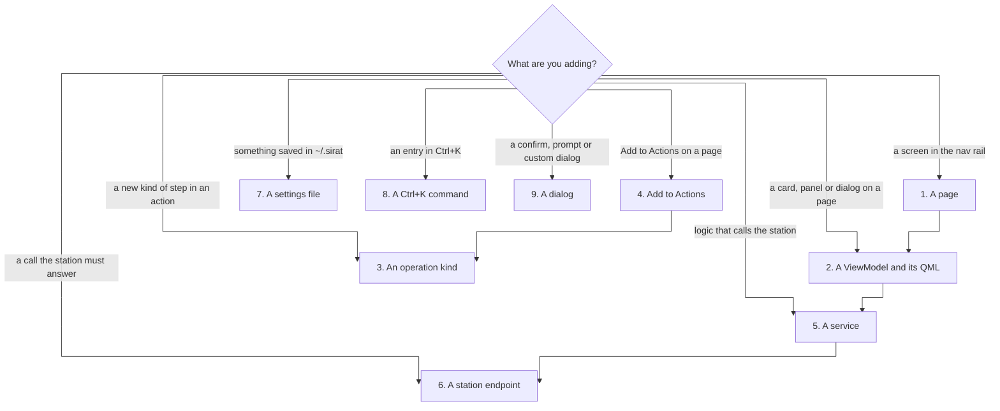

# Extending the SiRAT frontend

How to add the common kinds of feature, and every file each one touches. Paths are under `src/sirat_ui/`
unless they start with `tests/`, `docs/` or `scripts/`. See [ARCHITECTURE.md](ARCHITECTURE.md) for how the
pieces fit together.



The rules the tests enforce (`tests/unit/test_architecture.py`) apply to everything below:

- Services take the gateway area they need (`RegistersPort`, `InstrumentsPort`, …), never `StationGateway`.
- ViewModels never import `gateway.port` or `ErrorPresenter`; they call services.
- Services report station failures with `ErrorPresenter.present(error, context)`; ViewModels show results
  inline and toast only input and file problems.
- Qt properties: `qprop(type, "_attr", changed)` for stored values, `@pyqtProperty(type, notify=changed)`
  for computed ones. No lambda properties.
- `.ui.qml` forms contain layout only: no handlers, functions, `app.` or `vm.`; every interactive control has
  an `objectName`; every form has a wrapper `.qml` next to it; font sizes come from `Theme`.
- No Python file over 600 lines. `models/` imports only the standard library and other models.

---

## 1. A page

A page is one row in the page table plus the ViewModels its QML binds. The nav rail, page host, pop-out
windows and the "every page loads" test all read the table.

| File | Change | |
|---|---|---|
| `domains/shell/pages.py` | Add a row: `key`, `title`, `label` (nav rail), `icon`, `ready`, `source` (QML path relative to `qml/shell/`) | required |
| `qml/pages/<key>/<Name>Page.qml` | Wrapper: binds the form to `app.<vm>` and calls slots | required |
| `qml/pages/<key>/<Name>PageForm.ui.qml` | Form: layout only, `property alias` for every control the wrapper touches | required |
| ViewModels for the page | See [2. A ViewModel](#2-a-viewmodel-and-its-qml) | required |
| `qml/components/Icon.qml` | Only if no existing glyph fits (`glyphs` map) | optional |
| `app/commands.py` | A Ctrl+K entry that opens the page ([8](#8-a-ctrlk-command)) | optional |
| `tests/e2e/test_journeys.py` | A journey through the page; the load test picks the page up from `pages.py` already | recommended |
| `scripts/screenshot.py`, `docs/GAP_REVIEW.md` | A screenshot and the requirement rows marked done | recommended |

The page keeps its state after the first visit (`PageLoader` loads lazily and doesn't unload), so start polling
in `onVisibleChanged` only if it should stop when hidden (see `ChamberCard.qml`).

## 2. A ViewModel and its QML

| File | Change | |
|---|---|---|
| `domains/<area>/<thing>_viewmodel.py` | `class XViewModel(BaseViewModel)` with `changed = pyqtSignal()`, properties (`qprop` / `@pyqtProperty`), slots (`@pyqtSlot`). Take services and state stores in the constructor | required |
| `app/container.py` | Construct it in the area's `_<area>_viewmodels()` method and return it under the name QML uses: `"myThing": MyThingViewModel(...)` makes `app.myThing` | required |
| `qml/pages/<area>/<Thing>.qml` + `<Thing>Form.ui.qml` | Wrapper binds `vm.prop` and calls `vm.slot()`; form holds the layout | required |
| `tests/unit/domains/test_<area>.py` | Behaviour tests through `harness.shell.myThing` against the fake (`harness` fixture in `tests/conftest.py`) | required |

Which state store to inject:

| Need | Inject |
|---|---|
| connected?, DUT position, chip, `can(method)` for enabling buttons | `StationState` |
| the open register or peripheral | `SelectionState` |
| value format, dark mode, other preferences | `PreferencesState` |
| set the status bar message | `StatusLine` (services usually do this, not ViewModels) |

A new area builder method also needs adding to the tuple in `ServiceContainer._build_viewmodels`.

## 3. An operation kind

Operations are the steps saved in an action (`~/.sirat_actions.json`) and sent with `automation.seq.run`.
Each kind is defined once in `core/ops.py`; `tests/unit/core/test_ops.py` fails until the schema and the
color exist.

| File | Change | |
|---|---|---|
| `core/ops.py` | `_register(OpKind("my_kind", describe=…, code=…, wire_fields=(…) or to_wire=…, carries_code=…, editable=…))` | required |
| `stores/schemas/operations.py` | A pydantic model with `type: Literal["my_kind"]`, added to `OPERATION_MODELS` (the file schema) | required |
| `qml/theme/Theme.qml` | A color in both maps of `kindColor` (light and dark), or a tone in `kindTone` | required |
| `gateway/fake/fake_station.py` | Handle the kind in `_execute_op` so sequences can run it against the fake | required |
| `docs/API_DESIGN.md` | The wire op (`automation` section) so the real service implements it | required |
| `tests/unit/domains/…` | A test that records and runs the kind | recommended |

`describe` is what the Actions list shows, `code` returns the lines for Generate code (req 16), and the wire
shape is `{"type": kind, **wire_fields}` unless `to_wire` builds it (see `signal_generator`, `custom_function`).

## 4. Add to Actions on a page

| File | Change | |
|---|---|---|
| the page's service | Take `actions: ActionRecorder` (`domains/automation/recorder.py`) and add `add_action(...) -> Action` that calls `self._actions.add(name, [op])`; `add()` makes the name unique | required |
| the page's ViewModel | An `addToActions()` slot that calls the service and toasts `Added <name> to Actions` | required |
| `app/container.py` | Pass `actions` (the `ActionService`) to the service | required |
| the page's form and wrapper | An `Add to Actions` button (`objectName`, `iconName: "bolt"`) bound to the slot | required |
| `core/ops.py` and the rest of [3](#3-an-operation-kind) | Only if the op is a new kind | conditional |

## 5. A service

| File | Change | |
|---|---|---|
| `domains/<area>/<name>.py` | The class. Constructor takes the narrowest gateway area (`gateway/port.py`), the state stores, `ErrorPresenter`, `LogService`, other services. Expose an `Event` (`core/observable.py`) for ViewModels to follow | required |
| `app/container.py` | Add a field to the `Services` dataclass and construct it in `_build_services()` | required |
| `app/container.py` `reload_user_data()` | Add it to the list if it reads a settings file | conditional |
| `app/container.py` `stop()` | Stop its timers if it polls (see `ChamberService.stop_polling`) | conditional |
| `tests/unit/domains/test_<area>.py` | Behaviour tests through its ViewModel | required |

Long-running station work (an activity) goes through `ActivityTracker.follow(activity_id, on_progress,
on_done)`; don't subscribe to `gateway.events` yourself for activities.

## 6. A station endpoint

An endpoint is an API method the real station service must answer (`docs/API_DESIGN.md`).

| File | Change | |
|---|---|---|
| `docs/API_DESIGN.md` | The method, its parameters, result model and requires | required |
| `gateway/port.py` | The method on its area interface (or a new area interface added to `StationGateway`), returning `Call[Result]` | required |
| `models/station.py` | The result dataclass, if new | conditional |
| `core/requires.py` | `METHOD_REQUIRES["area.method"] = ("dut", "idle", …)`; a new tag also needs `TAG_TEXT` | required |
| `gateway/fake/fake_station.py` | `def method(...)`: `return self._respond("area.method", position, run, **params)`. Instrument calls use `_instrument_call`; memory and Python calls live in `gateway/fake/advanced.py` (`FakeAdvanced` plus a one-line method on `AdvancedMethods`) | required |
| the service that uses it | Call it, report failures with `ErrorPresenter` | required |
| `tests/unit/gateway/test_fake_station.py` | The fake answers it and refuses it when requires aren't met | recommended |
| `scripts/architecture/backend_doc.py` | Its entry in `F` (signature, behaviour, errors, changes) and a sample call in `payloads.py`; then `uv run python scripts/architecture/backend_doc.py` regenerates `docs/BACKEND_DESIGN.md` | required |
| later: `gateway/api/` | `ApiStationGateway` maps it to the client SDK | when the backend exists |

The fake must keep the same rules as the real service (requires, error codes), or the GUI will rely on
behaviour the real backend won't have.

## 7. A settings file

Files in `~/.sirat/` (or `~/.sirat_*.json` for formats shared with the old GUI) are loaded through pydantic
cleaners, so a bad entry is skipped and reported instead of crashing.

| File | Change | |
|---|---|---|
| `stores/schemas/files.py` | A pydantic model and a `clean_<name>(raw, report)` function | required |
| `stores/schemas/__init__.py` | Import it and add it to `CLEANERS` | required |
| `stores/json_store.py` | A `UserStores` field, its `JsonStore(path, default, CLEANERS[...])` in `in_home()`, and add it to `all()` | required |
| `domains/settings/transfer.py` | Add it to `_named()` so export, import and Clear all include it | required |
| the service that owns it | Read with `store.load()`, write with `store.save(data)`, and a `reload()` | required |
| `app/container.py` | Pass the store to the service; add the service to `reload_user_data()` | required |
| `tests/unit/domains/test_settings.py` | Bump the `"Imported N settings files"` count | required |
| `docs/FRONTEND_PLAN.md` | The file in the persistence list | recommended |

## 8. A Ctrl+K command

| File | Change | |
|---|---|---|
| `app/commands.py` | `Command(key, title, subtitle, run, shortcut="")` in `palette_commands()`. `go("page", then)` opens a page first. A `shortcut` (Qt key sequence) is bound by `Main.qml` and shown in the palette automatically | required |
| `app/commands.py` + `app/container.py` `_palette()` | If the command calls a ViewModel the function doesn't receive yet, add a parameter and pass `cast(XViewModel, vms["x"])` | conditional |

## 9. A dialog

Standard dialogs need no QML: a service or ViewModel calls `InteractionService`
(`shared/interactions.py`): `confirm(ConfirmRequest)`, `prompt(PromptRequest)`, `alert(Alert)`,
`toast(level, text)`, `choose_open_file(...)`, `choose_save_file(...)`, `show_code(title, code)`. The request
types are in `models/dialogs.py`; tests answer them with `harness.ix.answer_next(...)`.

A custom dialog:

| File | Change | |
|---|---|---|
| `qml/dialogs/<Name>Dialog.qml` | Built on `ModalDialog`, `visible: vm.isOpen` | required |
| `qml/shell/DialogHost.qml` | Add `<Name>Dialog { }` | required |
| a ViewModel | `isOpen` property and open/close slots; register it in the container | required |

---

## Before you're done

```bash
uv run pytest -q
```

```bash
uv run pyrefly check
```

```bash
uv run python scripts/screenshot.py
```

Then update `docs/GAP_REVIEW.md` for the requirement. If classes, signatures or station calls changed,
regenerate the diagrams:

```bash
uv run python scripts/architecture/build.py
```
