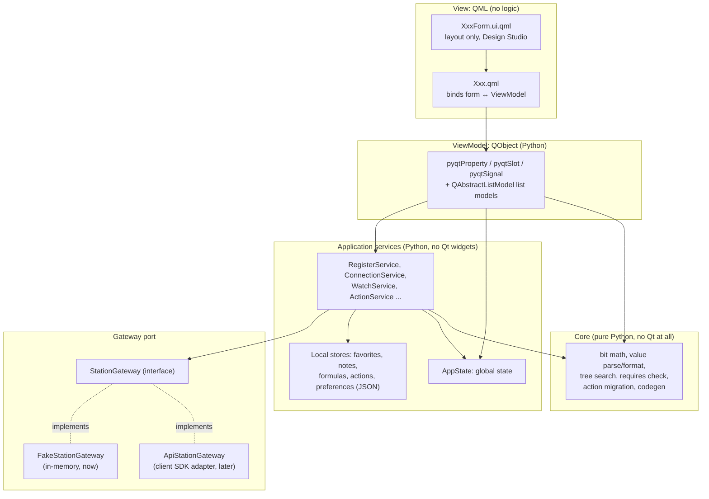
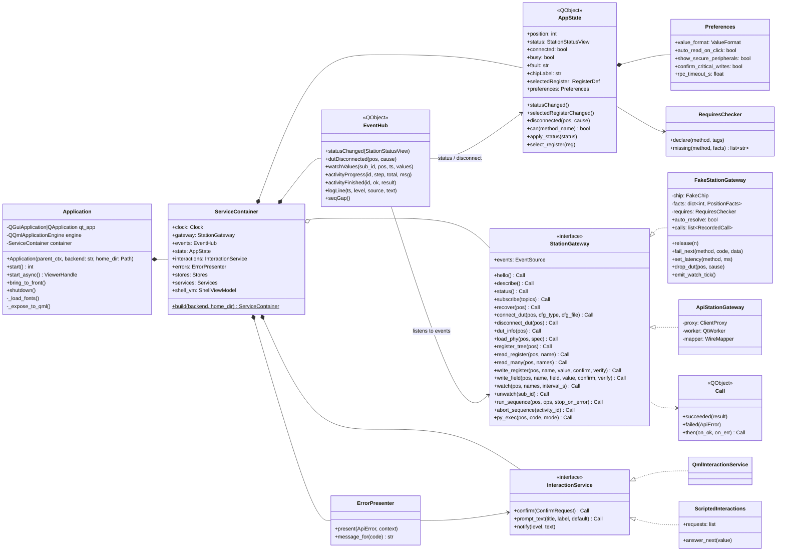
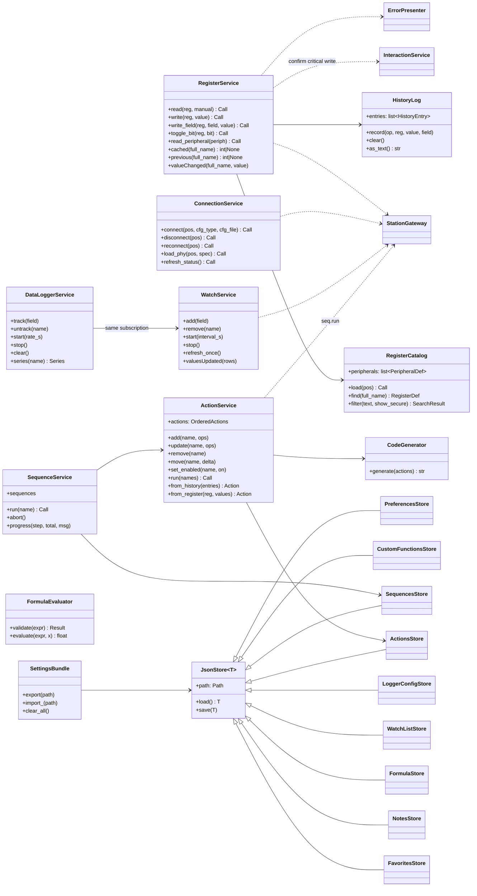
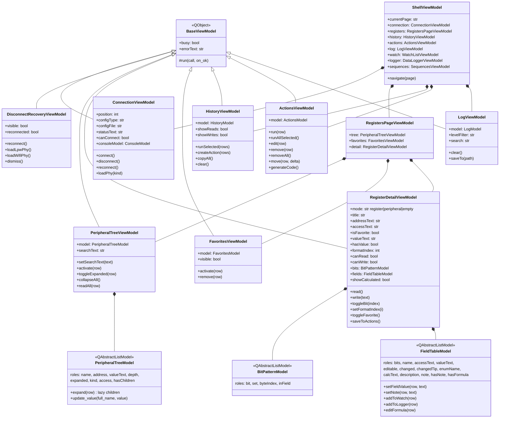
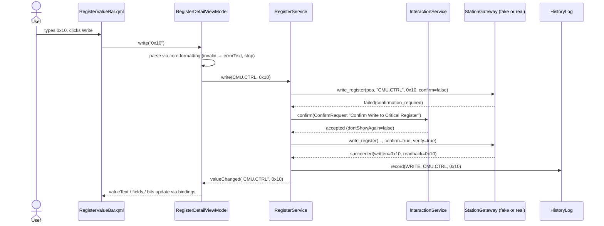

# SiRAT Frontend Plan

**Status:** Draft for review. No code written yet.
**Date:** 2026-10-27
**Scope:** The frontend only: PyQt5 + QML on Python 3.10.5. The backend is the Station API service described in `SiRAT Station API Design Document.pdf`. It doesn't exist yet, so the frontend runs against an in-memory fake that follows the same contract.

Sources: `sirat_requirements.txt` (35 features) and `SiRAT Station API Design Document.pdf`. The visual direction comes from the "Sequence Editor" mockup.

---

## 1. Decisions at a glance

| Topic | Decision |
|---|---|
| Runtime | Python 3.10.5, PyQt5 5.15.x (pinned), Qt Quick 2.15, Qt Quick Controls 2.15 (Basic style, restyled by us) |
| Pattern | Strict MVVM. QML views have no logic. ViewModels have no QML knowledge. Services have no Qt widgets. |
| Design Studio | Every visual unit is split into `XxxForm.ui.qml` (pure layout, which Design Studio can edit) and `Xxx.qml` (wires the form to a ViewModel) |
| Composition | One `Application` bootstrap class is the composition root. It builds everything and injects it. No module-level singletons. |
| Global state | One `AppState` object holds cross-tab state (connection facts, selected DUT position, selected register, preferences) |
| Backend access | ViewModels never call the backend directly. They go through services, which go through a `StationGateway` interface. The fake and the real implementations are swappable. |
| Navigation | One window with a left nav rail and pages. Today's 15 floating dialogs become pages or side sheets, loaded lazily. |
| Look | A light, neutral, card-based design system in one `Theme` singleton, matching the mockup |
| Testing | Behavior-first: unit, ViewModel, integration, QML load and lint, then E2E through page objects. Everything runs against the fake backend. |

---

## 2. Frontend architecture (layers)

The API doc splits the backend into domains. The frontend mirrors that split: one folder per feature area. Inside each area the same five layers repeat, and each layer may only import the layers below it.



**Why this shape**

- **Core is pure Python.** Bit insert/extract, hex/dec/bin parsing, search matching, and formula evaluation are where most bugs hide. Pure functions are the cheapest thing to test.
- **Services own workflows.** "Write a register" means: check access, ask for confirmation if the peripheral is critical, call the backend, verify the read-back, update the cache, log to history. That workflow belongs in one place, `RegisterService`. It doesn't belong in QML or in a ViewModel.
- **The gateway is a port.** The API doc says "wire models are not GUI view-models; the GUI maps them." The gateway is where that mapping happens. When the real `contracts` package and client SDK exist, we write `ApiStationGateway` and nothing above it changes.
- **The GUI-only features from the API doc stay in services and stores.** Favorites, notes, formulas, history, SVD search, and settings never touch the gateway.

### Threading and async

- The real client SDK delivers replies and events as Qt signals from a worker thread. The gateway marshals them onto the GUI thread.
- Every gateway call returns a `Call` object. It fires `succeeded(result)` or `failed(ApiError)` on the GUI thread.
- The fake gateway can resolve calls **immediately** (fast tests) or **on demand** with `fake.release()`. The on-demand mode lets a test check in-between states such as "the Connect button reads *Connecting…* and is disabled".
- Time comes from an injected `Clock`. Watch ticks and debounce timers use a `FakeClock` in tests, so no test calls `sleep()`.

---

## 3. Project layout


### Design rules (enforced by tests/unit/test_architecture.py unless noted)

- Services depend on the gateway area they use (`gateway/port.py`); only `app/` and `gateway/` see `StationGateway`.
- ViewModels reach the station only through services. Services report unexpected station failures through
  `ErrorPresenter`; ViewModels show results inline and toast only input and file problems.
- `models/` imports only the standard library and other models.
- One way to declare a Qt property: `qprop(...)` for stored values, `@pyqtProperty` for computed ones.
- An operation kind is defined once, in `core/ops.py`; tests check its file schema and theme color exist.
- A page is one row in `domains/shell/pages.py` plus its ViewModels registered in the container; the shell
  turns each registered ViewModel into `app.<name>` (convention, not a test).
- Pages that offer "Add to Actions" depend on `ActionRecorder`, not the whole `ActionService` (convention).

```
Sample_UI/
├── pyproject.toml                 # python = "==3.10.5", PyQt5 pinned
├── designstudio/
│   ├── SiRAT.qmlproject           # opens src/sirat_ui/qml in Qt Design Studio
│   └── mockups/                   # forms with ListModel sample data, for DS previews
├── src/sirat_ui/
│   ├── __main__.py                # python -m sirat_ui --backend fake
│   ├── app/
│   │   ├── application.py         # Application (bootstrap / composition root)
│   │   ├── container.py           # ServiceContainer: builds services, then VMs one area at a time
│   │   ├── commands.py            # the Ctrl+K command list
│   │   ├── launch.py              # launch_viewer(), launch_viewer_async() (req §1)
│   │   └── qml_setup.py           # fonts, import paths, context property
│   ├── models/                    # shared dataclasses; imports only stdlib and each other (enforced)
│   │   ├── registers.py           # RegisterDef, FieldDef, AccessType, ChipInfo, SearchResult
│   │   ├── facts.py               # PositionFacts, InstrumentFacts
│   │   ├── station.py             # Station API results and events
│   │   ├── actions.py, radio.py, instruments.py, dumps.py, memory.py, dialogs.py, settings.py
│   ├── state/                     # each store has its own change event
│   │   ├── station.py             # StationState: facts, position, chips, instruments, requires checks
│   │   ├── selection.py           # SelectionState: the open register or peripheral
│   │   ├── preferences.py         # PreferencesState
│   │   └── status.py              # StatusLine: the status bar message
│   ├── core/                      # pure Python, no Qt imports (enforced by a test)
│   │   ├── bits.py                # extract/insert field, bit toggle
│   │   ├── formatting.py          # parse/format hex/dec/bin
│   │   ├── search.py              # peripheral/register/field matching (req §6)
│   │   ├── requires.py            # RequiresChecker: mirrors server check_requires
│   │   ├── formula.py             # safe formula evaluator ('x' only)
│   │   ├── ops.py                 # one OpKind per operation kind: description, code, wire, flags
│   │   ├── actions.py             # action summaries + legacy format migration
│   │   ├── naming.py              # load_phy, load_phy_2 ... for saved names
│   │   └── codegen.py             # Python code generation templates (req §16)
│   ├── gateway/
│   │   ├── port.py                # one interface per API area (RegistersPort ...); StationGateway = all
│   │   ├── activities.py          # ActivityTracker: routes activity events to whoever started them
│   │   ├── errors.py              # ApiError, ErrorCode (mirrors API doc)
│   │   ├── fake/
│   │   │   ├── fake_station.py    # FakeStationGateway; composes FakeBench and FakeAdvanced
│   │   │   ├── scenarios.py       # named fault/latency scenarios
│   │   │   └── fixtures/chip_small.json
│   │   └── api/                   # ApiStationGateway (when backend exists)
│   ├── services/                  # one per area; see class diagram
│   ├── stores/                    # JSON persistence in ~/.sirat (req §1 auto-load list)
│   ├── viewmodels/
│   │   ├── shell/  connection/  registers/  watch/  logger/
│   │   ├── actions/  sequences/  dumps/  radio/  instruments/
│   │   └── advanced/  tests/  logs/  settings/
│   └── qml/
│       ├── Main.qml
│       ├── theme/       Theme.qml, qmldir          (pragma Singleton)
│       ├── components/  AppButton, Card, Chip ...  (design system)
│       ├── shell/       AppShell, NavRail, TopBar, BottomDock, StatusBar
│       ├── pages/       registers/ watch/ actions/ ... (each: Page.qml + PageForm.ui.qml)
│       └── dialogs/     ConfirmWriteDialog, VerifyFailedDialog, DisconnectSheet ...
└── tests/
    ├── unit/            core + services + viewmodels
    ├── integration/     container wired with the fake backend + real stores in tmp dir
    ├── qml/             every QML file loads; .ui.qml lint
    ├── e2e/             user journeys through page objects
    ├── pages/           page objects (RegistersPage, ConnectSheet ...)
    └── conftest.py      fixtures: fake_station, app, clock, interactions
```

---

## 4. Components (what the user sees)

### 4.1 Application shell

```
┌──────────────────────────────────────────────────────────────────────────────┐
│ SiRAT  [EFR32XG29 revA0]  DUT [1 ▾]  ● Connected      ⌘K Search   [Connect]  │ TopBar
├────┬─────────────────────────────────────────────────────────────────────────┤
│ ▣  │                                                                         │
│ ◎  │                         Active page (Loader, lazy)                      │
│ ≡  │                                                                         │
│ ▶  │                                                                         │
│ ⇄  ├─────────────────────────────────────────────────────────────────────────┤
│ ∿  │  History │ Actions │ Log                         (BottomDock, collapsible)│
│ ⚙  │                                                                         │
├────┴─────────────────────────────────────────────────────────────────────────┤
│ BUFC_NS.LPMODE @ 0xBA000008 · read ok                      Service v1.2 · idle│ StatusBar
└──────────────────────────────────────────────────────────────────────────────┘
 NavRail
```

### 4.2 Pages (the "tabs")

The 35 features group into 11 pages. Each page loads the first time it's opened (req §2, lazy dialogs). Its ViewModel lives in the container, so state survives switching tabs.

| Nav item | Page contains | Req § |
|---|---|---|
| **Registers** (home) | Peripheral tree + search, Favorites column (shown only when there are favorites), Register detail (header, value bar, bit grid, fields table) | 4–8, 10, 11 |
| **Watch** | Watch list table, refresh rate, write-in-place, "add to logger" | 18 |
| **Logger** | Tracked fields, sample rate, start/stop, live plots | 17 |
| **Actions** | Large actions view, edit sheet, generate code | 13, 16 |
| **Sequences** | Sequence list + editor (reorder, add/remove), run/abort with progress | 14 |
| **Dumps** | Take dump, compare dumps, diff vs live, Radio Calculator diff | 12, 21 |
| **Radio** | Load LPW/WiFi PHY, PRS routing | 23, 24 |
| **Instruments** | Signal generator, BLE packet config, GFSK generator, RF switch, temp chamber, ECA | 25–30 |
| **Advanced** | Python console, custom functions, DUT control API explorer, memory viewer | 15, 19, 20, 22 |
| **Tests** | Test executor, debug harness | 33 |
| **Settings** | Preferences, hardware config, import/export/clear user settings, system info, about | 31, 32, 34 |

The **BottomDock** is always available: Operation History (§9), Actions panel (§13), Log view (§35). **Sheets/dialogs** are for interruptions only: Connect to DUT (§3), Disconnect recovery (§3), Confirm critical write (§7), Write verification failed (§7), Formula editor (§11), Name prompt, Code preview (§16).

### 4.3 Register detail, in the new style

```
┌ BUFC_NS.LPMODE  ☆                     0xBA000008 · RW · 32-bit ──── LION A0 ┐
├──────────────────────────────────────────────────────────────────────────────┤
│ Value  [ 0x00000003                    ]  (Hex|Dec|Bin)   [Read]  [■ Write]  │
├──────────────────────────────────────────────────────────────────────────────┤
│ Bits   31 ··· 24 │ 23 ··· 16 │ 15 ··· 8 │ 7 ··· 0      (click a bit to toggle)│
│        ▢▢▢▢▢▢▢▢  │ ▢▢▢▢▢▢▢▢  │ ▢▢▢▢▢▢▢▢ │ ▢▢▢▢▢▢■■                          │
├──────────────────────────────────────────────────────────────────────────────┤
│ Bits  Name         Access  Value  Enum   Calc   Description           ◎ ∿ x² │
│ 1     LPENBYM33    [RW]    0x1    —      —      Low power … from M33  ◎ ∿ x² │
│ 0     LPENBYSEQ    [RW]    0x1    —      —      Low power … from M0p  ◎ ∿ x² │
└──────────────────────────────────────────────────── [Save register to Actions]┘
```

Access type is shown as a small tinted chip (`[RW]` green, `[R]` blue, `[W]` red ...). The full row is no longer painted. It's quieter, and the meaning is the same as req §7.

### 4.4 Design system components (`qml/components/`)

Every component is a `.qml` with a matching `.ui.qml` where it has real layout. All of them read colors, spacing, and fonts from `Theme`.

| Component | Use |
|---|---|
| `AppButton` | variants: `primary` (black, like "Save"), `secondary` (outlined), `ghost`, `danger`; sizes sm/md; optional icon |
| `IconButton` | star, watch, logger, formula, remove (×) |
| `Card` | white surface, 1px hairline border, 8px radius, optional title row with right-aligned meta text ("apply to every condition · click a value to edit") |
| `SectionHeader` | bold 13px title + muted helper text + right-side actions |
| `Chip` / `Pill` | tinted tags: access type, tag:rx, splits A–F, status ("✓ Valid") |
| `StatusPill` | Connected / Disconnected / Busy / Fault (dot + label) |
| `TextField`, `HexField`, `NumberField` | monospace for values; inline validation message |
| `SegmentedControl` | Hex/Dec/Bin, READ/WRITE filters |
| `Toggle`, `CheckBox` | |
| `DataTable` | header + rows on Qt 5.15 `TableView` + `HorizontalHeaderView`; sortable; editable cells by role |
| `TreeList` | indented ListView over a flattened tree model (Qt 5 has no QML TreeView) |
| `BitGrid` | 32 toggle cells in 4 byte groups |
| `KeyValueGrid` | condition details / system info style two-column grid (as in the mockup) |
| `StatTile` | large number + label ("Test runs 71") for logger, dumps summary, test results |
| `LinePlot` | data logger and watch sparklines (implementation chosen in Phase 0 spike) |
| `ConsoleView` | monospace output with colored levels (§3 console colors, softened) |
| `EmptyState` | "(no sequences saved yet)" done nicely: icon + text + primary action |
| `Sheet` / `Dialog` | right-side sheet for forms, centered modal for confirmations |
| `Toast` | non-blocking success/error notices ("Wrote 0x3, verified") |
| `CommandPalette` | Ctrl+K: jump to register, page, or action |

### 4.5 Visual style (the "modern" look)

What makes the mockup feel modern:
- A neutral off-white canvas with white cards and hairline borders, mostly without shadows.
- One dark accent for the primary action.
- Small muted helper text.
- Monospace for anything numeric.
- Tinted chips instead of saturated colors.
- Compact but even spacing.

`Theme.qml` turns that into tokens:

```qml
// qml/theme/Theme.qml
pragma Singleton
import QtQuick 2.15

QtObject {
    property bool dark: false

    // surfaces
    readonly property color canvas:      dark ? "#111214" : "#F6F6F4"
    readonly property color surface:     dark ? "#1A1B1E" : "#FFFFFF"
    readonly property color border:      dark ? "#2A2C30" : "#E6E6E3"
    readonly property color textPrimary: dark ? "#ECECEC" : "#1C1C1C"
    readonly property color textMuted:   dark ? "#9A9A9A" : "#8A8A86"
    readonly property color accent:      dark ? "#FFFFFF" : "#111111"   // primary button

    // semantic tints (chip background / chip text)
    readonly property color infoBg:  "#EEF3FF"; readonly property color infoFg:  "#3B5BDB"
    readonly property color okBg:    "#EAF7EE"; readonly property color okFg:    "#2B8A3E"
    readonly property color warnBg:  "#FFF4E5"; readonly property color warnFg:  "#C76A00"
    readonly property color dangerBg:"#FDECEC"; readonly property color dangerFg:"#C92A2A"
    readonly property color splitBg: "#F1EEFF"; readonly property color splitFg: "#6741D9"
    readonly property color changed: "#FFF6BF"   // changed-field highlight (§5)
    readonly property color noteBg:  "#FFFBEA"   // field has a note (§10)

    // access type → chip colors (§7 semantics, modern tints)
    function accessBg(a) { return ({ro: infoBg, rw: okBg, wo: dangerBg, w1: warnBg, rw1: splitBg})[a] || border }

    // spacing, radius, type
    readonly property int s1: 4;  readonly property int s2: 8
    readonly property int s3: 12; readonly property int s4: 16; readonly property int s6: 24
    readonly property int radius: 8; readonly property int radiusSm: 4
    readonly property string fontUi:   "Inter"           // bundled, fallback Segoe UI
    readonly property string fontMono: "JetBrains Mono"  // bundled, fallback Cascadia Mono
    readonly property int fontSm: 11; readonly property int fontMd: 13; readonly property int fontLg: 16
    readonly property int fontXl: 24  // stat tiles
}
```

- Inter and JetBrains Mono (both OFL) are bundled and registered with `QFontDatabase` at startup, so the app looks the same on every station.
- Icons: Lucide SVGs (ISC license), tinted through `ColorOverlay` or pre-colored.
- Dark mode costs almost nothing because every color is a token. Whether to ship it is an open question.
- A **Component Gallery** page (debug builds only) shows every component in every state. It's the living style guide, and it's the first thing to open in Design Studio.

> Note: the requirements doc (§2) says "standard Qt theme". This plan replaces that on purpose, at your request. The per-feature *semantics* stay the same: access colors, the changed-field highlight, the notes highlight, the console level colors.

---

## 5. The `.ui.qml` / `.qml` split (Design Studio workflow)

Each visual unit has two files:

```qml
// pages/registers/RegisterValueBarForm.ui.qml   ← Design Studio edits this
import QtQuick 2.15
import QtQuick.Layouts 1.15
import "../../components"

Card {
    property alias valueField: valueField
    property alias formatControl: formatControl
    property alias readButton: readButton
    property alias writeButton: writeButton
    property string notReadText: "<not read yet - click \"Read Register\">"

    RowLayout {
        anchors.fill: parent
        HexField { id: valueField; objectName: "registerValueField"; Layout.fillWidth: true }
        SegmentedControl { id: formatControl; objectName: "formatControl"; model: ["Hex", "Dec", "Bin"] }
        AppButton { id: readButton;  objectName: "readButton";  text: "Read";  variant: "secondary" }
        AppButton { id: writeButton; objectName: "writeButton"; text: "Write"; variant: "primary" }
    }
}
```

```qml
// pages/registers/RegisterValueBar.qml          ← wiring only
import QtQuick 2.15

RegisterValueBarForm {
    property var vm                                  // RegisterDetailViewModel, injected

    valueField.text: vm.valueText
    valueField.placeholderText: vm.hasValue ? "" : notReadText
    formatControl.currentIndex: vm.formatIndex
    readButton.enabled: vm.canRead
    writeButton.enabled: vm.canWrite
    writeButton.busy: vm.busy

    readButton.onClicked: vm.read()
    writeButton.onClicked: vm.write(valueField.text)
    formatControl.onActivated: vm.setFormatIndex(index)
}
```

**Rules for `.ui.qml` files** (checked by an automated lint test):
1. No `function` definitions, no `Connections`, no signal handlers (`onXxx:`), and no JS beyond simple property expressions.
2. No references to ViewModels or context properties. The form exposes `alias` and plain properties only. That way it renders in Design Studio with default values.
3. Every interactive element gets an `objectName`. Tests find elements by name, never by position.
4. Versioned Qt 5 imports only (`QtQuick 2.15`, `QtQuick.Controls 2.15`, `QtQuick.Layouts 1.15`). No Qt 6-only types.

**Design Studio mock data:** `designstudio/mockups/` holds tiny wrapper files that instantiate forms with `ListModel` sample data (peripherals, fields, history rows). Design Studio previews look real, and the production forms stay clean.

**ViewModel injection into QML:** one root context property, `app` (the `ShellViewModel`), exposes child ViewModels as constant properties (`app.registers.detail`, `app.watch`, ...). Pages receive their VM through a `vm` property. A page can be loaded in a test with any VM, real or fake.

---

## 6. Class diagrams

The diagrams are split into three so each one stays readable.

### 6.1 Bootstrap, global state, gateway



**Notes**
- `Application` is the only place that knows which gateway is in use (`--backend fake|api`). It handles req §1: it reuses an existing `QApplication`, launches in blocking or async mode, and acts as a singleton that brings the window to front.
- `AppState` is the single source of truth for anything shared across tabs. Every page's enabled/disabled state comes from `AppState.can("registers.write")`. That uses the same requires tags as the server (`dut`, `phy`, `idle`, `no_fault`), so the UI and the service agree.
- `InteractionService` is how a ViewModel asks the user something without knowing QML exists. The ViewModel calls `confirm(...)`, QML shows the dialog, and the answer comes back as a `Call`. Tests swap in `ScriptedInteractions` ("answer yes to the next confirmation"). This is the key to testing user behavior without clicking dialogs.
- `ErrorPresenter` is the one error handler. The API doc says "the GUI shows its own wording per code". `wrong_state`, `confirmation_required`, `verify_failed`, `dut_disconnected`, and the other codes each map to one message and one presentation.

### 6.2 Services and stores



Stores keep the file names from req §1: `~/.sirat_favorites.json`, `~/.sirat/field_notes.json`, and so on. Existing users keep their data. `ActionsStore` runs the legacy-format migration from req §13 on load.

### 6.3 ViewModels (Registers slice shown in full, others in outline)



The remaining pages follow the same pattern: one `XxxViewModel` plus one list model each. They are `WatchListViewModel`, `DataLoggerViewModel`, `SequencesViewModel`, `DumpsViewModel`, `RadioCalcDiffViewModel`, `PhyLoaderViewModel`, `PrsRoutingViewModel`, `SignalGeneratorViewModel`, `BlePacketViewModel`, `GfskViewModel`, `RfSwitchViewModel`, `ChamberViewModel`, `EcaViewModel`, `ConsoleViewModel`, `CustomFunctionsViewModel`, `ApiExplorerViewModel`, `MemoryViewerViewModel`, `TestExecutorViewModel`, `SettingsViewModel`, and `SystemInfoViewModel`.

**How tabs talk to each other** (no ViewModel holds a reference to another tab's ViewModel):
- Selecting a register anywhere (tree, favorites, command palette, watch list) calls `AppState.select_register`. The detail ViewModel listens.
- A read or write anywhere goes through `RegisterService`, which emits `valueChanged`. The tree, watch list, and detail view all update.
- "Add to watch" or "Add to logger" from the fields table calls `WatchService.add` / `DataLoggerService.track`. The Watch and Logger pages show the field even if they've never been opened.

### 6.4 One flow end to end: writing a critical register



If the read-back differs, the gateway returns `verify_failed` with `written` and `readback`. `ErrorPresenter` shows the "Write Verification Failed" dialog, and the displays use the read-back value (req §7).

---

## 7. Testing strategy (behavior, not layout)

### 7.1 Principles

1. **Test what the user can do, not where pixels are.** Every test maps to a line in the USER REQUIREMENTS sections, for example "User can toggle individual bits" (§5). Tests carry a marker: `@pytest.mark.req("5.bit-toggle")`. A report then shows which requirements are covered.
2. **Find things by meaning.** Tests address `objectName`s and ViewModel properties, never coordinates, colors, or sizes. You can redesign a page in Design Studio and the tests still pass.
3. **Most tests run below QML.** ViewModels *are* the UI's behavior, without the rendering. Testing them is fast, stable, and needs no window.
4. **The fake backend must not lie.** It enforces the same requires rules and error codes as the API doc. Later, one shared contract test suite runs against both the fake and the real gateway.
5. **No sleeps.** Time is injected through `FakeClock`, and fake calls resolve when the test says so.

### 7.2 The test pyramid

| Layer | Folder | What it proves | Tools | Approx. count |
|---|---|---|---|---|
| **Unit: core** | `tests/unit/core` | bit math, parsing/formatting, search rules (§6 algorithm), formula safety, action legacy migration, codegen output | `pytest`, `hypothesis` (property tests: `extract(insert(v, f, x), f) == x` for all fields) | many, run in ms |
| **Unit: services** | `tests/unit/services` | workflows: confirm-then-write, verify-failed handling, history only for manual reads, debounce, store round-trips | `pytest`, fake gateway, `ScriptedInteractions`, `tmp_path` | dozens |
| **Unit: ViewModels** | `tests/unit/viewmodels` | user behavior: "click Read → value shows, history gets a row"; "disconnected → Write disabled"; "search 'lpmode' → exactly one match auto-selected" | `pytest-qt` (`qtbot.waitSignal`, `QSignalSpy`), no window | dozens per page |
| **Integration** | `tests/integration` | the real container wired with the fake backend and real JSON stores. Cross-tab behavior: star a register → favorites column appears; write in detail → tree value updates; DUT drop → recovery sheet requested, all write buttons disabled; restart app → favorites/notes/formulas restored | `pytest-qt` | ~20–40 |
| **QML checks** | `tests/qml` | every `.qml` loads with zero warnings (catches broken bindings and typos); `.ui.qml` lint (rules in §5); every interactive element has an `objectName` | `QQmlEngine` + message handler, simple parser | one per file, automatic |
| **E2E** | `tests/e2e` | full app window + fake backend scenario, driven by real mouse/keyboard events on objects found by name. ~10–15 key journeys only | `pytest-qt`, `QTest` on `QQuickWindow`, page objects | small |
| **Bench smoke (later)** | `tests/bench` | the same E2E journeys with `--backend api` against one real station | as above | 3–5 |

### 7.3 The fake backend (the stub)

`FakeStationGateway` is a real, stateful, in-memory station:

- **Chip fixture** (`fixtures/chip_small.json`): about 6 peripherals chosen to hit every rule.
  - `CMU`: critical, needs confirmation.
  - `USART0`: read-sensitive, refused by watch/read_many.
  - `GPIO`: plain RW.
  - `BUFC`: RO/WO fields, plus a register with read-only bits so `verify_failed` happens naturally.
  - A register with enum fields.
  - `_NS`/`_S` variants, for the secure-peripheral filter.
- **Facts and requires**: per-position facts (`dut_connected`, `phy`, `activity`, `fault`) with the reset rules from the API doc. A disconnect clears `phy_loaded`, and so on. A call with unmet requires fails with `wrong_state` and `missing` tags, exactly like the server.
- **Events**: `status.changed`, `dut.disconnected`, `registers.watch` (one per tick, driven by `FakeClock`), `activity.progress` / `activity.finished` for sequences, `log.line`.
- **Control knobs for tests**:
  - `fail_next("registers.write", "dut_disconnected")`
  - `set_latency("dut.connect", 500)`
  - `auto_resolve = False` + `release()`
  - `drop_dut(1, "power cycle")`
  - `calls` (assert what the UI sent)
- **Named scenarios** for manual runs and E2E: `python -m sirat_ui --backend fake --scenario flaky_dut`. Scenarios include `happy`, `disconnected_at_start`, `flaky_dut`, `slow_rpc`, `critical_writes`, and `long_sequence`. A non-frontend person can then click through any situation without hardware.
- **Later**: a `FakeStationServer` that speaks the real TCP/JSON framing, so the real client SDK can be E2E-tested before the real service exists. This is optional and can wait until the contracts package lands.

### 7.4 What tests read like

ViewModel test (behavior, no window):

```python
@pytest.mark.req("7.critical-confirm")
def test_writing_a_critical_register_asks_first_and_writes_after_yes(app):
    app.fake.connect(position=1)
    app.select("CMU.CTRL")
    app.interactions.answer_next(True)

    app.registers.detail.write("0x10")

    assert app.interactions.last.title == "Confirm Write to Critical Register"
    assert app.registers.detail.valueText == "0x00000010"
    assert app.history.rows[-1] == ("WRITE", "CMU.CTRL", "0x00000010")
```

E2E test (page objects hide the clicking):

```python
@pytest.mark.req("3.disconnect-recovery")
def test_user_recovers_after_dut_power_cycle(running_app):
    regs = RegistersPage(running_app)
    regs.open_register("GPIO.MODEL")
    running_app.fake.drop_dut(1, cause="power cycle")

    sheet = DisconnectSheet(running_app)
    assert sheet.is_open()
    assert not regs.write_enabled()

    sheet.click_reconnect()
    assert sheet.status_text() == "✓ Connected"
    sheet.close()
    regs.click_read()
    assert regs.value_text().startswith("0x")
```

### 7.5 The first E2E journeys (the critical paths)

1. Connect to DUT 1 → chip label shows, tree loads, Connect becomes Disconnect.
2. Search → open register → auto-read → value, bits, and fields agree.
3. Write a register value → read-back shown → history entry.
4. Toggle a bit → confirm (critical) → cancel → bit reverts, no write sent.
5. Edit a field value with Enter → out-of-range rejected with a message; in-range written.
6. Verify-failed write → warning shown → read-back value displayed.
7. Star a register → favorites column appears → restart → still there.
8. Add a note and a formula → calculated column appears → persists after restart.
9. Add fields to watch → start → value change highlighted.
10. History → select → Create Action → Run → operations sent in order.
11. Build a sequence → run → progress → abort → state returns to idle.
12. DUT disconnect mid-session → recovery → reconnect → load PHY buttons enabled.

### 7.6 CI checks

- `pytest -m "not bench"` runs everything headless (`QT_QPA_PLATFORM=offscreen`).
- Coverage targets: core ≥ 95%, services/ViewModels ≥ 85%. No target for QML; it's covered by the load checks and E2E.
- Import rules (from the API doc, applied to the GUI): `sirat_ui` never imports NI drivers, pandas, BenchUtils, or dut_control, and `core/` never imports Qt.
- A requirements-coverage report lists the `req(...)` markers against the requirement IDs.

---

## 8. Phased roadmap (frontend only)

| Phase | Deliverable | Done when |
|---|---|---|
| **0. Spikes** (1–2 days) | Confirm: your Qt Design Studio version opens Qt 5 / QtQuick 2.15 `.ui.qml`; Qt 5.15 `TableView` + `HorizontalHeaderView` behave in PyQt5 5.15; plot choice for logger (PyQtChart QML vs custom `QQuickPaintedItem`); `launch_viewer_async` threading on Windows | Short written findings; plan adjusted |
| **1. Skeleton** | `Application`, `ServiceContainer`, `AppState`, `Theme`, core components, Component Gallery, app shell (TopBar, NavRail, BottomDock, StatusBar), `FakeStationGateway` + fixture, test harness with one test of each layer | `python -m sirat_ui --backend fake` opens the styled shell; CI green |
| **2. First vertical slice** (matches the API doc's slice) | Connect sheet, status-driven enabling, peripheral tree + search, register detail (read/write/bits/fields), confirm + verify dialogs, disconnect recovery, history panel, log panel | E2E journeys 1–6 and 12 pass against the fake |
| **3. Personal data** | Favorites, notes, formulas, preferences, import/export/clear settings | Journeys 7–8 |
| **4. Monitoring** | Watch list, data logger (shared subscription) | Journey 9 |
| **5. Automation** | Actions panel/page, sequences, code generation, custom functions | Journeys 10–11 |
| **6. Hardware tools** | Dumps/diffs, PHY loaders, PRS routing, instruments pages | Per-page ViewModel tests |
| **7. Advanced** | Python console, API explorer, memory viewer, test executor, system info | Per-page ViewModel tests |
| **8. Real backend** | `ApiStationGateway`, contract test suite shared with the fake, bench smoke | Same E2E journeys pass with `--backend api` |

---

## 9. Risks and open questions

1. **Qt Design Studio and Qt 5.** Recent Design Studio releases target Qt 6 first. Qt 5 projects need the Qt 5 project setting and versioned imports. Phase 0 confirms that your installed version handles this. If it doesn't, the fallback is keeping forms Qt 5 compatible and previewing with `qmlscene`.
2. **No QML TreeView in Qt 5.** The plan uses a flattened tree model in a `ListView`. That also gives lazy loading (§4) and easy testing.
3. **Charts.** Resolved: `pyqtgraph` is widget-based and doesn't embed in QML, so the logger uses its own QML `TimePlot` (grid, axes, auto-range, drag zoom, linked X axes) to meet req §17.
3b. **Logger rate vs API.** Req §17 allows 0.01–3600 s; `registers.watch` allows 0.1–60 s. The logger uses a watch inside that range and polls `registers.read_many` outside it. Confirm with the API owners whether the watch range should widen instead.
4. **Async launch from PyCharm.** Running Qt off the main thread works on Windows only under specific conditions. The API doc also changes debug mode: the client attaches to a running service. Confirm whether `launch_viewer_async` is still needed.
5. **Floating windows.** This plan merges the 15 dialogs into pages. If people rely on several windows side by side (watch list next to the logger, for example), we can add "pop out" per page later.
6. **Dark mode.** Nearly free with tokens. Ship it or not?

---

## 10. Next step

Review this plan, especially the page grouping (§4.2), the class diagrams (§6), and the open questions (§9). After that, Phase 0 spikes, then Phase 1 skeleton.
